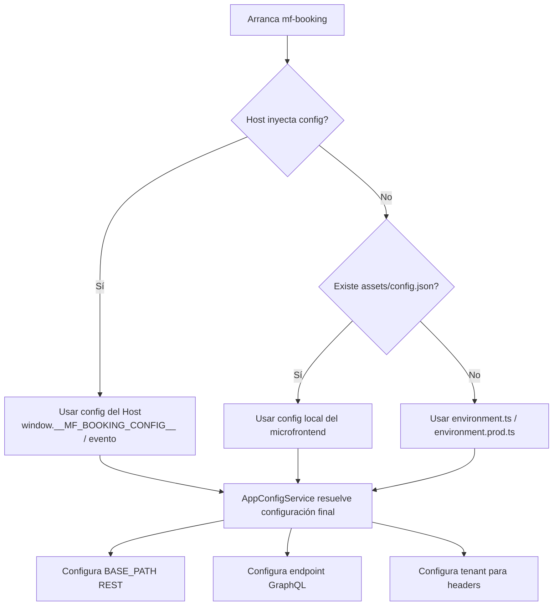
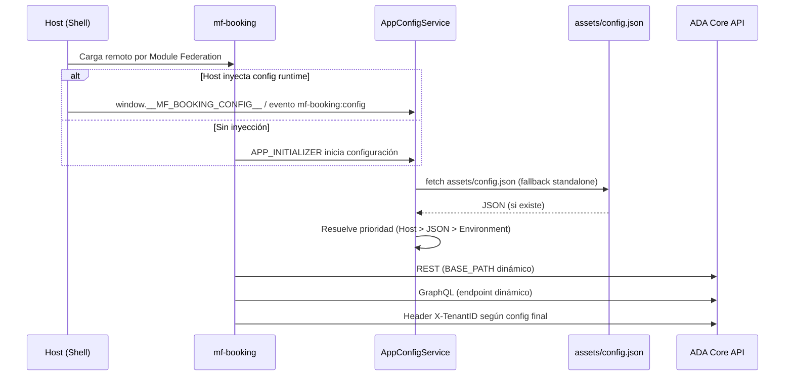

# Microfrontend Config Architecture (Frontend)

Este documento resume la estrategia de configuración para los microfrontends en `arcadia/frontend`.

## Objetivo

Tener microfrontends **autónomos** (standalone) pero también **alineados por el host** cuando se integran por Module Federation.

## Patrón adoptado (híbrido)

Orden de prioridad de configuración:

1. **Host runtime config** (inyectada en tiempo de ejecución)
2. **`assets/config.json` del microfrontend** (fallback standalone)
3. **`environment.ts` / `environment.prod.ts`** (fallback final)

Esto evita acoplar un remoto al `environment` del host y permite despliegues independientes.

## Implementación en `mf-booking`

## Comandos de arranque local (rápido)

Orden recomendado: **Host (arcadiaFront) → mf-booking**.

### 1) Host shell `arcadiaFront` (puerto 4200)

```bash
cd /home/sotobotero/workspace/repositories/personal/arcadia/frontend/arcadiaFront
ng serve --port 4200
```

### 2) Microfrontend `mf-booking` (puerto 4202)

```bash
cd /home/sotobotero/workspace/repositories/personal/arcadia/frontend/mf-booking
ng serve --port 4202
```

### 3) Microfrontend `mf-platform-admin` (puerto 4204)

```bash
cd /home/sotobotero/workspace/repositories/personal/arcadia/frontend/mf-platform-admin
ng serve --port 4204
```

Administración de membresías de prestadoras (ruta `/platform-admin` del host). El host solo ofrece la ruta y la entrada de
menú si `myPermissions` incluye `PLATFORM_MEMBERSHIPS_MANAGE` y el host usa el realm del personal (no el realm abierto de
Toki); el backend valida el permiso en cada operación. Entrada runtime: `mfPlatformAdminRemoteEntry`
(fallback `MF_PLATFORM_ADMIN_REMOTE_ENTRY` en `environment*.ts`).

### 4) Microfrontend `mf-provider` (puerto 4205)

```bash
cd /home/sotobotero/workspace/repositories/personal/arcadia/frontend/mf-provider
npm install
npm start
```

"Mis servicios" de una prestadora del marketplace: servicios, horario semanal y descansos, y fotos (Uppy). Ruta `/provider` del
host, con el permiso `PROVIDER_SERVICES_MANAGE`; en un host con realm abierto, una prestadora que inicia sesión aterriza ahí
(`HomeRouteService`). Entrada runtime: `mfProviderRemoteEntry` (fallback `MF_PROVIDER_REMOTE_ENTRY` en `environment*.ts`).
Detalle en `mf-provider/README.md`.

### 5) Microfrontend `mf-onboarding` (puerto 4206)

```bash
cd /home/sotobotero/workspace/repositories/personal/arcadia/frontend/mf-onboarding
npm install
npm start
```

Formulario público de alta de un negocio (sin sesión). Ruta `/empezar` del host, sin guards; ADA solo responde en los hosts
registrados en `tenant_domains` (en local, `toki.localhost:4200`). Entrada runtime: `mfOnboardingRemoteEntry`
(fallback `MF_ONBOARDING_REMOTE_ENTRY` en `environment*.ts`). La clave pública de Cloudflare Turnstile viaja en el runtime
config del host como `turnstileSiteKey` (`ARCADIA_TURNSTILE_SITE_KEY` en el contenedor del host). Detalle en `mf-onboarding/README.md`.

### 6) Microfrontend `mf-network` (puerto 4207)

```bash
cd /home/sotobotero/workspace/repositories/personal/arcadia/frontend/mf-network
npm install
npm start -- --port 4207
```

Administración de la red comercial del tenant (referidos y, más adelante, comisión por venta): campañas, modelo de red y posición de un miembro. Ruta `/red` del host,
con el permiso `NETWORK_MANAGE` (el backend lo valida en cada operación). Entrada runtime: `mfNetworkRemoteEntry`
(fallback `MF_NETWORK_REMOTE_ENTRY` en `environment*.ts`). Detalle en `mf-network/README.md`.

### 7) Microfrontend `mf-restaurant` (puerto 4208)

```bash
cd /home/sotobotero/workspace/repositories/personal/arcadia/frontend/mf-restaurant
npm install
npm start -- --port 4208
```

Restaurante: mesero (mesas, reservas, pedido y cobro), cocina y configuración de mesas. Un solo remoto con cuatro módulos expuestos y una ruta del host
cada uno: `/restaurante/mesas` (`TABLE_SERVICE`), `/restaurante/pedidos` (`TABLE_SERVICE`), `/restaurante/cocina` (`KITCHEN`) y `/restaurante/configurar` (`TABLE_ADMIN`). Entrada runtime:
`mfRestaurantRemoteEntry` (fallback `MF_RESTAURANT_REMOTE_ENTRY` en `environment*.ts`). Detalle en `mf-restaurant/README.md`.

### URLs de validación rápida

- Host: `http://localhost:4200`
- Remote `mf-booking`: `http://localhost:4202/remoteEntry.js`
- Remote `mf-platform-admin`: `http://localhost:4204/remoteEntry.js`
- Remote `mf-provider`: `http://localhost:4205/remoteEntry.js`
- Remote `mf-onboarding`: `http://localhost:4206/remoteEntry.js`
- Remote `mf-network`: `http://localhost:4207/remoteEntry.js`
- Remote `mf-restaurant`: `http://localhost:4208/remoteEntry.js`

### Fuentes de configuración

- `src/environments/environment.ts`
- `src/environments/environment.prod.ts`
- `src/assets/config.json`
- Inyección host vía:
  - `window.__MF_BOOKING_CONFIG__`
  - evento `mf-booking:config`

### Servicio central

- `src/app/core/config/app-config.service.ts`

Responsabilidades:

- Resolver configuración efectiva (`adaCoreBaseUrl`, `graphqlEndpoint`, `tenantId`)
- Cargar `assets/config.json`
- Aplicar override del host (global/evento)

### Inicialización temprana

- `src/app/app.module.ts` usa `APP_INITIALIZER` para cargar config antes de usar servicios HTTP.

### Consumo

- REST base path dinámico: `src/app/booking/booking.module.ts` (`BASE_PATH`)
- GraphQL endpoint + tenant: `src/app/shared/graphql/ada-graphql-client.service.ts`
- Tenant header para REST/GraphQL: `src/app/shared/interceptors/booking-auth.interceptor.ts`
- Servicios de dominio (ej. diary): leen tenant desde `AppConfigService`

## Ejemplo de inyección desde Host

```ts
window.__MF_BOOKING_CONFIG__ = {
  adaCoreBaseUrl: 'http://localhost:8080/ADA_ENTERPISE_CORE',
  graphqlEndpoint: 'http://localhost:8080/ADA_ENTERPISE_CORE/graphql',
  tenantId: 'default_tenant'
};

window.dispatchEvent(new CustomEvent('mf-booking:config', {
  detail: {
    adaCoreBaseUrl: 'http://localhost:8080/ADA_ENTERPISE_CORE',
    tenantId: 'default_tenant'
  }
}));
```

## Buenas prácticas

- No hardcodear URLs/tenant en servicios de negocio.
- No modificar código autogenerado (`api-generated`).
- Mantener contrato de config pequeño, tipado y estable.
- No poner secretos en frontend (solo configuración pública).

## Diagrama (Mermaid)



## Diagrama Secuencia (Mermaid)



## Snippet de inicialización en Host (Runtime Injection)

Sí: este es el snippet que necesita el Host para inyectar configuración runtime al remoto.

> **Tip de Oro (Producción):** no escribir estos valores a mano en el código del Host.
> El Host debe leerlos desde su propio `config.json` (o variables de entorno inyectadas al contenedor)
> y luego poblar `window.__MF_BOOKING_CONFIG__` dinámicamente al cargar.

```html
<script>
  // Debe ejecutarse ANTES de cargar el remoteEntry del microfrontend
  window.__MF_BOOKING_CONFIG__ = {
    adaCoreBaseUrl: 'http://localhost:8080/ADA_ENTERPISE_CORE',
    graphqlEndpoint: 'http://localhost:8080/ADA_ENTERPISE_CORE/graphql',
    tenantId: 'default_tenant'
  };

  // Opcional: actualización dinámica posterior a la carga
  window.dispatchEvent(new CustomEvent('mf-booking:config', {
    detail: {
      adaCoreBaseUrl: 'http://localhost:8080/ADA_ENTERPISE_CORE',
      tenantId: 'default_tenant'
    }
  }));
</script>
```

## 8) Architecture Decision Records (ADR)

### ADR-1: Calendar Export Strategy (US1 — Client Booking + Calendar Sync)
**Decision**: `.ics` file (RFC 5545) + Google Calendar direct link (no OAuth).
**Rationale**:
- `.ics` works natively on iOS, Android, macOS, Windows, Google, Outlook without authentication.
- Google Calendar link (`https://calendar.google.com/calendar/r/eventedit?...`) requires 0 backend overhead, opens in user's calendar app.
- Google Calendar API would add OAuth complexity without meaningful UX benefit for MVP.
**Status**: Approved. Implementation: `CalendarExportService` in `mf-booking/shared/services/`.

### ADR-2: Device Tracking (US1 — Anonymous Booking History)
**Decision**: UUID v4 in `localStorage` + sent as `deviceId` header in REST calls.
**Alternatives Considered**:
- IP address: unreliable (NAT, VPN, dynamic).
- MAC/device fingerprint: privacy concerns, fails on mobile web.
- Phone number: breaks "no registration" requirement.
**Rationale**: `localStorage` persists across sessions in same browser/app, standard web practice for anonymous tracking.
**Status**: Approved. Implementation: `DeviceIdService` in `mf-booking/core/`, new field `device_id` in `diary.diary` table.

### ADR-3: Professional Calendar Integration (US2 — Service Provider Sync)
**Decision**: iCal feed URL (`/ical/professional/{token}`) subscribed directly in Google/Apple/Outlook.
**Rationale**:
- CalDAV-style subscription (one-time setup) auto-syncs new bookings.
- Reduces dev complexity vs. API push notifications or SMS.
- Matches industry standard (Calendly, Acuity, Mindbody).
**Status**: Approved. Implementation: endpoint in ADA backend, token table in `core.professional_ical_token`.

## TODO (Docker / despliegue)

- [ ] Implementar este runtime injection en el Host antes de cargar `mf-booking`.
- [ ] Cambiar URLs hardcodeadas por variables de entorno del contenedor (Host).
- [ ] Definir valores por entorno (`dev`, `staging`, `prod`) sin recompilar el remoto.
- [ ] Validar que `tenantId` venga desde configuración de despliegue (no fijo en código).
