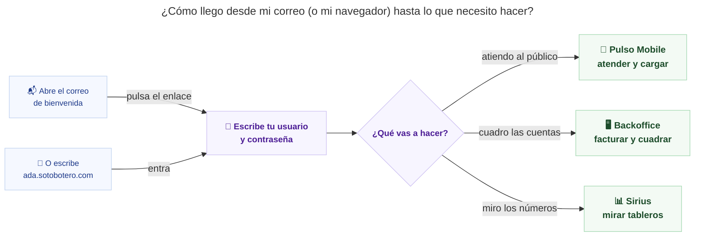
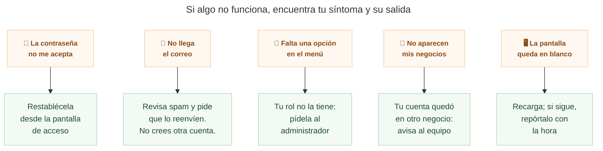

# Cómo entrar

> **Una dirección. Una contraseña. El resto lo eliges tú.**
>
> Esta página es para cualquiera: no hace falta saber de sistemas. Si vienes a probar el producto, entra primero y
> sigue con el [índice de QA](README.md).

## 📍 La llave

### `ada.sotobotero.com`

**Es la única dirección que hay que recordar.** Escríbela en el navegador y ya estás en la puerta. Funciona igual en
computador, tableta y celular.

> [!TIP]
> **¿Te llegó un correo del equipo?** El botón del correo te deja en esa misma puerta. No hay que escribir nada.

<!-- Mantenimiento: si cambia el dominio, además de la tabla de "Las direcciones" hay que
     cambiar las líneas `click` de los dos diagramas de este archivo (mermaid no lee variables). -->

**El correo es del primer día; la dirección, de todos los días.** Y una sola cuenta para todo: si ya entraste, cambiar
de pantalla no te vuelve a pedir la contraseña. Si tienes varios negocios, eliges al entrar.

## 🆘 Si algo no funciona

Busca tu síntoma arriba; la salida está debajo. Arriba, en pequeño lo que te pasa; abajo, en grande lo que haces.

[Reportar un fallo](README.md#cómo-reportar-un-fallo) · [Ver los flujos de prueba](README.md)

## 🚪 Las direcciones

> [!IMPORTANT]
> **Este es el único documento del repositorio que escribe direcciones.** Si el dominio cambia, se cambia solo esta
> tabla y todo lo demás sigue funcionando: los otros documentos enlazan aquí.

| Adónde vas | Producción | Ensayo |
|---|---|---|
| 📱 **S&B Pulso Mobile** — tarjetas y botones grandes; se usa en el celular, para atender al público | [ada.sotobotero.com](https://ada.sotobotero.com/) | [stg-ada.sotobotero.com](https://stg-ada.sotobotero.com/) |
| 🖥️ **S&B Pulso Backoffice** — la pantalla clásica, con muchos campos; en el computador, para facturar y cuadrar cuentas | [ada.sotobotero.com/ADA_ENTERPISE_CORE/](https://ada.sotobotero.com/ADA_ENTERPISE_CORE/) | [stg-ada…/ADA_ENTERPISE_CORE/](https://stg-ada.sotobotero.com/ADA_ENTERPISE_CORE/) |
| 📊 **BI S&B Sirius** — tableros con gráficas; se abre solo para mirar | [ada.sotobotero.com/grafana/](https://ada.sotobotero.com/grafana/) | — solo existe en producción |
| 🔧 **Administración de plataforma** — crear y aprobar negocios (equipo de plataforma) | [ada.sotobotero.com/platform-admin](https://ada.sotobotero.com/platform-admin) | [stg-ada…/platform-admin](https://stg-ada.sotobotero.com/platform-admin) |
| ✍️ **Alta de negocio** — el formulario público para registrarse | [ada.sotobotero.com/empezar](https://ada.sotobotero.com/empezar) | [stg-ada…/empezar](https://stg-ada.sotobotero.com/empezar) |
| 🔑 **Acceso** — la pantalla de la contraseña | [sso.sotobotero.com](https://sso.sotobotero.com) | la misma |
| **Sitio del negocio** — el marketplace público | `<negocio>.sotobotero.com` | solo con host registrado en el maestro de ensayo |

**Mira la barra de direcciones antes de llenar algo:** si dice `stg-ada`, estás en ensayo; si dice `ada`, en producción.
Una prueba enviada en producción crea un negocio real.

<strong>Para QA — qué se prueba en cada cara</strong>

| Cara | Qué se prueba | Detalle |
|---|---|---|
| **Pulso Mobile** | inventario, reservas, mesas y pedidos del restaurante, catálogo del proveedor; se usa en celular | [flujos](README.md#flujos-en-el-orden-que-conviene-probarlos) |
| **el Backoffice** | facturación y caja, separados y cartera, compras y cuentas por pagar, contabilidad y reportes | [flujos](README.md#flujos-en-el-orden-que-conviene-probarlos) |
| **Sirius** | que los tableros muestren lo que se acaba de generar (puede tardar unos minutos; solo el negocio con permiso) | [índice de QA](README.md) |
| **Administración** | alta, aprobación y aprovisionamiento de negocios (lo usa el equipo de plataforma) | [cómo se monta un restaurante](restaurante-configuracion.md) |

<strong>Para QA — nombre técnico de la pantalla de acceso</strong>

La pantalla de acceso es **Keycloak**, en `sso.sotobotero.com`. El usuario final no necesita ese nombre: para él es
«la pantalla de acceso». Los nombres de producto son **S&B Pulso Mobile**, **S&B Pulso Backoffice** y **BI S&B Sirius**
(ver `infraestructure-ascode/docs/brand/naming.md`).

**Última revisión:** 2026-11-19.
