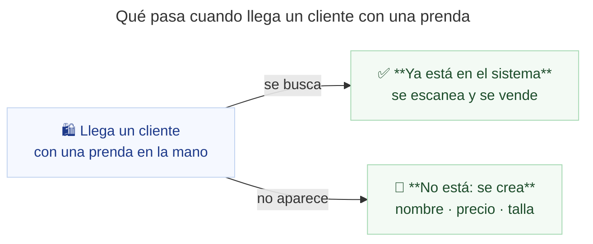
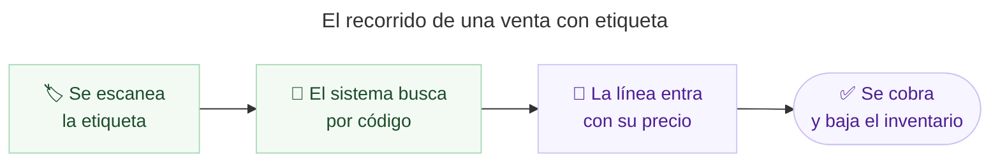

# Cómo cargar el inventario sin cerrar la tienda

> **Se carga vendiendo.** El inventario no se digita antes de abrir: cada venta deja el producto registrado, y lo que más
> rota entra primero. La operación nunca se detiene.

Contexto del módulo: cómo se mueve el inventario (interno: `docs/INVENTORY_MODULE.md`). Cómo se cuenta lo que hay:
[cómo se cuenta el inventario](e2e-conteo-de-inventario.md). Acceso y direcciones: [00-acceso.md](00-acceso.md).

## 🎯 Qué hay que lograr

1. **Saber qué hay** en todo momento.
2. **Registrar cada venta** sin frenar la caja.
3. **Reportes que deciden**: qué se vende más, qué marca rota mejor, qué talla se agota primero.

El error más caro es cargar todo el catálogo en una hoja de cálculo antes de vender: paraliza la tienda, llena el sistema
de diferencias y desanima al equipo.

## 🚶 Cargar en movimiento

Así los productos más vendidos quedan en el sistema primero, y los que nunca se venden no generan digitación.

## 📋 Lo mínimo para crear el producto en caja

| Campo | Para qué alcanza |
|---|---|
| **nombre**, con la marca delante | se reconoce en pantalla y en los reportes |
| **precio de venta** | se puede cobrar |
| **talla** | el stock se controla por variante desde el primer día |

El **código se genera solo**. Marca, categoría, color y cantidad se completan después, o en el mismo momento si hay
tiempo. La regla: si un campo no cambia el precio ni el stock, no es urgente.

## 🔠 El código que se genera

| Ejemplo | Qué es |
|---|---|
| `LEV-CAM-NEG-M` | Levi's · camiseta · negra · talla M |
| `ZAR-PAN-AZU-32` | Zara · pantalón · azul · talla 32 |
| Solo una marca o pocas | `CAM-NEG-S`, `CAM-NEG-M`, `CAM-NEG-L`: más corto, igual de útil |

La marca va delante porque es como se piensa en el mostrador. Un código por variante (talla y color) hace que escanear
sea una sola lectura y que el stock por talla sea exacto.

## 🖨️ Etiquetar o no etiquetar

| | Con etiqueta propia | A ojímetro |
|---|---|---|
| Velocidad en caja | una lectura por prenda | búsqueda manual: lenta en hora pico |
| Quién puede cobrar | cualquiera del equipo | solo quien se sabe el inventario |
| Precisión | la manda el sistema | depende de la memoria de la persona |
| Cuándo sirve | desde ~500 referencias y con varias personas | menos de 100 referencias, o los primeros días mientras llegan las etiquetas |

La etiqueta lleva nombre, talla y color, código de barras **Code 128** (no QR: el QR no agrega nada para cobrar) y
precio. Con código del proveedor legible se registra ese; si no, se genera el interno y se pega etiqueta propia.

## 🗓️ Los primeros quince días

| Momento | Qué se hace |
|---|---|
| Día 1, medio día | crear el negocio, definir los grupos principales, configurar la impresora si ya se tiene |
| Día 1, ese mismo día | empezar a vender: por cada prenda que llega a caja, se escanea o se crea y se vende |
| Fuera de hora pico | un empleado carga lo que está en los estantes, priorizando lo que más rota |
| Semanas 1 y 2 | lo vendido ya quedó registrado; llega mercancía nueva: se registra antes de colgarla y se imprime su etiqueta |
| Cierre de la semana 2 | lo que más vende ya está en el sistema; lo demás se carga por lotes en horas tranquilas |

## 🧾 Vender escaneando

## 📊 Por qué importa cada campo

| Campo | Reporte que habilita |
|---|---|
| marca | ventas por marca: a qué proveedor reordenar |
| categoría | ventas por tipo de prenda |
| talla | stock y ventas por talla: qué se agota y qué sobra |
| precio de venta | ingresos y ticket promedio |
| cantidad | alerta de stock bajo y reposición |
| código | trazabilidad: qué se vendió, cuándo y a qué precio |
| nombre | búsqueda rápida en caja, sin ambigüedad |

Si marca y talla quedan vacías o inconsistentes, estos reportes no funcionan: es lo único que vale la pena llenar bien
desde el primer día.

## 🧮 Cuándo sí cargar por archivo

- El proveedor manda su catálogo en Excel o CSV.
- Se migra un inventario que ya existe en otro sistema.
- Llega una colección completa de temporada y se carga el lote antes de etiquetar.

<strong>Cómo llega mercancía nueva, paso a paso</strong>

1. Si el proveedor trae código de barras propio, se registra ese código.
2. Si no trae, se usa el código interno que genera el sistema.
3. Se imprimen las etiquetas antes de colgar la prenda.
4. La cantidad recibida se registra como entrada de inventario
   (albarán de entrada (interno: `docs/INVENTORY_MODULE.md`)) y queda con su costo y su cuenta por pagar.

> [!WARNING]
> **DEPRECADO** — la lista de compra de hardware (impresora de etiquetas, rollos, impresora de tickets, lector de código
> de barras, marcas, precios y enlaces de tienda) salió de este documento: son decisiones de compra con fecha, no
> documentación del sistema, y no se escriben direcciones ni precios en el repositorio. Se elimina cuando esa lista viva
> en un documento de operación del negocio, fuera de `docs/`.

**Última revisión:** 2026-11-19.
