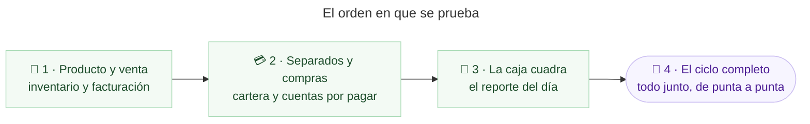

# Cómo probar el sistema

> Se prueba en el mismo orden en que lo usa un negocio: primero se vende, después se cobra, y al final la caja tiene que
> cuadrar. Cada flujo es un documento aparte, con pasos numerados, datos de ejemplo y lo que tiene que pasar en cada paso.

> [!IMPORTANT]
> **Paso 0, siempre: [cómo entrar y qué cara es cada una](00-acceso.md).** Ahí están la dirección, el login y qué pantalla
> se usa para qué. Este índice no repite direcciones: si cambia el dominio, se cambia solo allí.

## Los siete flujos

| # | Flujo | Qué queda probado | Documento |
|---|---|---|---|
| 1 | **Producto y venta** | crear el producto, entrada de stock, venta con tres medios de pago, rectificativa y cierre de caja | [e2e-happy-path-inventario-facturacion.md](e2e-happy-path-inventario-facturacion.md) |
| 2 | **Separados y cartera** | separado con anticipo, abonos, entrega, cancelación, venta fiada, límite de crédito y cobro | [e2e-cartera-separados.md](e2e-cartera-separados.md) |
| 3 | **Compras y cuentas por pagar** | compra de contado, a crédito y mixta; abono y reverso; devolución al proveedor; saldo a favor; cupo | [e2e-compras-cuentas-por-pagar.md](e2e-compras-cuentas-por-pagar.md) |
| 4 | **La caja cuadra** | que el reporte refleje lo que de verdad entró y salió, venga del flujo que venga | [e2e-reporte-de-caja.md](e2e-reporte-de-caja.md) |
| 5 | **El ciclo completo** | compra → venta → separado → fiado → cartera → pago y devolución, con inventario, caja y saldos conciliados | [e2e-ciclo-completo.md](e2e-ciclo-completo.md) |
| 6 | **Conteo de inventario** | cargar un almacén que no estaba en el sistema, unidades sin soporte y conteo de auditoría | [e2e-conteo-de-inventario.md](e2e-conteo-de-inventario.md) |
| 7 | **Gimnasio** | reservas y membresías de punta a punta | [e2e-gym-manual-tests.md](e2e-gym-manual-tests.md) |

El **5** es el que más vale: si ese cuadra, el resto de los módulos están hablando entre ellos. Los flujos 1 a 4 se pueden
correr sueltos; el 5, solo después.

## Si vienes a probar un negocio concreto

| El negocio es… | Corre esto, en este orden |
|---|---|
| **Restaurante, cafetería, bar** | [montarlo](restaurante-configuracion.md) → [atender una mesa](guia-restaurante.md) → [3 compras](e2e-compras-cuentas-por-pagar.md) |
| **Joyería, ropa, ferretería, tienda** | [1 producto y venta](e2e-happy-path-inventario-facturacion.md) → [2 cartera](e2e-cartera-separados.md) → [6 conteo](e2e-conteo-de-inventario.md) |
| **Clínica u odontología** | el módulo clínico se prueba en el Backoffice, no tiene pantallas en Mobile → [2 cartera](e2e-cartera-separados.md) → [4 caja](e2e-reporte-de-caja.md) |
| **Gimnasio o centro de servicios** | [7 gimnasio](e2e-gym-manual-tests.md) → [2 cartera](e2e-cartera-separados.md) |
| **Proveedor que vende en un marketplace** | [1 producto y venta](e2e-happy-path-inventario-facturacion.md) → [cargas de archivo](e2e-cargas-archivo-demo.md) |

## Cómo se lee un flujo

Un flujo son pasos con **Acción** y **Esperado**: se hace lo que dice la acción y se compara con lo esperado. Si no
coincide, el flujo **se detiene ahí** y se reporta; no se sigue para ver si el resto cuadra, porque todo lo de después
arrastra el error.

Los montos son redondos a propósito. Ruta de menú entre comillas, por ejemplo *Inventario → Cuentas por pagar*.

## Si un paso no da lo esperado

Se reporta con estos seis datos y con eso el fallo se encuentra:

| Dato | Por qué |
|---|---|
| flujo y número de paso | ubica la parte del sistema |
| qué hiciste | reproduce el camino |
| qué esperabas | compara contra la regla escrita |
| qué pasó de verdad | el síntoma, sin interpretarlo |
| captura y hora aproximada | la hora lleva al error en el servidor |
| negocio y usuario usados | sin ellos el error no se reproduce |

## Preparar los datos antes de empezar

<strong>Cinco cosas que tienen que existir</strong>

1. **Un negocio de pruebas**, nunca uno con datos reales: lo entrega el equipo.
2. **Un usuario con permisos** sobre lo que se va a probar. Si una opción no aparece en el menú, falta el permiso: se
   pide, no se busca otra ruta.
3. **Datos base**: un cliente, un proveedor, tres productos con stock, un medio de pago en efectivo y uno electrónico, y
   una **caja abierta** para el usuario.
4. **Períodos contables abiertos** para hoy; sin período la operación se guarda pero su asiento queda en *Pendientes de
   contabilizar* (que también se prueba).
5. **Las cifras iniciales anotadas** (stock, saldos, total de caja): los resultados esperados se expresan como cambios
   respecto a ellas.

## Presentar el producto a un cliente

<strong>Tres guiones que no son pruebas</strong>

| Guion | Qué muestra | Documento |
|---|---|---|
| **Ciclo del negocio** | un día completo en lenguaje llano, con cuatro videos cortos | [guia-ciclo-del-negocio.md](guia-ciclo-del-negocio.md) |
| **Cargas de archivo** | plantillas, productos con solo el nombre, filas rechazadas que se corrigen | [e2e-cargas-archivo-demo.md](e2e-cargas-archivo-demo.md) |
| **Restaurante** (histórico) | la historia escena por escena; se conserva como evidencia | legacy/e2e-restaurante-demo.md (interno: `docs/legacy/e2e-restaurante-demo.md`) |

## Para preparar un negocio desde cero

<strong>Guías de arranque y de datos de prueba</strong>

| Guía | Para qué |
|---|---|
| [INVENTORY_ONBOARDING_STRATEGY.md](INVENTORY_ONBOARDING_STRATEGY.md) | cargar el inventario de un negocio que abre sin sistema |
| [guia-ciclo-del-negocio.md](guia-ciclo-del-negocio.md) | el día del negocio completo, para el dueño |
| [PLAN_SEED_LOTES_Y_PERFORMANCE.md](PLAN_SEED_LOTES_Y_PERFORMANCE.md) · [SEED_LOTES_RUNBOOK.md](SEED_LOTES_RUNBOOK.md) | generar datos de prueba con lotes y vencimientos |

## Mantener esto al día

- Un flujo se actualiza en el mismo cambio que modifica la pantalla o la regla que prueba.
- Cada documento cierra con su **última revisión**; con más de seis meses, se trata como dudoso.
- **Las direcciones viven solo en [00-acceso.md](00-acceso.md).** Al escribir, las caras se nombran por su nombre: Pulso
  Mobile, Pulso Backoffice, Sirius.
- Cómo se escribe uno de estos documentos: `ai-workspace/DESIGN.md` (jerarquía, verbos del usuario, fuente única para lo
  que cambia y la prueba de los 5 segundos). Un documento que no lo pase se rehace antes de publicarlo.
- Esta carpeta se publica en el repositorio público de documentación: no lleva nombres de clientes, direcciones,
  contraseñas ni datos de ningún negocio.

**Última revisión:** 2026-11-20.
