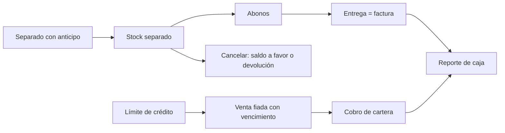

# E2E manual — Separados y cartera (ventas fiadas)

Cubre el separado con anticipo (crear, abonar, aplicar saldo a favor, entregar, cancelar), la venta fiada, el límite de
crédito del cliente y el cobro de cartera. Antes: [README de QA](README.md).

## Datos de prueba

| Dato | Valor |
|---|---|
| Cliente | QA Cliente, límite de crédito **500.000** |
| Productos | P-001 a 100.000, P-002 a 50.000, con al menos 20 unidades cada uno |
| Medios de pago | Efectivo y transferencia |
| Caja | Una caja abierta del usuario (*Caja A*) |

Anotar antes: stock disponible de P-001 y P-002, total de la Caja A.

## Bloque 1 — Separado

### 1.1 Crear el separado con anticipo
- **Acción:** *Facturación → Separados → Nuevo separado*. Cliente QA Cliente; P-001 × 3 (300.000) y P-002 × 2 (100.000), total
  **400.000**. *Anticipo* de **100.000** en efectivo. Dejar el plazo por defecto.
- **Esperado:**
  - Mensaje *Separado creado* con su número; estado *Abierto*; *Abonado* 100.000, *Falta* 300.000.
  - El plazo (*Vence*) trae el valor por defecto de la empresa.
  - El stock **disponible** de P-001 baja 3 y el de P-002 baja 2, y el stock queda visible como separado.

### 1.2 Validaciones al crear
| Intento | Esperado |
|---|---|
| Sin cliente | "Seleccione el cliente" |
| Sin productos | "Agregue al menos un producto" |
| Cantidad 0 | "Las cantidades deben ser mayores que cero" |
| Fecha de vencimiento pasada | "La fecha de vencimiento es obligatoria y no puede ser pasada" |
| Anticipo mayor que el total | "El anticipo no puede ser mayor que el total del separado" |
| Más unidades de las disponibles | No se crea; indica qué producto falta |

### 1.3 Lo separado no se puede vender
- **Acción:** intentar vender por una factura normal más unidades de P-001 que las disponibles (descontando las separadas).
- **Esperado:** se rechaza con un mensaje claro. Vender lo que sí está disponible funciona.

### 1.4 Abonar
- **Acción:** abrir el separado, *Abonar* **100.000** por transferencia con referencia.
- **Esperado:** mensaje *Abono registrado*; *Abonado* 200.000, *Falta* 200.000; la lista *Abonos* muestra fecha, medio de pago,
  recibido por y referencia. Abonar más que el saldo se rechaza.

### 1.5 Estado de cuenta del cliente
- **Acción:** *Estado de cuenta* del separado, y luego *Estado de cuenta de un cliente*.
- **Esperado:** cada abono con su fecha, monto y medio; el saldo coincide con el de la lista; los separados abiertos y los
  fiados del cliente aparecen juntos y diferenciados.

### 1.6 Entregar
- **Acción:** *Entregar* pagando el saldo (**200.000**) en efectivo.
- **Esperado:** mensaje *Separado entregado* con el número de **factura**; estado *Entregado*; el stock separado sale del
  inventario; la factura tiene los mismos ítems y lo abonado figura como pago. Un separado entregado ya no admite abonos ni
  cambios.

## Bloque 2 — Cancelar

Crear otro separado de P-002 × 2 (100.000) con anticipo de 40.000 en efectivo.

### 2.1 Cancelar dejando saldo a favor
- **Acción:** *Cancelar separado* → *Al cancelar*: *Dejar lo pagado como saldo a favor*.
- **Esperado:** estado *Cancelado*; el stock vuelve a estar disponible; el cliente queda con **40.000 de saldo a favor**,
  visible en su estado de cuenta.

### 2.2 Usar el saldo a favor
- **Acción:** crear un tercer separado y usar *Aplicar saldo a favor*.
- **Esperado:** el abono aparece con origen *Saldo a favor* y el saldo del cliente baja.

### 2.3 Cancelar devolviendo el dinero
- **Acción:** cancelar el tercer separado con *Devolver el dinero*, indicando el medio de pago de la devolución (los pagos deben
  sumar exactamente lo que se devuelve) y, si se quiere, una *Retención*.
- **Esperado:** estado *Cancelado*; en el reporte de caja sale una **salida** por lo devuelto (menos la retención).

### 2.4 Separado vencido
- **Acción:** con un separado cuyo plazo ya pasó (usar uno de datos de prueba con fecha vencida).
- **Esperado:** estado *Vencido*, el stock se libera y lo abonado queda como saldo a favor del cliente.

## Bloque 3 — Venta fiada y cartera

### 3.1 Vender con pago parcial
- **Acción:** *Facturación → Facturas → Crear*: P-001 × 2 (**200.000**) a QA Cliente. Pagar **50.000** en efectivo y dejar
  **150.000 a crédito** a 30 días.
- **Esperado:** factura guardada con saldo pendiente de 150.000.

### 3.2 Aparece en la cartera
- **Acción:** *Facturación → Cobro de cartera*.
- **Esperado:** "Cartera: fiados con saldo pendiente" muestra QA Cliente con *Saldo pendiente* **150.000**, su vencimiento y los
  *días de mora* (0 si no está vencida).

### 3.3 Abonar a la cartera
- **Acción:** *Abonar* **50.000** en efectivo, Caja A.
- **Esperado:** mensaje *Abono registrado*; saldo **100.000**; el abono aparece en *Abonos recibidos* y se contabiliza.

### 3.4 Límite de crédito
- **Acción:** vender de nuevo a QA Cliente por **450.000 a crédito** (con 100.000 pendientes el total supera el límite de
  500.000).
- **Esperado:** no se permite; mensaje de que se supera el límite de crédito, y no queda ninguna factura ni descuento de stock.
- **Variante:** vender 350.000 a crédito (total 450.000) sí se permite.

### 3.5 Editar el límite
- **Acción:** subir el límite del cliente a 800.000 y repetir el intento del paso 3.4.
- **Esperado:** ahora se permite.

### 3.6 Pagar todo
- **Acción:** abonar el saldo restante de cada fiado.
- **Esperado:** la fila sale de la cartera; el saldo del cliente queda en 0.

## Bloque 4 — Caja y contabilidad

- **Reporte de caja del día (Caja A):** el anticipo, los abonos, la entrega, los abonos de cartera y las devoluciones de
  dinero aparecen como movimientos con su signo correcto. Ver [e2e-reporte-de-caja.md](e2e-reporte-de-caja.md).
- **Pendientes de contabilizar:** los abonos, entregas, cancelaciones y ventas fiadas generan su asiento; si algo no se pudo
  contabilizar (por ejemplo, falta el período), queda ahí visible y se resuelve con su botón, sin bloquear la operación.

## Cierre del flujo

| Control | Valor esperado |
|---|---|
| Stock disponible de P-001 y P-002 | inicial − entregado − vendido (lo cancelado vuelve) |
| Separados abiertos de QA Cliente | ninguno |
| Cartera de QA Cliente | 0 al pagar todo |
| Saldo a favor de QA Cliente | el que quede de la cancelación 2.1, menos lo usado en 2.2 |

*Última revisión: 2026-10-24.*
