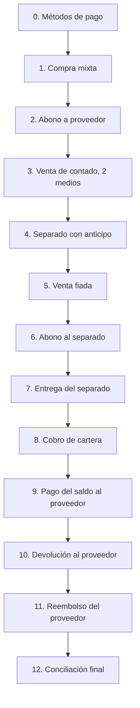

# E2E manual — Ciclo completo (compra → venta → cartera → proveedor → caja)

Un solo recorrido que une los flujos anteriores y termina cuadrando **inventario, caja, cartera de clientes y cuentas por
pagar**. Las pruebas automáticas ya cubren cada regla por separado; este ciclo existe para que una persona compruebe que
todo cuadra junto y que las pantallas dicen lo mismo. Correrlo después de los flujos individuales y antes de cada despliegue
grande. Antes: [README de QA](README.md).

## Datos de prueba

| Dato | Valor |
|---|---|
| Proveedor | QA Proveedor (cupo de crédito vacío = sin límite) |
| Cliente | QA Cliente (límite de crédito suficiente, p. ej. 500.000) |
| Producto | P-001 **nuevo, con stock 0** y costo promedio |
| Caja | Una caja abierta del usuario (*Caja A*), **sin movimientos del día** (usar un negocio de pruebas o anotar los previos) |

## Paso 0 — Revisar los métodos de pago

Los métodos de pago deciden si una operación mueve dinero o genera deuda. Revisar en *Facturación → Métodos de pago*:

| Método | Plazo (días) | Cuenta contable | Esperado |
|---|---|---|---|
| Efectivo | 0 | Caja | Pago inmediato: mueve la caja |
| Transferencia | 0 | Bancos (con *usa banco*) | Pago inmediato: mueve la caja y pide banco/referencia |
| Crédito | **30** (mayor que 0) | Cuenta de clientes para ventas y de proveedores para compras | **No** mueve la caja: genera cartera (venta) o cuenta por pagar (compra) |

- **Comprobar:** un método con plazo mayor que 0 en una venta crea un fiado en *Cobro de cartera*; en una compra crea una
  cuenta por pagar en *Cuentas por pagar*. Uno con plazo 0 no genera ninguna de las dos.
- Si falta la cuenta contable de un método, la operación se guarda pero su asiento queda en *Pendientes de contabilizar*.

## Pasos

Después de cada paso, comparar con la columna **Esperado** y anotar las cifras: el último paso las suma todas.

| # | Acción | Esperado |
|---|---|---|
| 1 | *Inventario → Compras*: 10 u de P-001 a 100.000 (**1.000.000**): 400.000 efectivo + 600.000 crédito a 30 días. Contabilizar | Stock físico **10**. *Por pagar*: QA Proveedor **600.000**. Historial: 400.000 *al registrar la compra*. Caja: salida 400.000 |
| 2 | *Cuentas por pagar* → *Pagar* 200.000 efectivo | Saldo **400.000**. Caja: salida 200.000 |
| 3 | *Facturación → Facturas*: 2 u de P-001 a 150.000 (**300.000**): 100.000 efectivo + 200.000 transferencia | Stock físico **8**. Caja: entrada 100.000 efectivo + 200.000 transferencia |
| 4 | *Separados → Nuevo*: 3 u a 150.000 (**450.000**), anticipo **150.000** efectivo | Stock físico 8, **disponible 5**, 3 separadas. Falta 300.000. Caja: entrada 150.000 |
| 5 | Factura fiada: 1 u a 150.000: 50.000 efectivo + **100.000 crédito** a 30 días | Stock físico **7**, disponible **4**. *Cobro de cartera*: QA Cliente **100.000**. Caja: entrada 50.000 |
| 6 | Abonar **100.000** efectivo al separado | Falta **200.000**. Caja: entrada 100.000 |
| 7 | *Entregar* el separado pagando **200.000** efectivo | Se genera la factura; stock físico **4**, disponible **4**, separadas 0. Caja: entrada 200.000 |
| 8 | *Cobro de cartera* → *Abonar* **100.000** efectivo | Cartera de QA Cliente **0**. Caja: entrada 100.000 |
| 9 | *Cuentas por pagar* → *Pagar* **400.000** efectivo | Saldo con el proveedor **0**; sale de *Por pagar*. Caja: salida 400.000 |
| 10 | *Compras* → *Devolver* **2 u** (200.000) a la Caja A | Stock físico **2**. Estado de cuenta: *Saldo a favor* **120.000**. Caja: entrada **80.000** (la parte pagada de contado) |
| 11 | Estado de cuenta → *Reembolso del proveedor* **120.000** efectivo | Saldo a favor **0**. Caja: entrada 120.000 |

## Paso 12 — Conciliación final

Cada fila debe coincidir **en todas las pantallas** que la muestran.

### Inventario

| Dónde mirar | Esperado |
|---|---|
| Kardex de P-001 | +10, −2, −1, −3, −2 = **2** unidades |
| Existencias de P-001 | físico **2**, disponible 2, separadas 0 |
| Valor del inventario | **200.000** (2 u × 100.000, con costo promedio; otro método de costo puede dar otra cifra) |

### Terceros

| Dónde mirar | Esperado |
|---|---|
| *Cuentas por pagar* (Por pagar y estado de cuenta del proveedor) | Saldo 0, saldo a favor 0, disponible igual al cupo |
| *Cobro de cartera* y estado de cuenta del cliente | Cartera 0, sin separados abiertos, saldo a favor 0 |
| Historial de pagos de la compra | 400.000 al registrar, 200.000, 400.000 (y la devolución en *Devoluciones*) |

### Caja (Reporte de caja del día, Caja A)

| Concepto | Entradas | Salidas |
|---|---|---|
| Compra de contado | | 400.000 |
| Pagos a proveedores | | 200.000 + 400.000 |
| Venta de contado | 300.000 | |
| Anticipo y abonos de separado, entrega | 150.000 + 100.000 + 200.000 | |
| Venta fiada (parte pagada) | 50.000 | |
| Cobro de cartera | 100.000 | |
| Devolución de compra | 80.000 | |
| Reembolso del proveedor | 120.000 | |
| **Total** | **1.100.000** | **1.000.000** |

- **Neto del día: +100.000.** Por medio de pago: efectivo **−100.000**, transferencia **+200.000**.
- Los totales del *Cierre de caja* deben dar lo mismo y generar el comprobante sin error.

### Contabilidad

| Dónde mirar | Esperado |
|---|---|
| *Pendientes de contabilizar* | Vacío (o solo lo que falte por período o cuenta, anotado) |
| Auxiliar del proveedor y del cliente | Saldo 0, igual a *Cuentas por pagar* y a *Cobro de cartera* |
| Libro diario | Un asiento por compra, pago, devolución, reembolso, venta, separado/abono y cobro |

## Si algo no cuadra

Detenerse en el primer paso que no coincide y reportarlo con el número de paso y las cifras de las pantallas. La causa más
común es una caja distinta entre pasos (revisar cuál se eligió) o un método de pago con plazo mal configurado (paso 0).

*Última revisión: 2026-10-24.*
