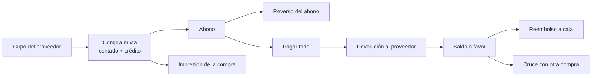

# E2E manual — Compras y cuentas por pagar

Cubre compras de contado, a crédito y mixtas, abonos a proveedores y su reverso, el cupo de crédito, la devolución al
proveedor y el cierre del saldo a favor (reembolso o cruce). Antes: [README de QA](README.md). Funcionamiento y reglas:
[ACCOUNTS_PAYABLE.md](../ACCOUNTS_PAYABLE.md).

## Datos de prueba

| Dato | Valor |
|---|---|
| Proveedor | QA Proveedor, cupo de crédito **1.000.000** |
| Producto | P-001, costo 100.000 por unidad |
| Medios de pago | Efectivo y transferencia |
| Caja | Una caja abierta del usuario (en adelante *Caja A*) |

Anotar antes de empezar: stock de P-001, total de la Caja A en el reporte de caja del día.

## Bloque 1 — Cupo de crédito

### 1.1 Configurar el cupo
- **Acción:** *Inventario → Proveedores*, abrir QA Proveedor, escribir **1000000** en *Cupo de crédito*, guardar.
- **Esperado:** se guarda. El campo vacío significa "sin límite".

### 1.2 Compra que supera el cupo
- **Acción:** *Inventario → Compras*, nueva compra al proveedor: 15 unidades de P-001 (1.500.000), **todo a crédito** a 30 días.
- **Esperado:** no se guarda; mensaje de que la compra supera el cupo, con cupo, adeudado, disponible y solicitado.

## Bloque 2 — Compra mixta y su lectura

### 2.1 Registrar una compra mixta
- **Acción:** nueva compra de 10 unidades de P-001 (**1.000.000**): pago 1 de **400.000 en efectivo** (Caja A, sin días) y pago 2
  de **600.000 a crédito** a 30 días. Guardar y contabilizar.
- **Esperado:**
  - Stock de P-001 sube 10.
  - La compra aparece en la lista; el botón *Contabilizar* queda visible en la barra de botones.
  - Si no hay período contable abierto, la compra queda en *Pendientes de contabilizar* y no se pierde.

### 2.2 Verla en cuentas por pagar
- **Acción:** *Inventario → Cuentas por pagar*, pestaña *Por pagar*.
- **Esperado:** QA Proveedor con *Saldo pendiente* **600.000** (solo lo que quedó a crédito), vencimiento a 30 días y la
  antigüedad en la columna *Sin vencer*.

### 2.3 El pago del registro aparece en el historial
- **Acción:** abrir *Pagos realizados* de esa compra.
- **Esperado:** una fila de **400.000** marcada *al registrar la compra*. Lo pagado al registrar y lo pagado después se ven
  en la misma lista.

### 2.4 Impresión de la compra
- **Acción:** en la lista de compras, seleccionar la compra y pulsar *Imprimir*.
- **Esperado:** se abre un PDF con el formato grande de factura (no un tiquete de 80 mm), con productos, totales y los dos
  medios de pago. Nada de textos de otra empresa.

## Bloque 3 — Abonos

### 3.1 Abonar
- **Acción:** en *Por pagar*, *Pagar* sobre la compra: **200.000** en efectivo, Caja A.
- **Esperado:** mensaje *Pago registrado*; saldo **400.000**; el historial muestra dos filas (400.000 al registrar y 200.000).

### 3.2 No se puede abonar de más
- **Acción:** intentar pagar 500.000.
- **Esperado:** se rechaza con un mensaje; el saldo no cambia.

### 3.3 Reversar el abono
- **Acción:** en el historial, *Reversar* el abono de 200.000 y confirmar.
- **Esperado:** mensaje *Pago reversado*; el saldo vuelve a **600.000**; la fila queda marcada *Reversado*. No se puede
  reversar dos veces.

## Bloque 4 — Devolución y saldo a favor

Preparar: abonar **600.000** (el saldo queda en 0) para que la compra esté pagada del todo.

### 4.1 Devolver mercancía
- **Acción:** en la lista de compras, *Devolver* sobre la compra: **3 unidades** de P-001 (300.000), motivo *Defectuoso*,
  elegir la **Caja A** en la que entra el dinero.
- **Esperado:**
  - Mensaje *Devolución registrada*; stock de P-001 baja 3.
  - Pestaña *Devoluciones*: aparece la devolución con valor 300.000 y estado de contabilidad *Contabilizada* (o *Pendiente*
    si falta período).
  - Un segundo intento de devolver 8 unidades (solo quedan 7) se rechaza con el mensaje de unidades disponibles.

### 4.2 Saldo a favor en el estado de cuenta
- **Acción:** en *Cuentas por pagar*, abrir el *Estado de cuenta* de QA Proveedor.
- **Esperado:** cupo, adeudado 0, disponible 1.000.000; sección *Saldo a favor* con **180.000** ("El proveedor debe
  devolver"). Es la parte de la devolución que correspondía a lo ya pagado a crédito (60 % de 300.000); el otro 40 %
  (120.000) corresponde a lo pagado de contado y entra directo a la caja (ver paso 4.3).

### 4.3 La caja refleja la devolución
- **Acción:** *Caja → Reporte de caja* del día, Caja A.
- **Esperado:** movimiento *Devoluciones de compra* de **120.000 como entrada** (la parte de contado). Salidas del
  día hasta aquí: 400.000 de la compra de contado, 200.000 del primer abono y 600.000 del abono final; entradas: 200.000 del
  reverso del primer abono y 120.000 de la devolución.

### 4.4 Reembolso del proveedor
- **Acción:** en el estado de cuenta, *Reembolso del proveedor* de **100.000** en efectivo en la Caja A.
- **Esperado:** mensaje *Reembolso registrado*; el saldo a favor baja a **80.000**; la caja muestra *Reembolsos de
  proveedores* de 100.000 como **entrada**.

### 4.5 Reembolso mayor que el saldo a favor
- **Acción:** intentar un reembolso de 200.000.
- **Esperado:** se rechaza: "El monto supera el saldo a favor: 80.000 disponible, 200.000 solicitado".

### 4.6 Cruce con otra compra
- **Acción:** registrar una segunda compra a crédito de QA Proveedor (1 unidad de P-001 por **150.000**, a 30 días). En el estado de cuenta, *Aplicar a una
  compra*, elegir esa compra y aplicar **80.000**.
- **Esperado:** mensaje *Saldo a favor aplicado*; el saldo a favor queda en 0; la segunda compra baja a **70.000**; el
  historial de esa compra muestra una fila *Saldo a favor*. **No** aparece ningún movimiento nuevo en la caja.

### 4.7 El saldo a favor solo paga compras del mismo proveedor
- **Acción:** con otro proveedor que tenga una compra a crédito, intentar aplicarle el saldo a favor de QA Proveedor.
- **Esperado:** no se ofrece esa compra en la lista, o se rechaza con "solo puede pagar otra compra del mismo proveedor".

### 4.8 Una compra con devoluciones no admite reversar pagos
- **Acción:** en la compra del paso 4.1, intentar *Reversar* uno de sus abonos.
- **Esperado:** se rechaza: la compra tiene devoluciones y sus pagos no se pueden reversar.

## Bloque 5 — Reportes sin datos

### 5.1 Mensaje amigable
- **Acción:** en *Compras* o *Kardex*, generar un reporte con un rango de fechas sin movimientos.
- **Esperado:** mensaje "No hay información para el reporte con los filtros elegidos…", no un error técnico.

## Cierre del flujo

| Control | Valor esperado |
|---|---|
| Stock de P-001 | inicial + 10 + 1 − 3 |
| Saldo de QA Proveedor en *Por pagar* | 70.000 (segunda compra tras el cruce) |
| Saldo a favor | 0 |
| Caja A, movimientos del flujo | salidas 400.000 + 200.000 + 600.000; entradas 200.000 (reverso) + 120.000 + 100.000 |

*Última revisión: 2026-10-24.*
