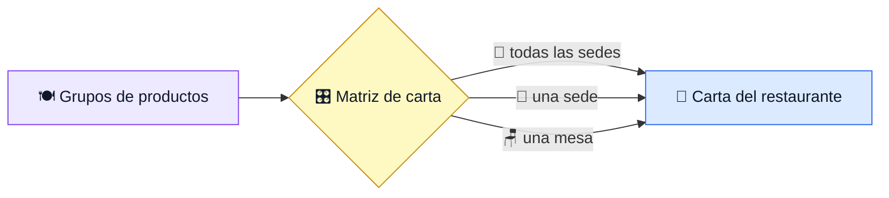
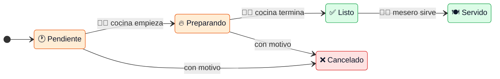
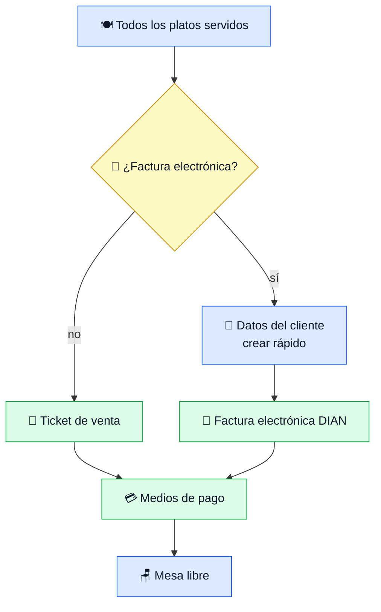
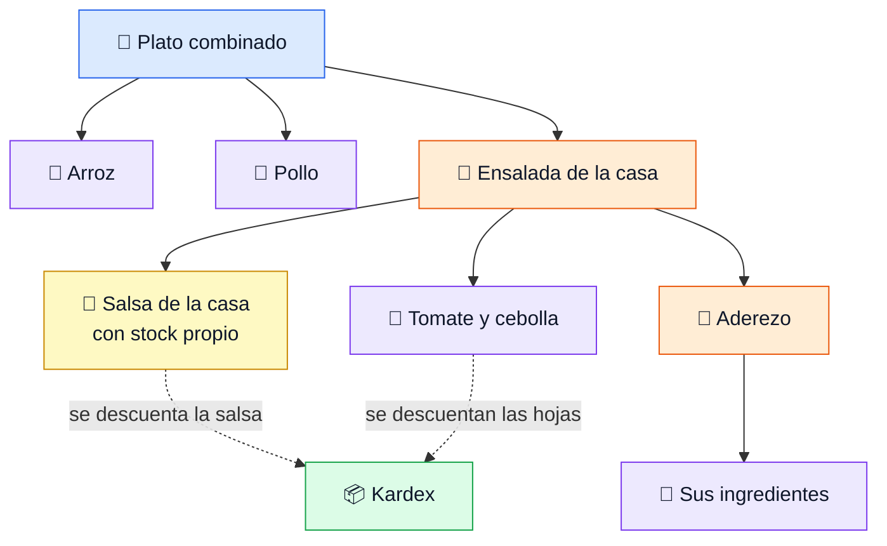

# Demo — ADA para restaurantes

Guion de apoyo para presentar la demo a un restaurante. Es un recorrido corto de lo que el cliente pidió, no una guía de
pruebas. Las reglas ya las cubren las pruebas automáticas; aquí se muestra que las pantallas hacen lo que se promete.
Antes: [README de QA](README.md).

## Lo que el cliente debe notar

| Mensaje | Cómo se demuestra |
|---|---|
| **Es el flujo del salón, no el de un sistema** | Mesa, ronda, cocina, servir, cuenta: los mismos pasos que hoy hacen con libreta y voz |
| **El mesero no escribe** | Tarjetas con foto, los más pedidos primero: dos toques por plato, desde el celular |
| **Nadie pregunta «¿ya salió?»** | La cocina marca y el mesero lo ve al instante |
| **La cuenta no se equivoca** | No deja cobrar con platos sin servir, y dice si es ticket o factura electrónica |
| **Lo vendido descuenta del inventario** | Sin doble digitación: se ve en el kardex en la misma demo |

Regla de la presentación: **nunca explicar una pantalla**. Si hace falta explicarla, se salta.

## Qué pidió el cliente y dónde se ve

| Necesidad | Escena | Pantalla |
|---|---|---|
| Tomar pedidos en la mesa con 3 meseros | 2 y 3 | Mesas y Pedido (celular) |
| Que la cocina vea y prepare los platos | 4 | Cocina (tableta o pantalla) |
| Cobrar la mesa, con ticket o factura electrónica | 5 | Cuenta y cobro |
| Carta amplia, con fotos, por sede o por mesa | 1 | Configurar → Carta y Platos |
| Controlar lo que sale de la cocina | 6 | Inventario → Kardex |
| Platos compuestos y productos prefabricados | 7 y 8 | Productos compuestos, código de barras |
| Parte administrativa y financiera | 9 | Reportes de caja, cartera, contabilidad |

## El recorrido

```mermaid
flowchart LR
    A["📖 1. Carta<br/>y platos"]:::stock --> B["🪑 2. Abrir<br/>mesa"]:::sala
    B --> C["📱 3. Pedido<br/>del mesero"]:::sala
    C --> D["👨‍🍳 4. Cocina"]:::cocina
    D --> E["🧾 5. Cuenta<br/>y cobro"]:::caja
    E --> F["📦 6. Inventario<br/>y kardex"]:::stock
    F --> G["🥗 7. Plato<br/>compuesto"]:::stock
    G --> H["🏷️ 8. Prefabricados"]:::stock
    H --> I["💰 9. Caja<br/>y reportes"]:::caja
    I --> J["🛒 10. Proveedor<br/>y materia prima"]:::stock
    J --> K["📒 11. Lo financiero"]:::caja
    classDef sala fill:#dbeafe,stroke:#2563eb,color:#0f172a
    classDef cocina fill:#ffedd5,stroke:#ea580c,color:#0f172a
    classDef caja fill:#dcfce7,stroke:#16a34a,color:#0f172a
    classDef stock fill:#ede9fe,stroke:#7c3aed,color:#0f172a
    classDef aviso fill:#fef9c3,stroke:#ca8a04,color:#0f172a
```

🔵 sala · 🟠 cocina · 🟢 caja · 🟣 inventario y catálogo. Cada escena dura 2 a 3 minutos. Si hay poco tiempo: 2, 3, 4, 5, 6 y 10. La 12 solo si preguntan cómo se configura.

## Preparar la empresa de la demo

La demo parte de cero, desde el formulario público de alta de Arcadia, como lo haría el cliente. El formulario **solo crea la
solicitud**: la empresa existe cuando quien administra la plataforma la aprueba y se aprovisiona.

```mermaid
flowchart LR
    F["📝 1. Formulario<br/>de alta"]:::sala --> S["📨 2. Solicitud<br/>en revisión"]:::aviso
    S --> A["✅ 3. Administrador<br/>aprueba y aprovisiona"]:::caja
    A --> M["🍽️ 4. Módulo restaurante<br/>y plan sembrados"]:::cocina
    M --> D["🥘 5. Datos de la demo<br/>(2 semillas)"]:::stock
    D --> U["👤 6. Usuarios<br/>Mesero y Cocina"]:::sala
    classDef sala fill:#dbeafe,stroke:#2563eb,color:#0f172a
    classDef cocina fill:#ffedd5,stroke:#ea580c,color:#0f172a
    classDef caja fill:#dcfce7,stroke:#16a34a,color:#0f172a
    classDef stock fill:#ede9fe,stroke:#7c3aed,color:#0f172a
    classDef aviso fill:#fef9c3,stroke:#ca8a04,color:#0f172a
```

**Datos para copiar y pegar en el formulario** (ficticios, no son de un negocio real):

| Campo | Valor |
|---|---|
| Nombre del negocio | Sabor de Casa Restaurante S.A.S. |
| País | Colombia |
| NIT | 900333002-1 |
| Nombre de contacto | Camila Restrepo |
| Correo | un correo propio que se pueda leer (ahí llega el aviso) |
| Teléfono | 3001234567 |
| Plan | **Restaurante** |
| Marketplace | Sí, con el subdominio `sabor-de-casa` |
| Asientos extra | 0 |

**Dónde se hace cada paso:**

| Paso | Dirección | Quién |
|---|---|---|
| 1. Solicitud (el formulario) | <https://ada.sotobotero.com/empezar> | El cliente o quien hace la demo |
| 3. Aprobar y aprovisionar | <https://ada.sotobotero.com/platform-admin> | Quien administra la plataforma (`root`) |
| El negocio ya aprovisionado | <https://ada.sotobotero.com/> y, para facturación y caja, <https://ada.sotobotero.com/ADA_ENTERPISE_CORE/> | El dueño, con el usuario del negocio |
| Marketplace público del negocio | `https://<subdominio>.sotobotero.com`, el que se pidió en el formulario (por ejemplo `sabor-de-casa.sotobotero.com`) | El público |
| Administrar el marketplace (portal de proveedora) | <https://ada.sotobotero.com/>, menú del negocio | El dueño |

Para ensayar sin tocar producción, el mismo recorrido existe en `https://stg-ada.sotobotero.com/empezar`.

En el formulario, marcar **Marketplace** y pedir un subdominio (por ejemplo `sabor-de-casa`). El plan **Restaurante** ya sale entre los
planes base, hoy con precio **$0** (marcador hasta confirmar el precio). El marketplace no va dentro del plan: se marca aparte, como en
cualquier otro plan. **El subdominio no se crea solo**: no hay comodín `*.sotobotero.com`, así que quien administra debe registrar el
host (`hosts`) y el DNS al aprobar; sin eso el marketplace del negocio no abre por su dirección.

**Después de aprovisionar**, quien administra aplica al tenant nuevo, en este orden (cada archivo trae su comando en la cabecera):

| Orden | Archivo | Deja |
|---|---|---|
| 1 | `db/seed/demo/demo-restaurante.sql` | 8 mesas (Mesa 1 a 7 y Terraza 1) y horario de 11:00 a 22:00 |
| 2 | `db/seed/demo/demo-restaurante-produccion.sql` | 8 insumos con existencias, salsa, aderezo y 6 platos con precio, y un proveedor de plaza de mercado |

**La carta de la demo** (precios en la lista «Todo público»):

| Plato | Precio | Cómo descuenta |
|---|---|---|
| Arroz con pollo | $24.000 | Por producción: ya hay 20 porciones listas |
| Bandeja paisa reducida | $32.000 | Por producción: 15 porciones |
| Ajiaco santafereño | $26.000 | Por producción: 15 porciones |
| Limonada de la casa | $8.000 | Por producción: 30 vasos |
| Ensalada de la casa | $14.000 | **Por receta al vender**: tomate, cebolla, limón, aderezo y salsa |
| Plato combinado de la casa | $28.000 | **Por receta al vender**: arroz 150 g, pollo 0,2 kg, papa criolla 0,15 kg y una ensalada |

Los usuarios **Mesero** y **Cocina** se crean desde la pantalla de usuarios de ADA (la clave vive en Keycloak, no en una semilla):

| Usuario | Rol | Nombre |
|---|---|---|
| Mesero | Mesero | Andrés Mejía |
| Cocina | Cocina | Luz Marina Gómez |

## Antes de la demo

| Revisar | Cómo |
|---|---|
| Negocio de demostración con datos | Semillas `demo-restaurante.sql` y `demo-restaurante-produccion.sql` ya aplicadas |
| Usuarios | `root` entra siempre. Para mostrar los roles, crear un **Mesero** y un **Cocina** desde la pantalla de usuarios |
| Una caja abierta | Sin caja no se puede cobrar |
| Dos dispositivos a la vista | Un celular para el mesero y una pantalla para la cocina |
| Factura electrónica | Solo si el negocio tiene resolución DIAN; si no, mostrar el ticket |

## 1. La carta

| Mostrar | Se ve |
|---|---|
| *Configurar → Carta* | Un grupo se enciende o apaga por canal, por sede o por mesa. Lo heredado sale bloqueado |
| *Configurar → Platos* | Tarjetas con foto. Crear un plato con nombre, grupo, precio y foto |

## 2. Abrir la mesa

| Hacer | Se ve |
|---|---|
| En *Mesas* tocar una mesa libre | Se pide el número de comensales |
| Poner más comensales que puestos | Solo avisa, no bloquea |

## 3. El pedido

| Hacer | Se ve |
|---|---|
| Sin escribir nada | Los platos **más pedidos** de la sede, en tarjetas |
| Escribir `sa` | Búsqueda dentro de la carta |
| Tocar 2 o 3 platos, una nota y *Enviar a cocina* | La ronda queda **Pendiente** |
| Enviar una segunda ronda | Cada ronda se numera |

*Mensaje:* tomar un pedido toma segundos, con una mano, sin teclado.

## 4. La cocina

| Hacer | Se ve |
|---|---|
| En *Cocina*, empezar y terminar un plato | El mesero ve el cambio en su pedido |
| Cancelar un plato con motivo | Queda registrado quién y por qué |

*Mensaje:* la cocina ve solo lo que le toca, en el orden en que llegó, y el salón se entera sin gritar.

## 5. Cuenta y cobro

| Hacer | Se ve |
|---|---|
| Pedir la cuenta con un plato sin servir | Botón bloqueado, con el motivo |
| Elegir *No* a la factura electrónica | Dice con claridad que es **ticket de venta** |
| Elegir factura electrónica | Se marca que el cliente la pide a su nombre. El cliente se crea al vuelo y el documento es obligatorio |
| Mirar la **propina voluntaria** | Si la caja pide propina, viene sugerida (el % lo define la caja), se quita con un toque o se cambia por otro valor, y se dice con qué medio se recibe. El cliente ve cuenta + propina; los medios de pago cubren la cuenta; el ticket la muestra aparte |
| Cobrar con dos medios de pago | La mesa queda libre y el pedido pagado |

*Mensaje:* el cliente que pide factura electrónica se atiende en la mesa, sin volver a caja ni rehacer nada. La propina queda aparte de la factura y, en *Pedidos → Pagadas*, el dueño ve las propinas del día por mesero.

## 6. Lo que sale de la cocina

| Hacer | Se ve |
|---|---|
| *Inventario → Kardex* del plato vendido | El movimiento de salida con su cantidad |
| Comparar la existencia antes y después | Baja lo que se vendió |

*Mensaje:* el inventario de cocina se mueve solo con cada venta; nadie lo digita al cierre.

## 7. Plato compuesto

> ⚠️ Mostrar solo si la víspera se comprobó en el negocio de la demo. Ver el plan, sección 8.

| Hacer | Se ve |
|---|---|
| *Productos compuestos* → abrir el plato combinado | Sus componentes, a tres niveles |
| Vender un combinado | El kardex baja los ingredientes. La salsa baja por su propio stock |
| Mirar el ticket | Sale el plato, no los ingredientes |

## 8. Prefabricados

| Hacer | Se ve |
|---|---|
| Crear un producto prefabricado | Genera su código de barras |
| Pasar la pistola lectora en una compra o venta | Encuentra el producto al instante |

## 9. Caja y reportes

| Hacer | Se ve |
|---|---|
| *Reporte de caja* del día | Lo cobrado por medio de pago |
| Cartera, cuentas por pagar y contabilidad | Se muestran solo si el cliente contrata esos módulos |

## 10. Del proveedor a la cocina (materia prima)

Lo que más pesa en un restaurante: comprar materia prima, y que cada plato la gaste según su receta.

| Hacer | Se ve |
|---|---|
| *Inventario → Compras*: comprar 10 kg de papa criolla a *Plaza de mercado y distribuidores DEMO*, a crédito | Sube la existencia de papa criolla y queda una cuenta por pagar |
| Anotar la existencia de **papa criolla** en el kardex | Punto de partida: 15 kg menos lo que ya gastó la producción |
| Vender 1 **Plato combinado** (escena 3 a 5) | El kardex baja 150 g de papa criolla, 150 g de arroz y 0,2 kg de pollo, más lo de la ensalada. Nadie lo digita |
| *Inventario → Cuentas por pagar*: abonar al proveedor | El saldo baja y el pago entra en el reporte de caja |

*Mensaje:* cada plato sabe qué gasta; el inventario y el costo se mueven solos, y lo que se le debe al proveedor está al día.
Los platos que se preparan por tandas (arroz con pollo, bandeja, ajiaco, limonada) descuentan al cerrar la **orden de producción**,
no al venderse. Detalle y pasos largos: [compras y cuentas por pagar](e2e-compras-cuentas-por-pagar.md).

## 11. Lo financiero de siempre

| Hacer | Se ve |
|---|---|
| Factura electrónica de la mesa (escena 5) | Documento DIAN a nombre del cliente |
| *Reporte de caja* | Lo cobrado por medio de pago y la propina aparte |
| Compra a crédito y su abono (escena 10) | Cuenta por pagar y egreso de caja |
| *Contabilidad* | Los asientos de ventas y compras salen de cada operación (causación); los que no tienen período abierto quedan en *Pendientes de contabilizar* |

*Mensaje:* facturación electrónica, causaciones, pagos a proveedores y egresos son los mismos de cualquier negocio; el restaurante
no necesita otro sistema para eso.

## 12. Cómo se arma un plato (para enseñarlo o prepararlo desde cero)

En la empresa de la demo los platos **ya vienen armados** (semilla de producción): basta con abrir las pantallas y mostrarlas. Esta
sección es para quien quiere crearlos a mano, o para responder «¿y esto cómo lo configuro yo?». Hay dos formas, y se escoge según
cómo se cocina el plato:

| Si el plato… | Se arma con | Cuándo baja el inventario | Ejemplos de la demo |
|---|---|---|---|
| Se prepara **por tandas** antes del servicio | **Orden de producción** | Al cerrar la orden: bajan los insumos y suben las porciones listas | Arroz con pollo, Bandeja paisa, Ajiaco, Limonada, Salsa de la casa |
| Se arma **al momento** con ingredientes sueltos | **Producto compuesto** (receta) | Al vender: bajan los ingredientes de la receta | Ensalada de la casa, Plato combinado |

Las dos viven en ADA, menú *Inventario*, y antes hace falta que el plato exista como producto (en la carta: *Configurar → Platos*, o
*Inventario → Productos*) y que los insumos tengan existencias (una compra, escena 10).

### Por tandas: *Inventario → Ordenes de producción*

| Hacer | Se ve |
|---|---|
| Entrar y pulsar *Gestionar orden de producción* | Pantalla de la orden |
| Elegir el **producto** (el plato o la salsa), el **lote**, la **ubicación** y la **fecha de caducidad** | La orden queda ligada a ese producto |
| Poner las unidades a producir (por ejemplo 20 porciones) y, con *Agregar*, cada insumo con su **cantidad** y su unidad (150 g de arroz, 0,2 kg de pollo…) | Se calcula el **costo total de materiales** y el costo de cada porción |
| *Guardar plantilla* | La receta queda para repetirla otro día |
| *Iniciar procesamiento* | La orden se cierra: **bajan los insumos** en el kardex y **suben las porciones** del plato |
| Otro día: *Crear desde plantilla* | La misma receta, lista para ajustar las unidades |

*Mensaje:* se cocina una vez para la tanda y el sistema ya sabe cuánto costó cada porción. Orden de trabajo: primero los preparados
(la salsa), luego los platos que los usan.

### Al momento: *Inventario → Productos compuestos*

| Hacer | Se ve |
|---|---|
| Crear uno nuevo y elegir el **producto compuesto** (el plato) | El plato debe tener existencias en 0 |
| **Código (opcional)**: dejarlo vacío | Se genera solo |
| **Rendimiento**: cuántas unidades del plato hacen las cantidades de abajo (normalmente 1) | Las cantidades se dividen por ese número |
| *Agregar* cada componente con su **cantidad** y su unidad (arroz 150 g, pollo 0,2 kg, papa criolla 0,15 kg…) | Se calcula el costo del plato |
| Un componente puede ser **otro producto compuesto** (la ensalada dentro del combinado), hasta seis niveles | Sale la receta a varios niveles |
| Un componente que **tiene existencias propias** (la salsa, producida por lotes) | La receta se corta ahí y se descuenta la salsa por su stock |
| Marcar **Descuenta por receta al vender** y guardar | Solo deja marcar si hay al menos un componente y el plato tiene stock 0; si no, explica el motivo |

*Mensaje:* es lo que pidió el cliente: el plato sabe qué gasta, y cada hamburguesa o combinado que se vende descuenta sus ingredientes
sin que nadie lo digite, ni en la mesa, ni por mostrador, ni en un pedido a domicilio que entre como venta de mostrador.

> ⚠️ La marca se edita solo desde esta pantalla; en la ficha del producto aparece de solo lectura. Si un ingrediente cambia de precio
> después, las ventas que ya se hicieron conservan la receta con la que se vendieron.

## 13. Ejemplo completo: de la receta al kardex

Un solo plato recorrido de punta a punta con los insumos que ya trae la semilla, para ensayarlo y para contarlo. Es el mismo plan de la
escena 7 pero **armado por nosotros**, así se ve cómo se conecta todo.

**El plato:** *Pechuga a la plancha con papa criolla*, $27.000. Receta para 1 plato (rendimiento 1):

| Componente | Cantidad | Viene de |
|---|---|---|
| Pechuga de pollo | 0,2 kg | Insumo con existencias (semilla) |
| Papa criolla | 200 g | Insumo con existencias (semilla) |
| Tomate chonto | 50 g | Insumo con existencias (semilla) |
| Salsa de la casa | 30 ml | Preparado **con stock propio**: la receta se corta aquí y baja la salsa |

| # | Dónde | Hacer | Se ve |
|---|---|---|---|
| 1 | *Inventario → Kardex* (ADA) | Anotar la existencia de pechuga, papa criolla, tomate y salsa | Punto de partida |
| 2 | *Configurar → Platos* (Arcadia) | Crear el plato: nombre, grupo **Platos y bebidas de la carta**, precio $27.000 y foto | Ya sale como tarjeta. Es la **publicación**: el grupo está encendido en la carta (por sede y por mesa se ve en *Configurar → Carta*) |
| 3 | *Inventario → Productos compuestos* (ADA) | Armar la receta de arriba y marcar *Descuenta por receta al vender* | Guarda: tiene componentes y el plato está en stock 0 |
| 4 | *Mesas* (celular) | Abrir una mesa, escribir `pec` | Aparece el plato en la búsqueda, y en «más pedidos» cuando se vende |
| 5 | Mismo pedido | Pedir **2** platos y *Enviar a cocina* | Ronda Pendiente |
| 6 | *Cocina* | Empezar y terminar los 2 platos | El mesero los ve **Listos**; los sirve |
| 7 | *Cuenta y cobro* | Cobrar con ticket | Mesa libre. El ticket dice el plato, no los ingredientes |
| 8 | *Inventario → Kardex* | Mirar los cuatro insumos | Pechuga **−0,4 kg**, papa criolla **−0,4 kg**, tomate **−100 g**, salsa **−60 ml**. Sin digitar nada |
| 9 | *Reporte de caja* | Revisar el día | $54.000 cobrados por el medio de pago elegido |

*Si el kardex no baja:* confirmar que el plato tiene la marca, que su existencia es 0 y que la venta se cerró (no un borrador). Si baja el
plato en vez de los ingredientes, el plato tiene existencias: la marca exige stock 0.

**Reserva.** El cliente reserva desde el marketplace y entra al **mismo pedido** (queda «reservada» hasta que llega). En la demo hoy
**no se puede mostrar** porque falta cargar el servicio «Reserva» (un producto de tipo servicio con empleado y turno, ver la cabecera de
`demo-restaurante.sql`). Si el cliente la pide, decirlo con esa claridad.

## Estado de cada tema

| Tema | Estado | Cómo decirlo al cliente |
|---|---|---|
| Mesas, pedido, cocina, cobro, carta por sede y mesa | ✅ Listo y probado | Se muestra completo |
| Fotos de los platos | ✅ Listo | Requiere el almacenamiento de imágenes activo en el servidor |
| Reservas por internet | ✅ Construido | El cliente reserva desde el marketplace y entra al mismo pedido. Se contrata como extensión (planes del marketplace). En la demo falta cargar el servicio «Reserva» |
| Descuento por receta (plato compuesto) | 🟡 Validar antes de la demo | Ensalada y Plato combinado descuentan al vender (migración 214 aplicada). Hacer la escena 10 completa en el negocio de la demo la víspera; si no cuadra, mostrar la receta y el kardex de la producción. Los demás platos bajan sus ingredientes al cerrar una orden de producción |
| Comandas impresas en cocina | ✅ Construido | Sale en papel de 80 mm con el diseño del ticket, o por el agente de impresión de la empresa; también se comparte por WhatsApp. Requiere el agente de impresión instalado en el local |
| Propina voluntaria | ✅ Construido | Sugerida al cobrar según la caja, la decide el cliente, queda aparte de la factura, sale en el ticket y se contabiliza como dinero de terceros. Aún no viaja en la factura electrónica ni en el reporte de caja (pendiente urgente) |
| Domicilios | ❌ No incluido | El módulo atiende **mesa**. Existen los tipos de pedido «Mostrador» y «Mensajería», pero no hay flujo de domicilio (ruta, repartidor, dirección). El plan lo dejó fuera de alcance. No prometerlo en la demo: si lo piden, decir que se evalúa |
| Fecha de entrega | 🟡 Sin fecha | El módulo está probado en local y no desplegado. No comprometer fecha hasta probar con un restaurante real |

*Comanda* es el papel que sale impreso en la cocina cuando el mesero envía el pedido.
