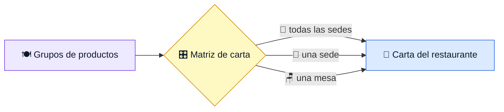
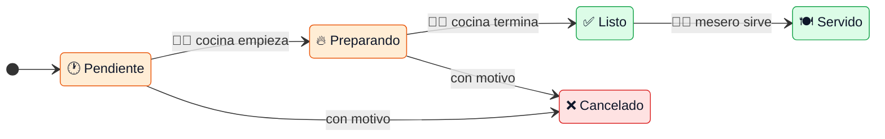
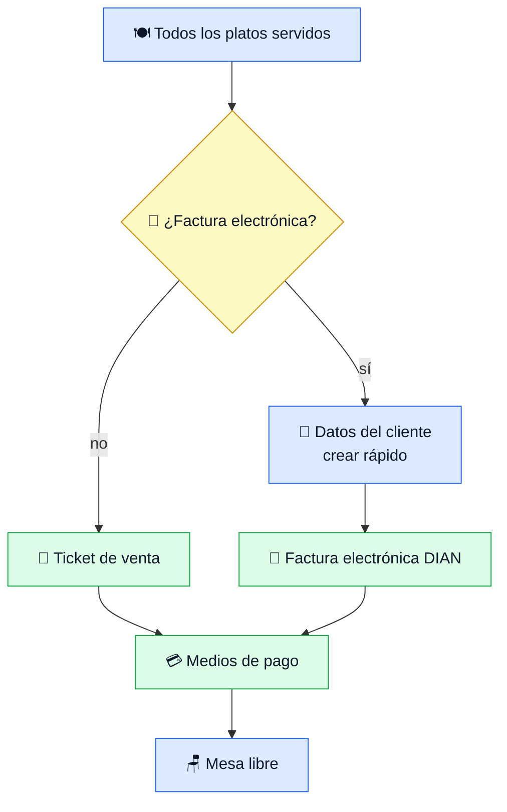
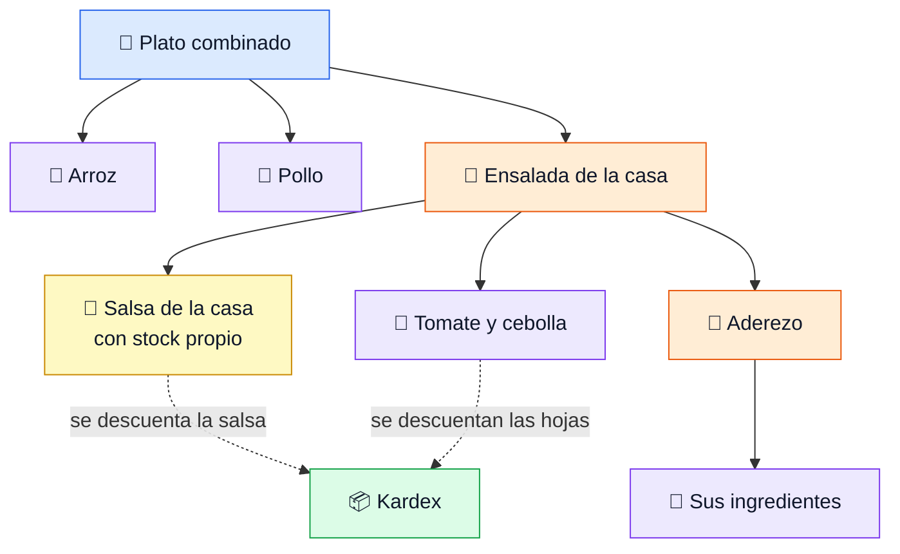

# Demo — ADA para restaurantes

Guion de apoyo para presentar la demo a un restaurante. Es un recorrido corto de lo que el cliente pidió, no una guía de
pruebas. Las reglas ya las cubren las pruebas automáticas; aquí se muestra que las pantallas hacen lo que se promete.
Antes: [README de QA](README.md).

## Lo que el cliente debe notar

| Mensaje | Cómo se demuestra |
|---|---|
| **Es el flujo del salón, no el de un sistema** | Mesa, ronda, cocina, servir, cuenta: los mismos pasos que hoy hacen con libreta y voz |
| **El mesero no escribe** | Tarjetas con foto, los más pedidos primero: dos toques por plato, desde el celular |
| **Nadie pregunta «¿ya salió?»** | La cocina marca y el mesero lo ve al instante |
| **La cuenta no se equivoca** | No deja cobrar con platos sin servir, y dice si es ticket o factura electrónica |
| **Lo vendido descuenta del inventario** | Sin doble digitación: se ve en el kardex en la misma demo |

Regla de la presentación: **nunca explicar una pantalla**. Si hace falta explicarla, se salta.

## Qué pidió el cliente y dónde se ve

| Necesidad | Escena | Pantalla |
|---|---|---|
| Tomar pedidos en la mesa con 3 meseros | 2 y 3 | Mesas y Pedido (celular) |
| Que la cocina vea y prepare los platos | 4 | Cocina (tableta o pantalla) |
| Cobrar la mesa, con ticket o factura electrónica | 5 | Cuenta y cobro |
| Carta amplia, con fotos, por sede o por mesa | 1 | Configurar → Carta y Platos |
| Controlar lo que sale de la cocina | 6 | Inventario → Kardex |
| Platos compuestos y productos prefabricados | 7 y 8 | Productos compuestos, código de barras |
| Parte administrativa y financiera | 9 | Reportes de caja, cartera, contabilidad |

## El recorrido

```mermaid
flowchart LR
    A["📖 1. Carta<br/>y platos"]:::stock --> B["🪑 2. Abrir<br/>mesa"]:::sala
    B --> C["📱 3. Pedido<br/>del mesero"]:::sala
    C --> D["👨‍🍳 4. Cocina"]:::cocina
    D --> E["🧾 5. Cuenta<br/>y cobro"]:::caja
    E --> F["📦 6. Inventario<br/>y kardex"]:::stock
    F --> G["🥗 7. Plato<br/>compuesto"]:::stock
    G --> H["🏷️ 8. Prefabricados"]:::stock
    H --> I["💰 9. Caja<br/>y reportes"]:::caja
    classDef sala fill:#dbeafe,stroke:#2563eb,color:#0f172a
    classDef cocina fill:#ffedd5,stroke:#ea580c,color:#0f172a
    classDef caja fill:#dcfce7,stroke:#16a34a,color:#0f172a
    classDef stock fill:#ede9fe,stroke:#7c3aed,color:#0f172a
    classDef aviso fill:#fef9c3,stroke:#ca8a04,color:#0f172a
```

🔵 sala · 🟠 cocina · 🟢 caja · 🟣 inventario y catálogo. Cada escena dura 2 a 3 minutos. Si hay poco tiempo: 2, 3, 4, 5 y 6.

## Antes de la demo

| Revisar | Cómo |
|---|---|
| Negocio de demostración con datos | Semillas `demo-restaurante.sql` y `demo-restaurante-produccion.sql` ya aplicadas |
| Usuarios | `root` entra siempre. Para mostrar los roles, crear un **Mesero** y un **Cocina** desde la pantalla de usuarios |
| Una caja abierta | Sin caja no se puede cobrar |
| Dos dispositivos a la vista | Un celular para el mesero y una pantalla para la cocina |
| Factura electrónica | Solo si el negocio tiene resolución DIAN; si no, mostrar el ticket |

## 1. La carta

| Mostrar | Se ve |
|---|---|
| *Configurar → Carta* | Un grupo se enciende o apaga por canal, por sede o por mesa. Lo heredado sale bloqueado |
| *Configurar → Platos* | Tarjetas con foto. Crear un plato con nombre, grupo, precio y foto |

## 2. Abrir la mesa

| Hacer | Se ve |
|---|---|
| En *Mesas* tocar una mesa libre | Se pide el número de comensales |
| Poner más comensales que puestos | Solo avisa, no bloquea |

## 3. El pedido

| Hacer | Se ve |
|---|---|
| Sin escribir nada | Los platos **más pedidos** de la sede, en tarjetas |
| Escribir `sa` | Búsqueda dentro de la carta |
| Tocar 2 o 3 platos, una nota y *Enviar a cocina* | La ronda queda **Pendiente** |
| Enviar una segunda ronda | Cada ronda se numera |

*Mensaje:* tomar un pedido toma segundos, con una mano, sin teclado.

## 4. La cocina

| Hacer | Se ve |
|---|---|
| En *Cocina*, empezar y terminar un plato | El mesero ve el cambio en su pedido |
| Cancelar un plato con motivo | Queda registrado quién y por qué |

*Mensaje:* la cocina ve solo lo que le toca, en el orden en que llegó, y el salón se entera sin gritar.

## 5. Cuenta y cobro

| Hacer | Se ve |
|---|---|
| Pedir la cuenta con un plato sin servir | Botón bloqueado, con el motivo |
| Elegir *No* a la factura electrónica | Dice con claridad que es **ticket de venta** |
| Elegir factura electrónica | Se marca que el cliente la pide a su nombre. El cliente se crea al vuelo y el documento es obligatorio |
| Mirar la **propina voluntaria** | Si la caja pide propina, viene sugerida (el % lo define la caja), se quita con un toque o se cambia por otro valor, y se dice con qué medio se recibe. El cliente ve cuenta + propina; los medios de pago cubren la cuenta; el ticket la muestra aparte |
| Cobrar con dos medios de pago | La mesa queda libre y el pedido pagado |

*Mensaje:* el cliente que pide factura electrónica se atiende en la mesa, sin volver a caja ni rehacer nada. La propina queda aparte de la factura y, en *Pedidos → Pagadas*, el dueño ve las propinas del día por mesero.

## 6. Lo que sale de la cocina

| Hacer | Se ve |
|---|---|
| *Inventario → Kardex* del plato vendido | El movimiento de salida con su cantidad |
| Comparar la existencia antes y después | Baja lo que se vendió |

*Mensaje:* el inventario de cocina se mueve solo con cada venta; nadie lo digita al cierre.

## 7. Plato compuesto

> ⚠️ Mostrar solo cuando esté desplegado y validado. Ver el plan, sección 8.

| Hacer | Se ve |
|---|---|
| *Productos compuestos* → abrir el plato combinado | Sus componentes, a tres niveles |
| Vender un combinado | El kardex baja los ingredientes. La salsa baja por su propio stock |
| Mirar el ticket | Sale el plato, no los ingredientes |

## 8. Prefabricados

| Hacer | Se ve |
|---|---|
| Crear un producto prefabricado | Genera su código de barras |
| Pasar la pistola lectora en una compra o venta | Encuentra el producto al instante |

## 9. Caja y reportes

| Hacer | Se ve |
|---|---|
| *Reporte de caja* del día | Lo cobrado por medio de pago |
| Cartera, cuentas por pagar y contabilidad | Se muestran solo si el cliente contrata esos módulos |

## Estado de cada tema

| Tema | Estado | Cómo decirlo al cliente |
|---|---|---|
| Mesas, pedido, cocina, cobro, carta por sede y mesa | ✅ Listo y probado | Se muestra completo |
| Fotos de los platos | ✅ Listo | Requiere el almacenamiento de imágenes activo en el servidor |
| Reservas por internet | ✅ Construido | El cliente reserva desde el marketplace y entra al mismo pedido. Se contrata como extensión (planes del marketplace). En la demo falta cargar el servicio «Reserva» |
| Descuento por receta (plato compuesto) | 🟡 En construcción | Se muestra cuando esté validado. Los demás platos bajan sus ingredientes al cerrar una orden de producción |
| Comandas impresas en cocina | ✅ Construido | Sale en papel de 80 mm con el diseño del ticket, o por el agente de impresión de la empresa; también se comparte por WhatsApp. Requiere el agente de impresión instalado en el local |
| Propina voluntaria | ✅ Construido | Sugerida al cobrar según la caja, la decide el cliente, queda aparte de la factura, sale en el ticket y se contabiliza como dinero de terceros. Aún no viaja en la factura electrónica ni en el reporte de caja (pendiente urgente) |
| Fecha de entrega | 🟡 Sin fecha | El módulo está probado en local y no desplegado. No comprometer fecha hasta probar con un restaurante real |

*Comanda* es el papel que sale impreso en la cocina cuando el mesero envía el pedido.
