# El ciclo del negocio — guía para el dueño y guion de los videos

Esta guía cuenta, sin tecnicismos, el camino que recorre una venta en un negocio real: lo que se vende (un **producto**
o un **servicio**), a quién se le vende, la factura, cómo se paga (de contado, fiado o parte y parte), los apartados con
anticipo, el cobro de la cartera y el cierre del día.

Se puede dejar al dueño del negocio como guía de consulta. La segunda parte es el **guion para grabar cuatro videos
cortos** (de unos 3 minutos cada uno) que explican lo mismo, con las mismas palabras y el mismo caso.

| Parte | Para quién | Qué contiene |
|---|---|---|
| **1. La guía** | el dueño y quien atiende el negocio | el ciclo completo, las palabras de la vida real y el paso a paso de cada día |
| **2. El guion** | quien graba los videos | los cuatro videos, escena por escena, con lo que se dice y lo que se ve |
| **Anexo** | soporte y QA | en qué pantalla está cada paso y qué se puede prometer |

**El caso de la guía:** una relojería. Vende relojes, correas y también **servicios de taller**. Al final hay una tabla
para contar el mismo ciclo en una ferretería, una tienda de moda o una de repuestos.

## Navegación rápida

**La guía, sección por sección:**

| # | Sección | Qué encuentra |
|---|---|---|
| 1 | [La historia](#g1) | el negocio, los clientes y lo que se vende |
| 2 | [El ciclo en una servilleta](#g2) | los cinco pasos, de un vistazo |
| 3 | [Las dos puertas](#g3) | ¿ya existe lo que vendo? ¿ya existe el cliente? |
| 4 | [El mapa completo](#g4) | el ciclo en cuatro estaciones |
| 5 | [Producto o servicio](#g5) | se venden igual, y qué escribir en cada caso |
| 6 | [Las tres preguntas antes de facturar](#g6) | el chequeo rápido antes de cobrar |
| 7 | [Los tres caminos del pago](#g7) | contado, crédito o parte y parte; y el cupo |
| 8 | [Lo que el sistema hace solo](#g8) | lo que no se digita |
| 9 | [Las palabras de la vida real](#g9) | cómo se llama cada cosa |
| 10 | [El día a día](#g10) | momento por momento y dónde se hace |
| 11 | [Separado con anticipo](#g11) | apartar, abonar y entregar |
| 12 | [Cobrar la cartera](#g12) | abono por abono |
| 13 | [Cerrar el día](#g13) | los cuatro tableros |
| 14 | [Si algo no aparece](#g14) | qué revisar primero |

**El [guion](#guion), para quien graba:**

| # | Sección | Qué contiene |
|---|---|---|
| 1 | [Los cuatro videos](#videos) | la idea, la duración y los diagramas de cada uno |
| 2 | [Tabla de escenas](#tabla-escenas) | las 28 escenas de los cuatro videos, con su minuto |
| 3 | [Video 1](#v1) · [Video 2](#v2) · [Video 3](#v3) · [Video 4](#v4) | el guion de cada video |
| 4 | [Antes de grabar](#antes-de-grabar) | qué dejar listo |
| 5 | [Reglas de oro](#reglas) | las siete reglas de la serie |
| 6 | [Cómo decirlo](#como-decir) | las palabras que no se dicen |
| 7 | [Otro rubro](#otro-rubro) | el mismo guion en otra tienda |
| 8 | [Anexo](#anexo) | pantallas y [qué se puede prometer](#prometer) |

---

# Parte 1 — La guía

## 1. La historia: Relojería El Brillante

| Quién | Qué hace en la historia |
|---|---|
| **Don Jorge** | dueño de la relojería; atiende, factura, hace los ajustes y cobra |
| **Doña Marta** | clienta de siempre; compra un reloj, pide fiar el resto y trae relojes a servicio |
| **Andrés Mejía** | reserva (aparta) un reloj de colección para el grado de su hija y abona por quincenas |
| **Caja principal** | la caja abierta del día: sin caja abierta no se cobra |

**Lo que se vende en el caso:**

| Qué se vende | Precio | Cómo vive en el sistema |
|---|---|---|
| Reloj automático Aurora, con grabado | $850.000 | producto personalizado: una sola pieza, precio propio, se vende sin existencias |
| Reloj de colección Herencia | $1.200.000 | pieza única: se aparta |
| Correa de cuero | $180.000 | producto de catálogo: 10 en vitrina |
| Cambio de batería y ajuste de pulso | $35.000 | **servicio**: no tiene vitrina ni existencias |
| Mantenimiento de reloj automático | $120.000 | **servicio**: se factura igual que un producto |

> **Herencia** es el nombre del modelo. Cuando el texto dice *"Andrés aparta el reloj Herencia"* quiere decir que el
> cliente lo **reserva** para llevarlo después, pagando por partes: eso es un **separado** (ver la sección 11).

**Las cuentas de la historia** (si se graban los videos, no cambiarlas: el espectador va sumando con la cabeza):

| Momento | Cuenta |
|---|---|
| Se crean el reloj Aurora, el servicio de batería y doña Marta | — (todavía no hay plata) |
| Marta compra el Aurora | $850.000 = $350.000 de contado + $500.000 fiados a 30 días |
| Se cobra un cambio de batería (ejemplo rápido del video 2) | $35.000 de contado |
| Andrés aparta (reserva) el reloj Herencia | $1.200.000 = $300.000 de anticipo + $500.000 en abonos + $400.000 al entregar |
| Marta paga su fiado | $500.000 = $200.000 + $300.000, y su cartera queda en 0 |

## 2. El ciclo en una servilleta

Cinco pasos, los mismos de cualquier negocio. Todo lo demás son detalles de cada paso.

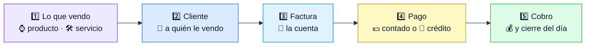

> **La regla que ordena todo:** no se puede saltar. Si no existe lo que vendo, no hay factura; si no existe el cliente,
> no hay a quién cobrarle; si no hay factura, no hay caja ni cartera. Todo lo demás es consecuencia.

## 3. Las dos puertas: ¿ya existe lo que vendo? ¿ya existe el cliente?

Antes de facturar hay dos puertas. Si algo no existe, se crea en ese momento y se sigue.

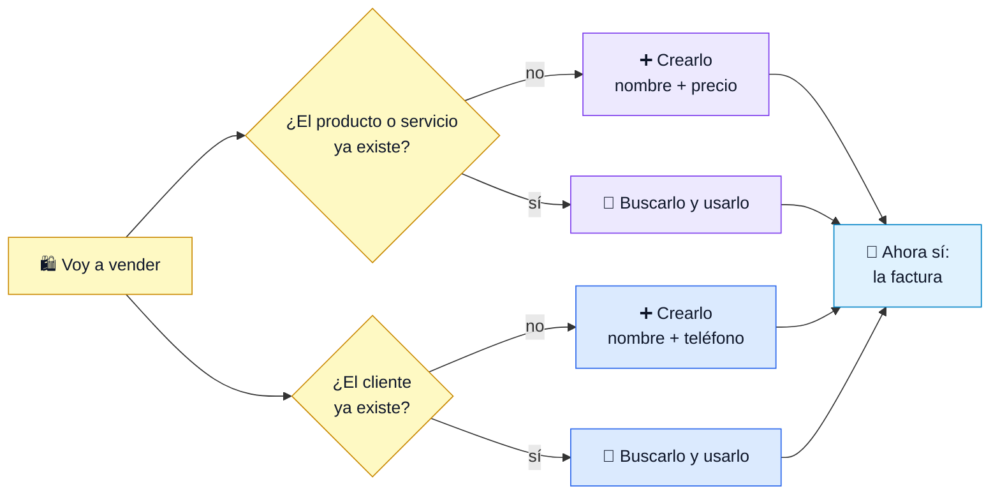

> **¿Qué va primero, el producto o el cliente?** No es una carrera: el orden lo pone la vida. Lo que no se puede saltar
> es que **los dos existan antes de la factura**. Si vende algo nuevo, primero lo que vende. Si llega alguien nuevo,
> primero el cliente.

## 4. El mapa completo, en cuatro estaciones

El ciclo con lo que pasa en cada estación. El detalle de cada una está en las secciones siguientes.

> **La estación 1 no arranca en blanco:** empieza por [las dos puertas](#g3) —¿ya existe lo que vendo? ¿ya existe el
> cliente?—. Si algo falta, se crea ahí mismo y se sigue.

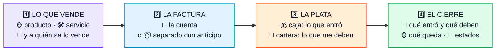

## 5. Producto o servicio: se venden igual

Un reloj y un cambio de batería se facturan de la misma manera. La diferencia es que el servicio no tiene vitrina: no
se cuenta en el inventario y no hay unidades que descontar.

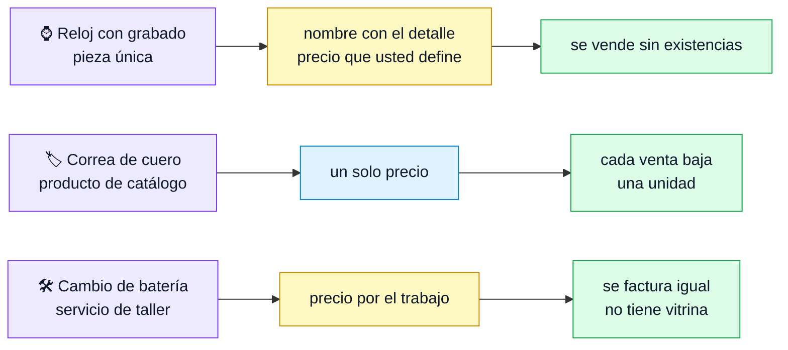

**Qué se escribe en cada caso** (se crea todo desde la misma pantalla de productos):

| Campo | Un producto (el reloj) | Un servicio (la batería) |
|---|---|---|
| **Nombre** | "Reloj Aurora con grabado" | "Cambio de batería y ajuste de pulso" |
| **Tipo** | Producto | Servicio |
| **Grupo** | Relojes / Correas | Servicios de taller |
| **Precio** | $850.000 | $35.000 |
| **Costo** (opcional) | $520.000 | lo que cuesta el repuesto |
| **Existencias** | 1, o 0 si se manda a hacer | no lleva |
| **Vender sin existencias** | sí, cuando es una pieza única | no aplica |

## 6. Las tres preguntas antes de facturar

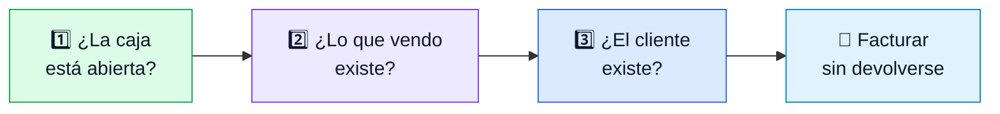

## 7. Los tres caminos del pago

La factura es una sola. Lo que cambia es de dónde sale la plata.

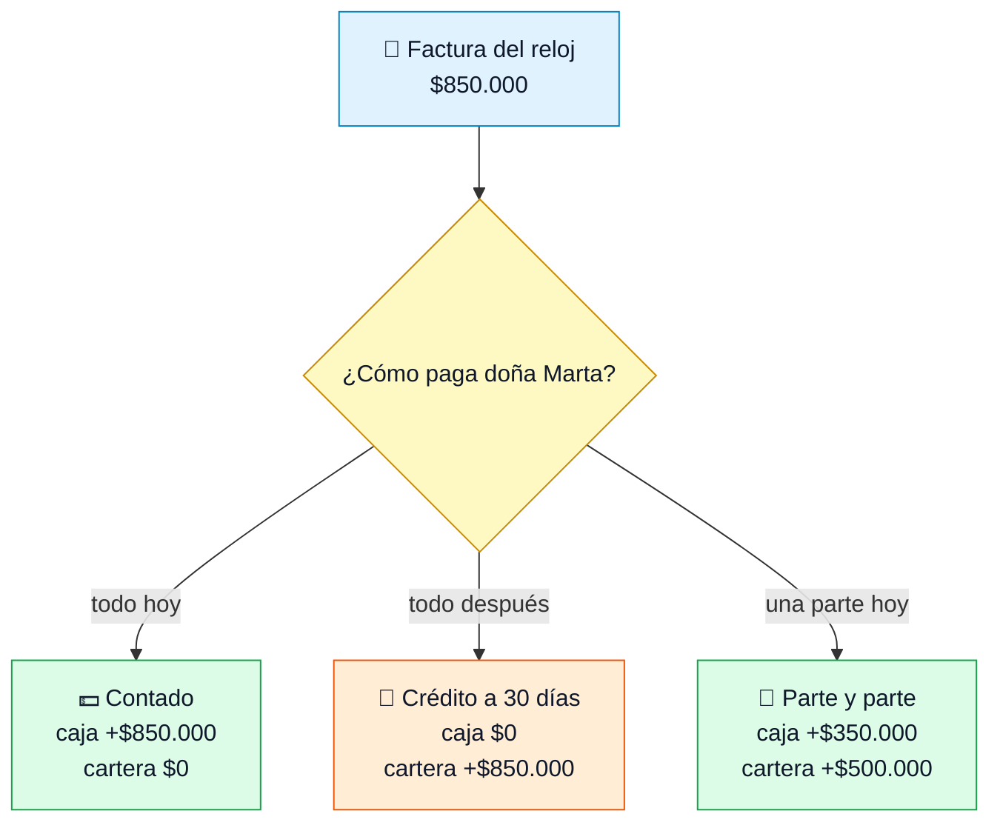

**El cupo es el freno** que evita el problema antes de que crezca:

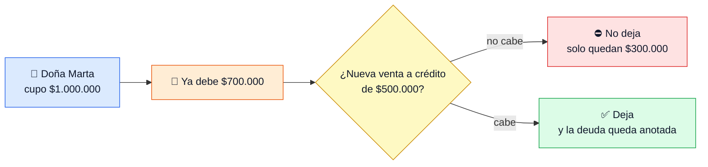

## 8. Lo que el sistema hace solo al guardar

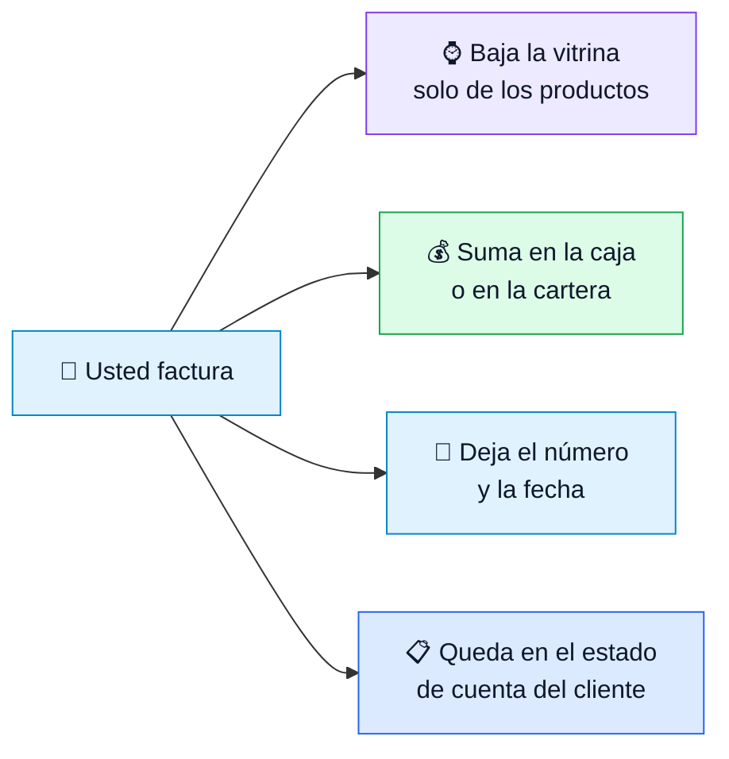

## 9. Las palabras de la vida real

En la conversación se usa la columna de la izquierda; en el sistema, la del centro.

| Como se dice en el negocio | Como se llama en el sistema | En el caso |
|---|---|---|
| "lo que vendo" | **producto o servicio** | el reloj Aurora, el cambio de batería |
| "a quién le vendo" | **cliente** | doña Marta |
| "la cuenta" | **factura** | $850.000 |
| "me pagó ya" | **contado** | $350.000 en efectivo |
| "me debe" | **crédito / cartera** | $500.000 a 30 días |
| "me dio una parte" | **abono** | $200.000 |
| "lo apartó con plata" | **separado con anticipo** | $300.000 por el reloj Herencia |
| "le quedó plata a favor" | **saldo a favor** | lo que pagó y no se usó |
| "la plata que entró hoy" | **caja** | el efectivo y las transferencias del día |
| "cuánto me deben" | **cartera pendiente** | lo fiado sin pagar |

## 10. El día a día, momento por momento

| Momento | Dónde se hace | Qué queda hecho |
|---|---|---|
| Llega algo nuevo: un reloj, una correa o un servicio | *Productos* → nuevo | El artículo existe en la lista, con su precio |
| Llega un cliente nuevo | *Clientes* → nuevo | El cliente existe, con su cupo si va a fiar |
| Se factura | *Facturas* → crear; un medio de pago por cada parte | La cuenta queda numerada; la plata va a la caja o a la cartera |
| El cliente aparta | *Separados* → nuevo; luego *Abonar* y *Entregar* | La pieza queda reservada; los abonos quedan con fecha y medio de pago |
| El cliente no paga todo | *Cobro de cartera* → *Abonar* | El saldo baja y se ve la mora |
| Se cierra el día | *Caja* → *Reporte de caja* y *Cierre* | Lo que entró, lo que se debe, lo que queda en vitrina |

## 11. Si el cliente aparta: separado con anticipo

| Palabra | Qué es | En el caso |
|---|---|---|
| **Separado** | el apartado completo: pieza + cliente + plazo + pagos | el reloj Herencia de Andrés |
| **Anticipo** | el primer pago de ese apartado | los $300.000 del primer día |
| **Abono** | cualquier pago siguiente | $300.000 y $200.000 |
| **Entrega** | el día que se lleva la pieza: aquí se factura | paga $400.000 y sale la factura |

> El anticipo no vive suelto: va **dentro del separado**. Si un cliente deja plata "para después" sin apartar nada, se
> le arma un separado con lo que va a llevar. Así la plata queda con destino y con nombre.

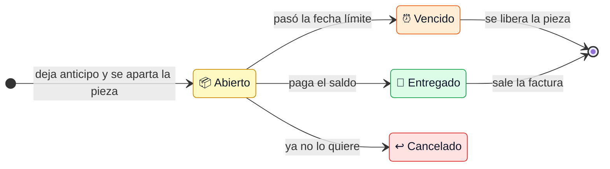

Si el plazo vence y el cliente no aparece, la pieza vuelve a quedar disponible y **lo que ya abonó queda como saldo a
favor suyo**: nada de lo que pagó se pierde.

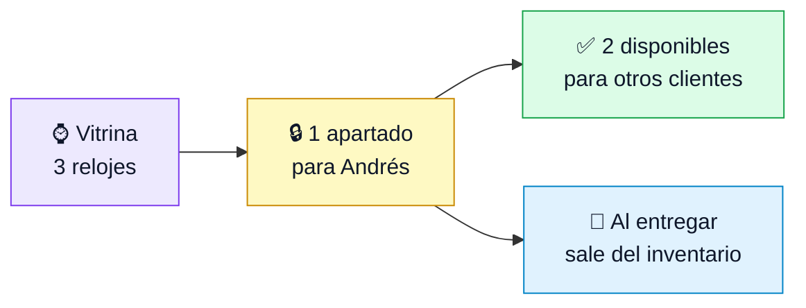

## 12. Cobrar la cartera: abono por abono

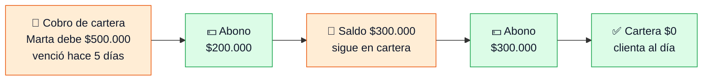

Lo que me deben **no está en la caja**: está en la cartera. La caja es lo que ya entró; la cartera es lo que falta por
cobrar.

## 13. Cerrar el día: los cuatro tableros

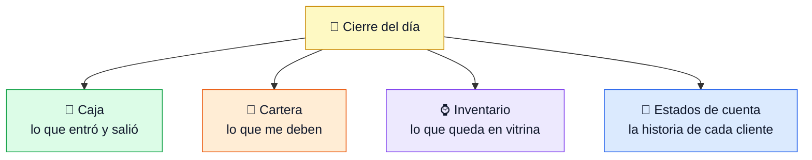

## 14. Si algo no aparece donde debería

| Lo que se ve | Qué revisar |
|---|---|
| Un producto no aparece al facturar | que esté en el grupo correcto y con el tipo correcto (producto o servicio) |
| La venta no aparece en la caja | el medio de pago: con plazo 0 la plata entra a la caja; con plazo mayor que 0 queda en la cartera |
| El cliente no puede comprar fiado | su cupo de crédito o lo que ya debe |
| La cartera aparece vacía | que la factura no se haya hecho con un medio de pago sin plazo |
| Un separado no deja abonar | su estado: uno entregado o cancelado ya no recibe abonos |

[↑ Volver a la navegación](#navegacion)

---

# Parte 2 — El guion de los videos

## Los cuatro videos de un vistazo

| # | Video | La idea que se lleva el dueño | Duración | Diagramas que salen |
|---|---|---|---|---|
| 1 | Antes de facturar: producto, servicio y cliente | **Lo que no está creado, no se puede vender** | 3:00 | servilleta, cuatro estaciones, dos puertas, tres preguntas |
| 2 | Contado, crédito o parte y parte | **La factura es la misma; cambia de dónde sale la plata** | 2:30 | tres caminos del pago, el cupo, lo que hace el sistema solo |
| 3 | Separados y anticipos | **Lo apartado no es venta todavía: es una promesa con anticipo** | 3:00 | el viaje del separado, lo apartado no se vende dos veces |
| 4 | Cobrar la cartera y cerrar el día | **Lo que me deben no está en la caja: está en la cartera** | 2:30 | cartera abono por abono, los cuatro tableros |

Son unos **11 minutos en total**. Se pueden ver sueltos, en ese orden, en la inducción de un cliente nuevo o antes de
entregarle el sistema. Si solo hay tiempo para tres, el 3 y el 4 se pueden unir en uno de 4 minutos.

---

## Tabla de escenas

Las 28 escenas de la serie, video por video. La columna **Ir** lleva al guion completo de ese video. (El orden de grabación, que no es el mismo, está en [Antes de grabar](#antes-de-grabar).)

| Video | # | Minuto | Escena | Ir |
|---|---|---|---|---|
| 1 | 1 | 0:00–0:20 | "Vender no empieza en la caja": el ciclo de la servilleta | [ver](#v1) |
| 1 | 2 | 0:20–0:55 | Lo que hace todos los días, solo que aquí queda anotado | [ver](#v1) |
| 1 | 3 | 0:55–1:20 | La historia: el reloj que no existe y el servicio nuevo | [ver](#v1) |
| 1 | 4 | 1:20–1:55 | Crear el reloj Aurora con el precio que usted pone | [ver](#v1) |
| 1 | 5 | 1:55–2:15 | Crear el servicio de batería: tipo Servicio, sin vitrina | [ver](#v1) |
| 1 | 6 | 2:15–2:40 | Crear a doña Marta: nombre completo y teléfono | [ver](#v1) |
| 1 | 7 | 2:40–2:55 | Volver a la factura: ya hay qué vender y a quién cobrarle | [ver](#v1) |
| 1 | 8 | 2:55–3:00 | Cierre: "Lo que no está creado, no se puede vender" | [ver](#v1) |
| 2 | 1 | 0:00–0:15 | La cuenta es la misma; lo que cambia es cómo la pagan | [ver](#v2) |
| 2 | 2 | 0:15–0:40 | Cobrar el servicio de la batería: $35.000 de contado | [ver](#v2) |
| 2 | 3 | 0:40–1:05 | El reloj con dos medios de pago: efectivo y fiado | [ver](#v2) |
| 2 | 4 | 1:05–1:30 | Caja y cartera, cada una con su cifra | [ver](#v2) |
| 2 | 5 | 1:30–1:55 | El cupo frena la venta antes de que crezca | [ver](#v2) |
| 2 | 6 | 1:55–2:20 | Lo que el sistema hace solo: inventario, número y fecha | [ver](#v2) |
| 2 | 7 | 2:20–2:30 | Cierre: "La factura es la misma; cambia de dónde sale la plata" | [ver](#v2) |
| 3 | 1 | 0:00–0:20 | La historia de Andrés y el reloj de colección | [ver](#v3) |
| 3 | 2 | 0:20–0:50 | Crear el separado con $300.000 de anticipo | [ver](#v3) |
| 3 | 3 | 0:50–1:15 | El reloj apartado: no se le vende a nadie más | [ver](#v3) |
| 3 | 4 | 1:15–1:45 | Abonar $300.000 y después $200.000 | [ver](#v3) |
| 3 | 5 | 1:45–2:15 | Entregar pagando $400.000: sale la factura | [ver](#v3) |
| 3 | 6 | 2:15–2:40 | Cancelar: la plata queda a favor o se devuelve | [ver](#v3) |
| 3 | 7 | 2:40–3:00 | Cierre: "Lo apartado es una promesa con anticipo" | [ver](#v3) |
| 4 | 1 | 0:00–0:20 | La plata que no está en la caja: está fiada | [ver](#v4) |
| 4 | 2 | 0:20–0:55 | Quién debe, cuánto, desde cuándo y cuántos días de mora | [ver](#v4) |
| 4 | 3 | 0:55–1:30 | Abonar $200.000: el saldo baja y la plata entra a la caja | [ver](#v4) |
| 4 | 4 | 1:30–1:55 | Los $300.000 que faltan: cartera en cero | [ver](#v4) |
| 4 | 5 | 1:55–2:20 | Los cuatro tableros del cierre | [ver](#v4) |
| 4 | 6 | 2:20–2:30 | Cierre: "Lo que me deben no está en la caja: está en la cartera" | [ver](#v4) |

---

## Video 1 — Antes de facturar: producto, servicio y cliente

| | |
|---|---|
| **Para quién** | el dueño y quien atiende el mostrador |
| **Cuándo** | primero de la serie; también el primer video de una inducción |
| **La idea** | nada se vende si no existe: primero lo que vendo (producto o servicio), después a quién se lo vendo (cliente) |
| **Frase de cierre** | **"Lo que no está creado, no se puede vender."** |
| **Toma clave** | crear el reloj Aurora, crear el servicio de batería y crear a doña Marta |

### La escena de la vida real

Son las 10 de la mañana. Entra doña Marta y pide el reloj Aurora con grabado que don Jorge encargó la semana pasada. No
está en la lista del sistema. Si factura "varios", después no sabrá qué vendió ni cuánto ganó, y si le fía no tendrá a
quién cobrarle. A Marta tampoco la tiene creada. Y en el taller hay un servicio nuevo que cobra desde ayer (cambio de
batería) que tampoco está. Primero crea el reloj, después el servicio, después a Marta, y **ahí sí** factura.

Este video responde la duda más común del dueño: *"¿y si vendí un montón de cosas y no me acuerdo de cómo crear el
producto personalizado con el precio que yo le puse?"*.

### En la vida / en el sistema

| En el negocio (vida real) | En el sistema |
|---|---|
| "Ese reloj no está en la lista" | *Productos* → crear: nombre con el detalle, grupo y el precio que usted pone |
| "El cambio de batería tampoco está" | el mismo formulario, con **tipo Servicio**: sin vitrina y sin existencias |
| "Marta no está en el cuaderno" | *Clientes* → crear: nombre completo y teléfono; el documento es opcional |
| "Le vendí seis cosas distintas" | cada cosa es una línea de la factura; todas deben existir antes |
| "No me acuerdo del precio que le puse" | el precio vive en el producto; la factura conserva el valor con que se vendió |

### Guion, escena por escena

| # | Tiempo | Qué se dice | Qué se ve |
|---|---|---|---|
| 1 | 0:00–0:20 | "Vender no empieza en la caja. Empieza en dos preguntas." | El ciclo de la servilleta, con los cinco pasos |
| 2 | 0:20–0:55 | "Esto es lo mismo que usted hace todos los días, solo que aquí queda anotado." | El ciclo recorriéndose paso a paso |
| 3 | 0:55–1:20 | "Hoy doña Marta quiere un reloj que no existe. Y hay un servicio nuevo que tampoco." | La historia, sin pantalla (voz y rostro) |
| 4 | 1:20–1:55 | "Primero el reloj: el nombre con el detalle, el grupo y el precio que usted pone." | Crear el Aurora, escribir $850.000, guardar |
| 5 | 1:55–2:15 | "El servicio se crea igual, con tipo Servicio: no tiene vitrina, pero se cobra." | Crear el cambio de batería, $35.000 |
| 6 | 2:15–2:40 | "Después el cliente: nombre completo y teléfono. El documento es opcional." | Crear a doña Marta, guardar |
| 7 | 2:40–2:55 | "Con los dos creados, la cuenta ya se puede hacer. Y si le fía, ya hay a quién cobrarle." | Volver a la factura y el ciclo completo |
| 8 | 2:55–3:00 | **"Lo que no está creado, no se puede vender."** | La frase en pantalla, sobre el ciclo |

### Toma clave

Un solo plano continuo de la creación del reloj: se ve **nombre, grupo, precio**, se guarda y se vuelve a ver en la
lista. El servicio entra como una toma corta de 20 segundos, sin explicar: se ve el tipo **Servicio** y que se factura.

### Si algo falla

Si el reloj no aparece al buscar en la factura, revisar el **grupo** (puede estar creado en otra categoría). Plan B:
dejar el producto ya creado antes de grabar y mostrar solo la búsqueda y la factura.

[↑ Volver a la navegación](#navegacion)

---

## Video 2 — Contado, crédito o parte y parte

| | |
|---|---|
| **Para quién** | el dueño y quien factura |
| **Cuándo** | segundo de la serie |
| **La idea** | la factura es una sola; lo que cambia es de dónde sale la plata |
| **Frase de cierre** | **"La factura es la misma; lo que cambia es de dónde sale la plata."** |
| **Toma clave** | la misma factura pagada con dos medios: efectivo y fiado a 30 días |

### La escena de la vida real

Primero entra un cliente a cambiar la batería del reloj: $35.000 de contado, un servicio, sin vitrina. Después llega doña
Marta y se lleva el Aurora de $850.000: trae $350.000 y pide que le fíen el resto a 30 días, como siempre. Don Jorge
elige el medio de pago en la misma factura: efectivo por $350.000 y fiado por $500.000. La cuenta queda con $500.000
pendientes, sin cuaderno aparte.

### En la vida / en el sistema

| En el negocio (vida real) | En el sistema |
|---|---|
| "Me pagó todo" | medio de pago de contado: la plata entra a la caja |
| "Me debe" | medio de pago con plazo: la deuda nace con fecha de vencimiento |
| "Me dio una parte" | dos medios de pago en la misma factura |
| "Era un servicio, no un reloj" | se factura igual; no descuenta vitrina |
| "Ya debe mucho" | el cupo del cliente lo frena antes de vender |

### Guion, escena por escena

| # | Tiempo | Qué se dice | Qué se ve |
|---|---|---|---|
| 1 | 0:00–0:15 | "La cuenta es la misma para todos. Lo que cambia es cómo la pagan." | Los tres caminos del pago |
| 2 | 0:15–0:40 | "Este señor solo vino a cambiar la batería: $35.000 de contado." | Facturar el servicio y cobrarlo |
| 3 | 0:40–1:05 | "Doña Marta se lleva el reloj. Tiene $350.000 y pide fiar el resto." | La factura del Aurora con los dos medios de pago |
| 4 | 1:05–1:30 | "Al guardar, la plata que entró va a la caja y lo que falta va a la cartera." | Caja y cartera, cada una con su cifra |
| 5 | 1:30–1:55 | "Si el cliente ya debe mucho, el cupo lo frena aquí, no tres meses después." | El intento con el cupo agotado y el mensaje |
| 6 | 1:55–2:20 | "El inventario, el número y la fecha quedan hechos. Nadie los digita." | El ciclo de lo que hace el sistema solo |
| 7 | 2:20–2:30 | **"La factura es la misma; lo que cambia es de dónde sale la plata."** | Frase en pantalla |

### Toma clave

La factura del reloj guardada con **dos medios de pago** y, al lado, las dos cifras: caja $350.000 y cartera $500.000.
El servicio de $35.000 va aparte, al principio y rápido, para que se vea que un servicio también se factura.

### Si algo falla

Si un medio de pago no aparece, es porque no tiene cuenta contable configurada: pedir al equipo que lo complete antes
de grabar (no se arregla desde esa pantalla).

[↑ Volver a la navegación](#navegacion)

---

## Video 3 — Separados y anticipos

| | |
|---|---|
| **Para quién** | el dueño y quien atiende el mostrador |
| **Cuándo** | tercero de la serie |
| **La idea** | lo apartado no es venta todavía: es una promesa con anticipo, y la plata no se pierde |
| **Frase de cierre** | **"Lo apartado no es venta todavía: es una promesa con anticipo."** |
| **Toma clave** | el separado pasando de Abierto a Entregado, con la factura al final |

### La escena de la vida real

Andrés Mejía quiere el reloj de colección Herencia de $1.200.000 para el grado de su hija, en diciembre, pero va a
pagarlo por quincenas. Deja $300.000 de anticipo y don Jorge lo aparta: **nadie más puede comprar ese reloj**. A las dos
semanas abona $300.000, después $200.000, y el día que lo recoge paga los $400.000 que faltan… y en ese momento sale la
**factura**. Mientras tanto, otra clienta cancela su separado: su plata no se pierde, queda a favor de ella.

### En la vida / en el sistema

| En el negocio (vida real) | En el sistema |
|---|---|
| "Aparté el reloj" | *Separados* → nuevo: cliente, pieza, total, anticipo y fecha límite |
| "Deja un abono" | *Abonar*: queda con fecha, medio de pago y quién lo recibió |
| "Ya no lo quiere" | *Cancelar*: dejar lo pagado como saldo a favor o devolver el dinero |
| "No volvió" | vence el plazo: la pieza se libera y la plata queda a favor del cliente |
| "Se lo entregué" | *Entregar*: paga el saldo y sale la factura con lo abonado |

### Guion, escena por escena

| # | Tiempo | Qué se dice | Qué se ve |
|---|---|---|---|
| 1 | 0:00–0:20 | "Hay ventas que no se pagan hoy: se apartan y se pagan por partes." | La historia de Andrés y el reloj |
| 2 | 0:20–0:50 | "Se abre el separado: cliente, pieza, precio y fecha límite. Y el anticipo." | Crear el separado con $300.000 |
| 3 | 0:50–1:15 | "Mientras esté apartado, ese reloj no se le puede vender a nadie más." | La pieza apartada y lo que queda disponible |
| 4 | 1:15–1:45 | "Cada abono queda con fecha, con medio de pago y con quién lo recibió." | Abonar $300.000 y luego $200.000 |
| 5 | 1:45–2:15 | "El día que se lo lleva, paga el saldo y sale la factura con lo abonado." | Entregar pagando $400.000 y ver la factura |
| 6 | 2:15–2:40 | "Si cancela, la plata no se pierde: queda a favor o se le devuelve." | Cancelar y mostrar el saldo a favor |
| 7 | 2:40–3:00 | **"Lo apartado no es venta todavía: es una promesa con anticipo."** | El viaje del separado, de nuevo |

### Toma clave

El separado en pantalla con **Abonado $800.000** y **Falta $400.000**, y al final la **factura por $1.200.000** con lo
abonado como pago.

### Si algo falla

Si el sistema no deja abonar, mirar el estado: un separado **entregado** o **cancelado** ya no recibe abonos. Plan B:
mostrar la lista de abonos de uno ya creado y contar la historia sobre esa lista.

[↑ Volver a la navegación](#navegacion)

---

## Video 4 — Cobrar la cartera y cerrar el día

| | |
|---|---|
| **Para quién** | el dueño y quien maneja la plata |
| **Cuándo** | último de la serie |
| **La idea** | lo que me deben no está en la caja: está en la cartera |
| **Frase de cierre** | **"Lo que me deben no está en la caja: está en la cartera."** |
| **Toma clave** | la cartera de doña Marta bajando a cero y el reporte de caja del día |

### La escena de la vida real

Pasaron los 30 días y el plazo ya venció. Doña Marta debe los $500.000 del Aurora. Don Jorge abre la cartera y ve lo que
cualquier dueño quiere ver de un vistazo: **quién le debe, cuánto, desde cuándo y cuántos días de mora**. Marta pasa y
abona $200.000. Queda $300.000. A la quincena paga los $300.000 y la cartera de ella queda en cero. Al final del día,
Jorge mira cuatro números antes de cerrar: la plata que entró, la que le deben, lo que le queda en vitrina y la historia
de cada cliente.

### En la vida / en el sistema

| En el negocio (vida real) | En el sistema |
|---|---|
| "¿Quién me debe?" | *Cobro de cartera*: cliente, saldo, vencimiento y días de mora |
| "Me abonó" | *Abonar*: el saldo baja y la plata entra a la caja |
| "¿Qué ha comprado esta clienta?" | *Estado de cuenta*: ventas, fiados, abonos y saldo a favor |
| "¿Cuánta plata entró hoy?" | *Caja* → *Reporte de caja* |
| "¿Cuánto me deben en total?" | la suma de la cartera pendiente |

### Guion, escena por escena

| # | Tiempo | Qué se dice | Qué se ve |
|---|---|---|---|
| 1 | 0:00–0:20 | "Hay plata que no está en la caja: está en la calle, fiada." | La cartera con la deuda de Marta |
| 2 | 0:20–0:55 | "Aquí se ve quién debe, cuánto, desde cuándo y cuántos días de mora." | *Cobro de cartera* con las columnas |
| 3 | 0:55–1:30 | "Marta abona $200.000: el saldo baja y la plata entra a la caja." | Abonar y ver las dos cifras a la vez |
| 4 | 1:30–1:55 | "Cuando paga los $300.000 que faltan, sale de la cartera y queda al día." | La fila en cero y el estado de cuenta |
| 5 | 1:55–2:20 | "Al cerrar, cuatro números: caja, cartera, vitrina y la historia de cada cliente." | Los cuatro tableros del cierre |
| 6 | 2:20–2:30 | **"Lo que me deben no está en la caja: está en la cartera."** | Frase en pantalla, sobre el cierre |

### Toma clave

La cartera con **$500.000** y, después de los dos abonos, la misma fila en **$0** — y al lado, la caja del día con los
abonos sumados.

### Si algo falla

Si la cartera aparece vacía, puede ser que la factura se haya hecho con un medio de pago **sin plazo**. Plan B: usar un
fiado ya creado en el negocio de demostración.

[↑ Volver a la navegación](#navegacion)

---

## Antes de grabar

| # | Qué dejar listo | Cómo |
|---|---|---|
| 1 | Un negocio de **demostración** (nunca uno con datos reales) | el asignado por el equipo |
| 2 | Los relojes, la correa y los dos servicios del caso | *Productos* (ver la guía, sección 4) |
| 3 | Doña Marta y Andrés, como clientes | *Clientes*; Marta con cupo de crédito de $1.000.000 |
| 4 | Medios de pago: efectivo, transferencia y **fiado a 30 días** | *Métodos de pago*; el fiado con plazo 30 |
| 5 | La **caja abierta** del día | *Cajas*; sin caja no se puede cobrar |
| 6 | Un separado **abierto** y un fiado **vencido**, para que las listas no salgan vacías | dejar creados antes de grabar |
| 7 | Pantalla limpia: una sola ventana, zoom al 125 %, notificaciones apagadas | — |
| 8 | Las cuentas de la historia, impresas al lado del computador | la tabla de la guía, sección 1 |

**Orden de grabación sugerido:** grabar el 4 primero (necesita la cartera con historia), después el 2 (crea el fiado que
alimenta el 4), después el 1 y al final el 3. Editar en el orden narrativo 1, 2, 3, 4.

## Reglas de oro para los cuatro videos

| # | Regla | Por qué |
|---|---|---|
| 1 | **Una sola idea por video.** Si aparece otra, va al siguiente | el dueño recuerda una frase, no diez |
| 2 | **Mostrar antes de explicar:** primero el clic, después la frase | se entiende sin saber de sistemas |
| 3 | **Hablar de plata, clientes y tiempo**, no de pantallas | es el idioma del dueño |
| 4 | **Nunca leer la pantalla** | leer en voz alta aburre y delata |
| 5 | **Cerrar siempre con la frase del video** y con el ciclo en pantalla | el cierre es lo que se queda |
| 6 | **Las mismas cuentas en los cuatro videos** | el espectador va sumando con la cabeza |
| 7 | **Lo que aparece en cámara es un negocio ficticio** | nunca datos de un cliente real |

## Cómo decirlo (y cómo no)

| No diga | Diga |
|---|---|
| módulo | pantalla, o "la parte de facturación" |
| kardex / inventario transaccional | movimiento de inventario, "lo que queda en vitrina" |
| causación, asiento contable | queda registrado, queda anotado |
| tenant | su negocio |
| TPV | datáfono |
| API, base de datos, endpoint | (no se mencionan) |
| saldo a favor | plata a favor del cliente |

## El mismo guion en otro rubro

La serie no es de relojes: es de cualquier negocio que venda, preste un servicio, fíe y aparte.

| Pieza de la serie | Relojería (el caso) | Ferretería | Moda | Servicios técnicos |
|---|---|---|---|---|
| Producto personalizado | reloj con grabado | kit armado para un maestro | vestido arreglado a la medida | instalación de un equipo |
| Servicio de taller | cambio de batería | corte de tubo y rosca | arreglo de ruedo | mantenimiento a domicilio |
| Cliente que fía | doña Marta | el maestro de la obra | la clienta de siempre | la administradora del edificio |
| Apartado con anticipo | reloj de colección | herramienta encargada | vestido para el grado | repuesto por encargo |

---

# Anexo — dónde está cada cosa y qué se puede prometer

Las pantallas del caso están en **ADA** (facturación, separados, cartera, caja e inventario). El alta de producto también
existe en la aplicación nueva (Arcadia), pero para el caso se usa ADA y así todo queda en el mismo lugar. El paso a paso
detallado de cada pantalla está en los flujos de QA.

| Escena de la guía | Pantalla | Paso a paso documentado | Estado |
|---|---|---|---|
| Crear un producto o un servicio | *Inventario → Productos* (nuevo) | [INVENTORY_MODULE.md](../INVENTORY_MODULE.md), "Registrar producto" | ✅ |
| Crear cliente y cupo de crédito | *Facturación → Clientes* (nuevo / editar) | [e2e-cartera-separados.md](e2e-cartera-separados.md), 3.4 y 3.5 | ✅ |
| Factura de contado | *Facturación → Facturas → Crear*, medio con plazo 0 | [e2e-happy-path-inventario-facturacion.md](e2e-happy-path-inventario-facturacion.md) | ✅ |
| Factura a crédito o parte y parte | la misma pantalla, medio de pago con plazo mayor que 0 | [e2e-cartera-separados.md](e2e-cartera-separados.md), 3.1 | ✅ |
| Separado con anticipo | *Facturación → Separados → Nuevo separado* | [e2e-cartera-separados.md](e2e-cartera-separados.md), Bloque 1 | ✅ |
| Abonos y entrega | separado abierto → *Abonar* / *Entregar* | e2e-cartera-separados, 1.4 y 1.6 | ✅ |
| Cancelación y saldo a favor | separado → *Cancelar separado* | e2e-cartera-separados, Bloque 2 | ✅ |
| Cobro de cartera y abonos | *Facturación → Cobro de cartera* | e2e-cartera-separados, 3.2 a 3.6 | ✅ |
| Estado de cuenta del cliente | desde el cliente o desde el separado | e2e-cartera-separados, 1.5 | ✅ |
| Caja del día y cierre | *Caja → Reporte de caja* y *Caja → Cierre* | [e2e-reporte-de-caja.md](e2e-reporte-de-caja.md) | ✅ |

## Qué se puede prometer y qué no

| Tema | Estado | Cómo decirlo |
|---|---|---|
| Producto con precio propio (pieza única) | ✅ | "Cada pieza se crea una vez, con el nombre y el precio que usted define" |
| Servicios (tipo Servicio, sin vitrina) | ✅ | "El servicio se crea igual y se factura igual; no lleva inventario" |
| Vender sin existencias | ✅ (viene permitido por defecto) | "La pieza que se manda a hacer se vende sin tenerla en vitrina" |
| Cliente con nombre completo, documento opcional y cupo | ✅ | "Nombre completo; el documento no es obligatorio" |
| Factura de contado, a crédito y con varios medios | ✅ | "La misma cuenta, pagada en partes" |
| Separado con anticipo, abonos, entrega, cancelación y saldo a favor | ✅ | "Lo apartado no se vende a nadie más" |
| Cobro de cartera con abonos, vencimiento y mora | ✅ | "Aquí ve quién le debe y hace cuánto" |
| Anticipo "suelto" (plata sin apartar nada) | ➖ No existe como documento aparte | "El anticipo va dentro del separado" |
| Producto con opciones que se eligen al facturar (color, medida, correa) | 🟡 Consultar antes de prometerlo | hoy se resuelve con un producto por variante |
| Factura electrónica DIAN | ✅ si el negocio tiene resolución; si no, ticket | "La misma cuenta, con número de la DIAN si aplica" |

*Última revisión: 2026-11-10.*

[↑ Volver a la navegación](#navegacion)
