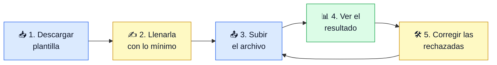

# Demo — Cargar datos desde un archivo

> **Heredado (2026-11).** Este flujo es anterior al estándar de QA: se conserva como checklist de regresión y se
> corre tal cual. Si lo reescribes, usa [guia-produccion-etapas.md](guia-produccion-etapas.md) como molde y cámbialo en
> el [índice](INDEX.md).

Guion corto. Un solo mensaje: **el cliente llena una plantilla con lo mínimo y ADA hace el resto**. Antes: [README de QA](INDEX.md).

Regla de la presentación: **nunca explicar una pantalla**. Si hace falta explicarla, se salta.

## Lo que el cliente debe notar

| Mensaje | Cómo se demuestra |
|---|---|
| **Basta con lo mínimo** | Un producto se carga solo con el nombre: ADA pone tipo, unidad, código y lista de precios |
| **La plantilla ya viene lista** | Se descarga en el momento, con lo obligatorio marcado con `*` y una hoja que explica cada columna |
| **Un error no tumba la carga** | Las filas buenas entran; las malas salen explicadas y se descargan para corregirlas |
| **No duplica** | Subir el mismo archivo dos veces no crea nada nuevo |

## El recorrido

🔵 pantalla · 🟡 el cliente en su archivo · 🟢 resultado. Cada escena dura 1 a 2 minutos.

## Dónde está cada cosa

Todo se abre igual: la lista → **Más opciones** → **Cargar desde archivo**. Dentro del diálogo están las dos plantillas.

| Qué cargar | Camino en ADA | Obligatorio |
|---|---|---|
| Productos | *Parámetros comunes → Productos → Más opciones → Cargar desde archivo* | Nombre |
| Proveedores | *Inventario → Proveedores → Más opciones → Cargar desde archivo* | Razón social y documento |
| Clientes | *Facturación → Clientes → Más opciones → Cargar desde archivo* | Nombre completo |
| Cambiar nombre, tipo, línea o grupo de productos que ya existen | *Parámetros comunes → Productos → Más opciones → Reclasificación masiva* | Id del producto |

## 1. Descargar la plantilla

| Hacer | Se ve |
|---|---|
| Abrir *Cargar desde archivo* en Productos | El diálogo con dos botones |
| *Descargar plantilla básica* | Un Excel con **una sola columna**: Nombre `*` |
| *Descargar plantilla completa* | El mismo Excel con precio, costo, código, marca, color, talla, impuesto, línea y grupo |
| Abrir la hoja *Guía* | Qué escribir en cada columna y un ejemplo |

*Mensaje:* el cliente solo necesita saber el nombre de lo que vende; lo demás es opcional.

## 2. Llenar y subir

Datos para copiar en la plantilla de productos (ficticios):

| Nombre | Precio | Línea | Grupo |
|---|---|---|---|
| Camisa lino blanca | 85.000 | Ropa | Camisas |
| Pantalón drill | 120.000 | Ropa | Pantalones |
| Gorra | 35.000 | Ropa | Accesorios |
|  | 10.000 |  |  |

La última fila va sin nombre a propósito: es la que saldrá rechazada.

| Hacer | Se ve |
|---|---|
| *Elegir archivo* y seleccionar el Excel | Carga sola, sin otro botón |
| Mirar el resultado | **Creados: 3 · Rechazados: 1** |

## 3. El resultado

| Mostrar | Se ve |
|---|---|
| La tabla de rechazadas | Fila 5: «El valor de Nombre es obligatorio» |
| *Descargar filas rechazadas para corregir* | Un Excel solo con esa fila y el motivo al final |
| Cerrar y abrir *Productos* | Los tres productos ya están, con código, tipo y grupo |

## 4. Corregir y volver a subir

| Hacer | Se ve |
|---|---|
| Escribir el nombre en la fila rechazada y subir ese mismo archivo | **Creados: 1** (el archivo se recarga tal cual, la columna del motivo se ignora) |
| *Cargar otro archivo* y subir de nuevo el primer Excel | **Actualizados: 3** y la fila sin nombre vuelve a salir rechazada (los productos ya existían: no se duplican) |

## 5. Proveedores y clientes (si preguntan)

| Hacer | Se ve |
|---|---|
| Cargar un proveedor con solo razón social y documento | Creado |
| Subir el mismo documento con otro nombre | **Ya existían: 1**, no se crea otro |
| En clientes, subir solo nombres | Se crean sin documento; el mismo teléfono o correo es el mismo cliente |

## 6. Clientes de todo tipo (documentos de cada país)

Archivos listos en `tests/fixtures/imports/<sector>/customers/customers-01.csv … NN`: cédula, cédula de extranjería, pasaporte, NIF, NIE y NIT, con la columna *Tipo de documento*.

| Hacer | Se ve |
|---|---|
| Subir `moda-madrid/customers/customers-01.csv` en *Facturación → Clientes → Más opciones → Cargar desde archivo* | 200 clientes con NIF, NIE y pasaportes |
| Subir `moda-infantil-colombia/customers/customers-01.csv` | Cédulas, NIT con dígito de verificación y pasaportes |
| Abrir un cliente | El tipo de documento quedó según el archivo |

## Si preguntan por el futuro

| Pregunta | Respuesta |
|---|---|
| «¿Y si mandamos el archivo por correo o por API?» | El motor es el mismo: la pantalla es un canal más. Ya existe la API REST con la plantilla y la carga |
| «¿Y el inventario inicial?» | Va con el albarán de entrada, para que el kardex y el costo queden bien; no es una columna del producto |
