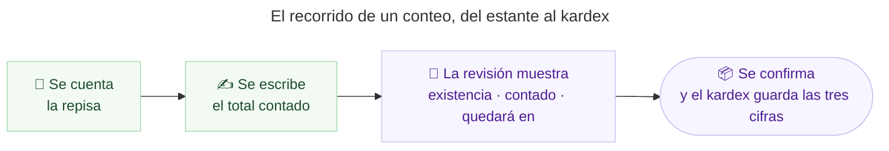
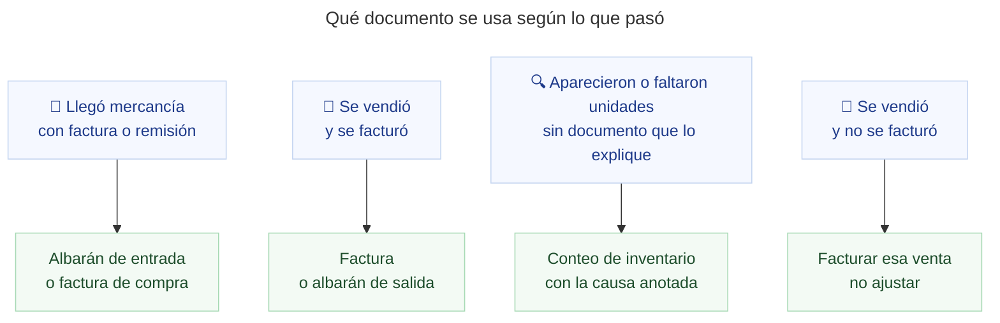

# Cómo se cuenta el inventario y se registra lo que hay

> **Se escribe lo que hay, no lo que sumas.** Cuentas la repisa, escribes el total contado y el sistema calcula la
> diferencia. El documento que genera se sigue llamando **ajuste de inventario (NTINV)** en listados, kardex y
> contabilidad: el menú dice lo que hace el operador, el documento qué es contablemente.

Contexto del módulo: cómo se mueve el inventario (interno: `docs/INVENTORY_MODULE.md`). Acceso y direcciones:
[00-acceso.md](00-acceso.md).

## 🧮 La regla única

Al pulsar **Revisar y registrar** la pantalla muestra, por línea y en total: **existencia en el sistema · cantidad
contada · quedará en · movimiento**, y avisa de que el inventario va a quedar en lo contado. El operador confirma ahí; no
resta ni suma nada a mano.



En el **albarán de entrada y de salida** hay una casilla marcada por defecto, *"Confirmar el albarán y mover inventario"*:
marcada, el inventario se mueve al guardar; desmarcada, el albarán queda **pendiente** y no lo toca hasta que se confirme.
Si es una salida y falta existencia, la revisión lo avisa en rojo y ADA la rechaza.

## 🧭 Si hay papel, va el documento



El conteo **no reemplaza** la facturación: escondería la venta y descuadraría la contabilidad.

## 🎬 Los tres conteos del arranque de un almacén

Producto nuevo creado desde el conteo (nombre, grupo y tipo; precio y costo opcionales):

| Escena | Existencia antes | Contado | Queda en | Movimiento |
|---|---|---|---|---|
| 1. Apertura: no hay nada sistematizado | 0 | 10 | 10 | +10 |
| 2. Aparecen 4 unidades más | 10 | 14 | 14 | +4 |
| 3. Auditoría un mes después | 14 | 12 | 12 | −2 |

- En la escena 2, si esas 4 unidades llegaron con factura o remisión, van por **albarán de entrada**, no por conteo.
- En la escena 3, si las 2 que faltan son una venta sin facturar, **se factura esa venta**; si no hay explicación
  documental, el conteo va con la causa anotada (merma, hurto, error de conteo, deterioro).

## 📋 Qué prueba QA

| # | Prueba | Se cumple si |
|---|---|---|
| 1 | Apertura con contado 10 | stock 10 y una fila de +10 en el kardex |
| 2 | Segundo conteo al alza (14) | stock 14, movimiento +4 y la existencia previa 10 visible en el documento |
| 3 | Conteo a la baja (12) | stock 12, movimiento −2 |
| 4 | Producto en negativo (−3) cargado por conteo 6 | stock 6, movimiento +9: el rechazo por “existencia insuficiente” era el error |
| 5 | Contado igual a la existencia | el documento se crea y no mueve inventario |
| 6 | Ajuste sin cantidad contada | la API lo rechaza con mensaje claro; la pantalla siempre la envía |
| 7 | Ajuste por encima de la existencia | nunca se rechaza: el conteo no valida existencia |
| 8 | Albarán de salida sin existencia | se rechaza con `CÓDIGO: se piden N y hay M disponibles` |
| 9 | Reporte de productos más comprados | el conteo **no** aparece como compra |
| 10 | Revisión antes de guardar | el primer botón no guarda; solo **Confirmar ajuste** crea el documento |
| 11 | Casilla del albarán | marcada mueve inventario; desmarcada queda pendiente y el stock no cambia |
| 12 | Confirmar desde la lista | el albarán pendiente pasa a *Pendiente facturar* y ahí sí mueve el inventario |

## 🔎 Por qué sirve en una auditoría

Cada línea guarda **las tres cifras**: existencia previa, cantidad contada y el movimiento aplicado al kardex. El
documento responde “¿por qué cambió el inventario?” sin depender de la memoria de nadie.

<details>
<summary><strong>Comprobar en la base (negocio de pruebas)</strong></summary>

```sql
-- stock y kardex del producto
select id, code, name, stock from inventory.product where code = 'FUN-SIL-NAV-UN';
select date, amount, document_type, support_number from inventory.kardex
 where product_id = (select id from inventory.product where code = 'FUN-SIL-NAV-UN') order by date desc;

-- lo que se contó en cada ajuste (una fila por línea)
select c.counted_amount, c.previous_stock, d.document_number
  from inventory.standard_document_detail_count c
  join inventory.standard_document_detail dt on dt.id = c.standard_document_detail
  join inventory.standard_document d on d.id = dt.owner_document
 order by c.id desc;
```

</details>

<details>
<summary><strong>Texto para el operador (copiar y pegar)</strong></summary>

```text
El ajuste de inventario se escribe con LO QUE HAY, no con lo que sumas.

Cuentas la repisa, escribes el total contado. El sistema te muestra:
  Existencia actual · Contado · Quedará en

1) Arranque: cuentas 10, ajuste con CONTADO = 10. Queda: antes 0, contado 10, movimiento +10.
2) Aparecen 4 más: cuentas 14, ajuste con CONTADO = 14. Queda: antes 10, contado 14, movimiento +4.
   Si esos 4 llegaron con factura o remisión, van por albarán de entrada, no por ajuste.
3) Al mes cuentas 12: ajuste con CONTADO = 12 y anotas la causa. Queda: antes 14, contado 12, movimiento -2.

El ajuste NO registra ventas (eso es factura o albarán de salida) ni compras (albarán de entrada o factura de compra).
Si la diferencia es una venta sin facturar, se factura esa venta.

En el albarán, la casilla "Confirmar el albarán y mover inventario" viene marcada:
si la dejas marcada, el inventario se mueve; si la desmarcas, el albarán queda pendiente
y no toca el inventario hasta que lo confirmes.
```

</details>

> [!WARNING]
> **DEPRECADO** — la nota de despliegue de la v1 (“aplica desde el despliegue del ajuste por conteo; antes el ajuste
> sumaba el número que se escribía”) se elimina cuando ningún negocio en operación use la versión anterior y todos los
> tenants tengan migrado el conteo (migración 273 en `db/migrations/applied/`).

**Última revisión:** 2026-11-19.
