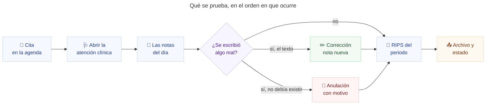
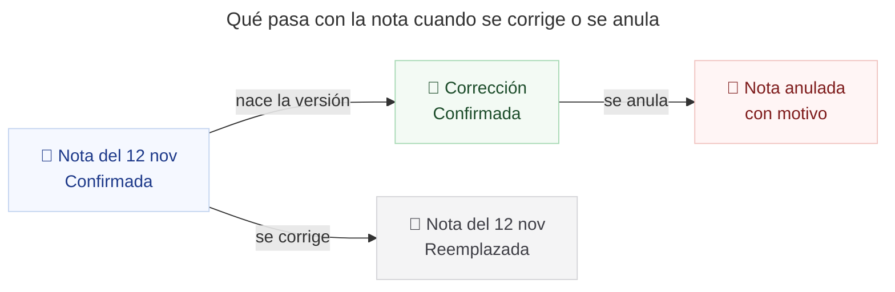

# E2E manual — Historia clínica y RIPS

La historia clínica es un documento legal, no un formulario: lo que se escribió no se borra ni se reescribe, se corrige o
se anula, y todo queda firmado. Sobre esa historia se arma el **RIPS** del periodo, que es el soporte de cobro de la
factura. Este recorrido prueba las dos cosas juntas. Antes: [cómo entrar](00-acceso.md) y el [índice de QA](INDEX.md).

> [!IMPORTANT]
> **Lo que este recorrido NO prueba: el envío contra el validador real del Ministerio.** El envío está hecho y se prueba aquí con
> lo que ADA puede comprobar solo (qué falta, qué queda guardado); que el validador **apruebe** el archivo y devuelva el CUV
> necesita credenciales SISPRO. Ver [lo que todavía no se prueba](#-lo-que-todavía-no-se-prueba).
>
> **Dos caminos, en este orden:** primero el profesional que **no factura electrónicamente** (Escenas 6 y 7), después el que **sí**
> factura electrónicamente (Escenas 8 a 10).

## ⚖️ La norma, y cómo la cumple el sistema

| Norma | Qué pide | Cómo lo cumple ADA |
|---|---|---|
| **Res. 1995 de 1999** (modificada por la **1715 de 2005**) | historia sin tachaduras ni enmendaduras, con la identificación de quien la escribe y la fecha, conservada en el tiempo | la nota guardada **no se reescribe**: corregirla crea otra que la reemplaza, anularla deja motivo, autor y fecha, y cada fila guarda quién la escribió y cuándo. Ninguna pantalla borra |
| **Res. 3100 de 2019** (habilitación) | registros propios de cada servicio —en odontología, odontograma y periodontograma— y consentimiento informado | cada registro tiene su tabla y su pantalla, y el consentimiento y los exámenes se adjuntan al paciente |
| **Res. 948 de 2026** (14-may-2026; **derogó la 2275 de 2023** y sus modificatorias 558 y 1884) | el RIPS viaja como JSON al validador del Ministerio, que devuelve el **CUV**; lo reportan también los profesionales independientes y quien no expide facturas (a diario como mínimo, y como máximo dentro de los 5 primeros días del mes siguiente) | el corte se genera con y sin factura, con su hash y su estado, y se descarga en JSON y CSV; se envía al validador por factura o, sin factura, por periodo |
| **Res. 2284 de 2023** | el RIPS es uno de los soportes de cobro de la factura | el corte guarda su archivo, su hash y su estado (generado, enviado, rechazado); la factura de cada atención se resuelve al generarlo |

Referencias: [Res. 1995 de 1999](https://normograma.supersalud.gov.co/compilacion/docs/resolucion_minsalud_r1995_99.htm) ·
[Res. 1715 de 2005](https://normograma.supersalud.gov.co/compilacion/docs/resolucion_minproteccion_1715_2005.htm) ·
[Res. 3100 de 2019](https://normograma.supersalud.gov.co/compilacion/docs/resolucion_minsaludps_3100_2019.htm) ·
[Res. 948 de 2026](https://www.minsalud.gov.co/sites/rid/Lists/BibliotecaDigital/RIDE/DE/DIJ/resolucion-0948-de-2026.pdf) ·
[Res. 2275 de 2023 (derogada)](https://www.suin-juriscol.gov.co/viewDocument.asp?id=30050861) ·
[Res. 2284 de 2023](https://www.alcaldiabogota.gov.co/sisjur/normas/Norma1.jsp?dt=S&i=152522)

### Qué guía técnica manda (esto cambia seguido y confunde)

| Documento | Estado | Para qué se usa |
|---|---|---|
| [Manual de consumo API Docker FEV-RIPS, **v4.3**](https://www.minsalud.gov.co/sites/rid/Lists/BibliotecaDigital/RIDE/DE/OT/manual-consumo-api-docker-fev-rips.pdf) | ✅ vigente | rutas, cuerpos y respuestas del validador: **manda para el envío** |
| [Documento técnico 1](https://www.minsalud.gov.co/sites/rid/Lists/BibliotecaDigital/RIDE/DE/OT/doc-tec1-tecnicas-datos-validacion-rips-fev-salud.pdf) (jul-2026) y los [ejemplos oficiales de la 948](https://www.minsalud.gov.co/sites/rid/Lists/BibliotecaDigital/RIDE/DE/OT/ejemplificaciones-estructura-resolucion-948-de-2026.zip) | ✅ vigente | campos y reglas del JSON: **manda para el contenido** |
| [Lineamientos de generación y validación del RIPS, v3.2 (mayo 2025)](https://www.minsalud.gov.co/sites/rid/Lists/BibliotecaDigital/RIDE/DE/OT/lineamientos-generacion-validacion-rips-factura-electronica-fev-doc-electronicos.pdf) | ⚠️ de la resolución **anterior** (2275); no trae los campos nuevos de la 948 | solo explicación; si contradice al Documento técnico 1, gana el Documento técnico 1 |

Más fuentes y hallazgos, con enlaces, en la sección 6 del plan (`ai-workspace/work/clinical-history-rips/plan.md`).

### Proyecto de resolución de MinSalud de 2026 (22-jul-2026)

Es un **proyecto**: deroga la Res. 1995 solo al publicarse; hoy rige la 1995. Se diseña para cumplir las dos. Texto guardado en
`ai-workspace/work/clinical-history-rips/fuentes/` y el cuadro completo, con estado por requisito, en
`ai-workspace/work/clinical-history-rips/plan.md` (sección «Cumplimiento de la norma»).

| Artículo | Qué pide | Cómo lo cumple ADA |
|---|---|---|
| 9 | identificación con sexo asignado al nacer, pertenencia étnica, discapacidad, responsable o acompañante con parentesco, EAPB | campos en la persona y en la pestaña Paciente; acompañante por atención y responsable, ambos con parentesco |
| 11 | cada registro con fecha, hora, diagnóstico y profesional | `recorded_at/by` los sella el servidor al **confirmar**; falta el cargo del profesional |
| 12 | sin enmiendas; en electrónico, trazar quién, cuándo y qué se modificó, conservando el original | corrección = nota nueva que reemplaza; una nota **confirmada no se modifica por ningún camino** (guarda en la entidad); la afiliación del día queda congelada |
| 13 | consentimiento como parte de la historia | anexo tipo consentimiento apuntando a la nota que cubre |
| 16 | conservar 15 años | nada confirmado se borra; solo se descarta un borrador, que aún no es historia |
| 26 | impedir modificar lo guardado, trazabilidad de accesos y consultas | lo primero sí; **el registro de accesos y consultas no existe todavía** (brecha conocida) |

### Estados de una nota

| Estado en pantalla | Estado guardado (`public.status`) | ¿Se edita? | ¿Es historia (lista, impresión, RIPS)? |
|---|---|---|---|
| **Borrador** | `CLINICAL_NOTE_DRAFT` | sí, solo su autor | no; solo lo ve su autor; se puede descartar |
| **Confirmada** | `CLINICAL_NOTE_CONFIRMED` | **nunca más** | sí; es la que va al RIPS |
| **Reemplazada** | (se deduce: confirmada con una versión posterior) | no | se ve en las versiones |
| **Anulada** | `CLINICAL_NOTE_VOIDED` | no | se ve marcada, con motivo y autor |

Jugadas legales (filas de `public.status_transition`, las valida `StatusMachine`): borrador → confirmada, y confirmada →
anulada **con motivo**. Nada vuelve a borrador. «Enviado al RIPS» **no es un estado de la nota**: es el estado del *corte*
(`RIPS Generated` → `RIPS Sent` / `RIPS Rejected`); una nota confirmada sigue confirmada aunque ya viaje en un corte enviado.
**Autoguardado:** en anamnesis, examen físico y evolución el diálogo guarda lo escrito como **Borrador** cada 30 s (interruptor «Autoguardar borrador», activo por defecto). El borrador aparece en la tabla solo para su autor, con **Continuar** y **Descartar borrador**; no sale en historia, impresión ni RIPS hasta pulsar «Guardar en la historia». **Dictado:** los textos libres tienen un micrófono (Chrome y Edge); pide confirmar una vez por sesión porque el navegador envía el audio a su servicio de voz.
La tabla de notas ofrece **solo** lo que su estado permite: Corregir y Anular solo en la confirmada vigente; consentimiento
solo en la confirmada vigente; Ver siempre.


## 🔁 El ciclo completo, de la cita al archivo



## 🧩 La nota guardada y sus versiones



Solo la **confirmada vigente** se corrige o se anula. La reemplazada se queda en la historia con su texto intacto, que es lo que un
auditor quiere poder leer.

## ✅ Antes de empezar

El menú **Sector médico** trae tres entradas: **Historia**, **Datos del prestador** y **Reportes RIPS** (los dos últimos abren los mismos diálogos que los botones de la lista de historias). **Salud y Bienestar** queda para el gimnasio.

| Necesitas | Detalle |
|---|---|
| Un paciente **con cliente vinculado** | la historia no se abre para alguien que no existe como cliente: se elige en la búsqueda de la primera pestaña |
| Un profesional (empleado) | queda como autor de cada nota y como profesional de la atención |
| Un servicio facturable con precio | es el procedimiento de la evolución y la línea que después viaja al RIPS |
| Una factura del periodo | solo para el modo **con factura electrónica** |
| Un servicio sin sus códigos | se completa en la sección **Salud (RIPS)** del formulario de producto (solo si el sector del negocio es salud; sale al crear el producto y al editarlo) o en el diálogo **Servicios del RIPS**: CUPS, código del servicio, si se reporta como consulta o procedimiento, grupo de servicios y modalidad. La clínica dental trae sus 246 servicios sembrados, solo falta el código del servicio y el precio |
| Los datos del prestador | menú **Sector médico → Datos del prestador** (o el botón del mismo nombre en la lista de historias): código de habilitación (REPS), tipo de prestador y el CUCON si atiende bajo contrato; el grupo de servicios y la modalidad se definen por servicio, en el producto |

### Prerrequisitos para enviar al validador del Ministerio (Escenas 7 y 9)

Solo para el envío real. Las demás escenas no los necesitan. Los tramita el **prestador como entidad** (representante legal o
administrador); no hace falta ser profesional de la salud. Quien sí debe serlo es quien firma las notas.

| # | Prerrequisito | Aplica a | Dónde se obtiene | Dónde se captura en ADA |
|---|---|---|---|---|
| 1 | Prestador inscrito en el **REPS**, con su código de habilitación | los dos | Registro Especial de Prestadores | *Datos del prestador* → código de habilitación |
| 1b | **MiSeguridadSocial** y, para el independiente, **Rethus** (para enviar RIPS) | los dos; Rethus solo el independiente | lámina oficial del Ministerio (mayo 2024, ver el plan, 6.10) | no se captura en ADA |
| 2 | **Usuario y clave SISPRO** | los dos | [web.sispro.gov.co](https://web.sispro.gov.co) (Art. 18 de la Res. 948) | *Validador del Ministerio* → usuario y clave (cifrada) |
| 3 | **Tipo de usuario** `RE` | solo el profesional independiente que **no** factura electrónicamente | se deduce: tipo de prestador *profesional independiente* y envío sin factura | no se captura |
| 4 | **Dirección del validador** (la de pruebas o la de producción) | los dos | micrositio de [facturación electrónica en salud](https://www.sispro.gov.co/central-financiamiento/Pages/facturacion-electronica.aspx) | *Validador del Ministerio* → dirección |
| 5 | **Códigos de cada servicio**: CUPS, código del servicio y si se reporta como consulta o procedimiento | los dos | tablas del Ministerio (CUPS y códigos de servicio) | botón **Servicios del RIPS** (son del servicio, no del prestador) |
| 6 | **Grupo de servicios y modalidad** | los dos | los define cada servicio (listas del Ministerio) | sección *Salud (RIPS)* del producto y diálogo *Servicios del RIPS* |
| 6b | **Finalidad, causa, tipo de diagnóstico, vía de ingreso, concepto de recaudo, valor pagado e incapacidad** | los dos | son de cada atención (listas oficiales de SISPRO) | en la evolución de tipo atención, junto al diagnóstico principal |
| 6c | **Sector del negocio = Salud** | los dos | lo elige el prestador; el módulo médico lo marca al activarse | *Perfil de la empresa → Editar → Sector del negocio*; activa la sección de salud del producto |
| 6a | **Municipio, país y zona (urbana o rural) de residencia** | los dos | ficha del paciente | pestaña Paciente: ciudad, país y residencia. La atención los **congela al guardarse**: si el paciente se muda, la atención de ayer sigue con la dirección de ayer |
| 6b | **Fecha de nacimiento, sexo y municipio** del paciente | los dos | ficha del paciente | pestaña Paciente |
| 7 | **Facturación electrónica habilitada** con la DIAN y facturas aceptadas | solo quien **sí** factura electrónicamente | ya existe en ADA | no aplica |

⚠️ Un negocio que no sea un prestador de salud real no tiene REPS ni usuario SISPRO. Para probar el envío hace falta un prestador
real o el contenedor de pruebas del Ministerio (en preparación, ver el plan).

Para probar la **cita que abre la atención**, el negocio tiene que tener el puente prendido (nace apagado):

```sql
update public.company_profile set clinical_from_diary_enabled = true where id = 1;
```

## Escena 1 — La cita abre la atención

*Agenda → cita del día → **Abrir atención clínica***.

| # | Acción | Esperado |
|---|---|---|
| 1 | Abrir una cita del día y pulsar **Abrir atención clínica** | se abre la historia del paciente de la cita, con una evolución del día a nombre del profesional |
| 2 | Cerrar y pulsar otra vez el mismo botón | **no se duplica**: vuelve a la misma atención |
| 3 | Abrir una cita de un paciente que no tiene historia | la historia se abre vacía, con el paciente ya vinculado |

## Escena 2 — Escribir las notas del día

*Historia clínica → paciente → **Editar***. El diálogo tiene tres pestañas, en el orden en que se usan: **Paciente**
(identificación, ubicación, datos sociales y de salud, afiliación y persona responsable), **Historia** (todas las notas en una
sola lista) y **Anexos**. En **Historia**, *Nueva nota* ofrece los botones en el orden en que se atiende a quien llega:
**anamnesis** (lo que cuenta), **examen físico**, **odontograma y periodontograma** (lo que se encuentra) y **evolución**
(lo que se hace).

| # | Acción | Esperado |
|---|---|---|
| 1 | Abrir la pestaña **Paciente** | cuatro tarjetas: Identificación, Ubicación y contacto, Datos sociales y de salud, Afiliación; la persona responsable plegada. Se ve **Sexo asignado al nacer**, Pertenencia étnica y Certificado de discapacidad. Ningún texto sale como una clave |
| 2 | Llenar la anamnesis y pulsar **Guardar en la historia**; confirmar | la nota aparece en la lista al instante; cerrar la ficha sin pulsar «Guardar ficha» y reabrir: sigue ahí, con su fecha y su profesional |
| 3 | Registrar el odontograma y el periodontograma | cada uno queda como su propio registro, con su fecha |
| 4 | **Evolución**: elegir el procedimiento, abrir **Acompañante de esta atención** y escribir documento, nombres y parentesco | la línea **Afiliación en esta atención** muestra la del paciente hoy; al confirmar **Guardar en la historia**, la nota aparece en la lista |
| 5 | Cambiar la afiliación del paciente (pestaña Paciente) y abrir la evolución de la fila 4 | la evolución **sigue diciendo la afiliación de ese día** y conserva a su acompañante con el parentesco |
| 6 | Cerrar el diálogo **sin** guardar una nota nueva | la nota nueva **no** existe al reabrir |

Si el acompañante ya existe como persona, al salir del campo del documento el bloque toma sus datos; si no existe, lo que se
escribió se guarda como persona nueva.

## Escena 2b — La evolución guarda cada dato en su campo

*Historia → **Evolución*** (antes la causa externa y la vía de realización se guardaban en el mismo campo que la finalidad y se pisaban).

| # | Acción | Esperado |
|---|---|---|
| 1 | Elegir una **finalidad**, una **causa externa** y una **vía de realización** distintas y guardar | al reabrir la nota (Ver) cada selector muestra su propio valor, no el último elegido |

## Escena 3 — Corregir sin borrar

*Historia clínica → paciente → pestaña **Historia** → elegir la fila de la nota*.

| # | Acción | Esperado |
|---|---|---|
| 1 | Seleccionar una evolución y pulsar **Editar** en la lista | el botón del diálogo dice **Guardar la corrección**, no "Agregar" |
| 2 | Cambiar el texto y guardar | la tabla de versiones muestra dos filas: la original **Reemplazada** y la nueva **Vigente** |
| 3 | Reabrir la historia y leer la nota original | **conserva el texto viejo y su afiliación**: no se reescribió |
| 4 | Seleccionar la versión reemplazada y volver a corregirla | se rechaza con el mensaje de que solo se corrige la vigente |
| 5 | Mirar la versión nueva | **hereda la afiliación y el acompañante** de la nota que reemplaza, no los de hoy |

## Escena 4 — Anular con motivo

*Pestaña **Historia** → elegir la fila → **Anular la nota seleccionada***.

| # | Acción | Esperado |
|---|---|---|
| 1 | Sin motivo, pulsar **Anular la nota seleccionada** | no deja: la anulación exige un motivo escrito |
| 2 | Escribir el motivo y anular | la nota queda en la historia marcada **Anulada**, con el motivo en rojo, quién y cuándo |
| 3 | Intentar anular la versión reemplazada de la escena 3 | se rechaza: solo la vigente se anula |
| 4 | Generar el RIPS de ese periodo | la nota anulada **no** aparece en el archivo |

## Escena 5 — Consentimiento y anexos

*Historia clínica → paciente → pestaña **Anexos*** (los adjuntos son de la persona, no del módulo clínico).

| # | Acción | Esperado |
|---|---|---|
| 1 | Abrir **Historia** de un paciente sin consentimiento | un aviso naranja dice que no hay consentimiento informado adjunto, con el botón **Adjuntar consentimiento** |
| 2 | Elegir una nota y pulsar **Adjuntar consentimiento** | salta a **Anexos** con el tipo *Consentimiento* elegido |
| 3 | Adjuntar un PDF (menos de 8 MB) | se guarda, se lista con su nombre, quién lo adjuntó y en la columna **Cubre** el tipo de la nota; el aviso desaparece |
| 4 | Adjuntar otro desde **Anexos** sin elegir nota | queda como consentimiento **general** de la persona: la columna **Cubre** va vacía |
| 5 | Adjuntar un `.zip`, o un archivo de más de 8 MB | se rechaza en el servidor: solo PDF, JPG, PNG o TIFF hasta 8 MB |
| 6 | Escribir la ocupación y elegir el grupo sanguíneo (pestaña Paciente) y **Guardar ficha del paciente** | al reabrir, los dos valores siguen ahí, y solo existen en la persona |

## Escena 5b — Cada rol ve su área

*Seguridad → Roles → permisos del rol sobre la lista de historias clínicas.* Hay seis permisos nuevos: *Historia clínica: datos
del paciente · anamnesis · examen físico · odontograma y periodontograma · evolución y procedimientos · anexos y consentimientos*.
El día del despliegue todo rol que ya abría la lista los recibe todos; el dueño quita los que no correspondan.

| # | Acción | Esperado |
|---|---|---|
| 1 | Quitar *anamnesis* a un rol y entrar con un usuario de ese rol | no aparece el botón **Anamnesis** ni sus filas en la lista |
| 2 | Quitar *anexos y consentimientos* | la pestaña **Anexos** y el botón **Adjuntar consentimiento** no se pintan |
| 3 | Quitar *datos del paciente* | la pestaña **Paciente** no se pinta y el diálogo abre en **Historia** |
| 4 | Intentar la acción escondida (por ejemplo desde una pantalla abierta antes del cambio) | el servidor la rechaza con «No tiene acceso a esta área de la historia clínica» |

## Escena 5c — Anexos: ver, descargar y filtrar

*Paciente guardado → pestaña **Anexos***. El botón **Periodontograma (archivo)** de la pestaña Historia es otra cosa: crea una nota de periodontograma con el archivo; los consentimientos, radiografías y exámenes se cargan aquí.

| # | Acción | Esperado |
|---|---|---|
| 1 | Elegir tipo **Radiografía o imagen**, escribir un título y cargar un JPG | aparece en la tabla con fecha y hora de carga, tipo, título y quién lo cargó |
| 2 | Cargar un PDF como **Consentimiento** | aparece como Consentimiento; el aviso de consentimiento faltante desaparece |
| 3 | Pulsar **Ver** en el PDF | se abre en un visor sobre la pantalla, con el título del anexo |
| 4 | Pulsar **Ver** en el JPG | se muestra la imagen |
| 5 | Cargar un TIFF y pulsar **Ver** | dice que ese tipo no se muestra y que se descargue |
| 6 | Pulsar el icono de descarga | baja el mismo archivo con su nombre |
| 7 | Filtrar por **Tipo**, por parte del **título** y por quién lo cargó | la tabla se acota igual que la de notas; con 9 anexos o más, pagina |
| 8 | Entrar con un rol sin el permiso de anexos | no ve la pestaña; si abre la acción escondida, el servidor la rechaza |

## Camino A — Profesional que no factura electrónicamente

## Escena 6 — Armar y descargar el RIPS sin factura

*Historia clínica → botón **RIPS** → modo **Sin factura***. Antes: haber confirmado al menos dos notas de atención del mismo mes, con
profesionales distintos.

| # | Acción | Esperado |
|---|---|---|
| 1 | Elegir el periodo y pulsar **Generar RIPS** | el corte aparece en la lista en estado **Generado**, con registros, y el JSON se descarga solo |
| 2 | Abrir el JSON | trae el NIT del prestador, el documento de cada paciente y la fecha de cada atención |
| 3 | Pulsar **CSV** en la fila | baja una tabla de lectura, una fila por servicio (no es un formato oficial: el RIPS es el JSON). El documento de la fila es el del paciente |
| 4 | Elegir un **profesional** y generar de nuevo | el archivo solo trae a sus pacientes; el nombre del archivo termina en `-filtrado` |
| 5 | Escribir parte del **nombre o del documento** de un paciente en *Paciente* y generar | solo trae a ese paciente |
| 6 | Elegir una **sede** y generar | solo trae atenciones registradas por usuarios con caja de esa sede; las atenciones anteriores a la sede no salen aquí, solo en *Todos* |
| 7 | Dejar **Sede**, **Profesional** y **Paciente** en *Todos* | vuelve el corte completo del periodo |
| 8 | Generar un periodo **sin atenciones**, o con un filtro que no encuentra nada | no genera archivo vacío: dice que no hay atenciones |
| 8b | Generar con una atención a la que le falta algo (zona, país, diagnóstico, CUPS…) | no genera un archivo a medias: dice qué falta |
| 8c | Abrir el JSON y comprobar un ítem de consulta y uno de procedimiento | cada ítem sale una sola vez, como consulta o como procedimiento según lo definido en su servicio, y la suma de los valores es la de la atención |
| 9 | Pulsar **Servicios del RIPS**: aparecen los servicios usados en atenciones, los incompletos primero con ⚠. Completar CUPS, código del servicio y consulta o procedimiento de uno y **Guardar** | el servicio pasa a ✔; el archivo siguiente trae sus códigos |
| 10 | Generar de nuevo después de que ese corte quedó **Enviado** (Escena 10) | ya no repite las atenciones reportadas |

## Escena 7 — Enviar el RIPS sin factura al validador

*Antes:* en **Datos del prestador → Validador del Ministerio**, dirección del validador, usuario (tipo de documento del catálogo, el mismo del perfil de la empresa y del cliente) y clave SISPRO (el tipo de usuario `RE`
se deduce). Misma pantalla del RIPS.

| # | Acción | Esperado |
|---|---|---|
| 1 | Con el validador sin configurar, pulsar **Enviar al validador (RIPS sin factura)** | dice «Falta configurar el validador» y no llama a nada |
| 2 | Configurado pero con un dato del paciente incompleto (sin fecha de nacimiento, por ejemplo) | el corte queda **Generado** con «Falta para el RIPS: fecha de nacimiento de…» y no se llama al validador |
| 3 | Con todo completo, pulsar el botón | con credenciales reales: estado **Enviado** y el **CUV**. Sin ellas, hasta aquí llega la prueba |
| 4 | Si el validador rechaza | estado **Rechazado** con las reglas incumplidas; se corrige el dato y se pulsa otra vez |
| 5 | Con el validador apagado | el corte queda **Generado** con el error y los intentos; no cuenta como rechazo |
| 6 | Pulsar de nuevo después de un envío aprobado | «No hay atenciones sin factura por reportar»: las atenciones enviadas no se reenvían |
| 7 | Atender a un paciente que **sí tiene una factura electrónica aceptada** en el periodo y enviar sin factura | esa atención **no** entra: va con su factura (Camino B) |
| 8 | Atender a un paciente con una factura de **tiquete normal** (no electrónica) y enviar sin factura | esa atención **sí** entra |

## Camino B — Profesional que sí factura electrónicamente

## Escena 8 — Con factura: buscar las facturas del periodo

*Mismo diálogo → modo **Con factura electrónica** → **Buscar facturas***.

| # | Acción | Esperado |
|---|---|---|
| 1 | Elegir periodo y pulsar **Buscar facturas** | tabla con las facturas electrónicas **aceptadas** de los pacientes que tuvieron atenciones: factura, fecha, paciente, estado del RIPS (*Sin enviar* al comienzo) y CUV |
| 2 | Aplicar sede, profesional o paciente y volver a buscar | solo salen las facturas de esos pacientes |
| 3 | Escribir en el filtro de la columna **Factura** o **Paciente** | la tabla se acota |
| 4 | Comprobar que en este modo **no aparece** el botón **Generar** | con factura el RIPS se arma por factura; el corte del periodo es solo sin factura |

## Escena 9 — Con factura: enviar y reenviar

*Antes:* los prerrequisitos 1, 2, 4, 5, 6, 6b y 7. Facturar electrónicamente una atención y esperar la aceptación de la DIAN.

| # | Acción | Esperado |
|---|---|---|
| 1 | Revisar la tabla después de la aceptación | nada se envía solo: la factura sale *Sin enviar* |
| 2 | Pulsar el icono de envío de una fila | con datos completos: **Enviado** y el **CUV**; con datos incompletos: dice qué falta y no llama al validador |
| 3 | Marcar varias filas y pulsar **Enviar seleccionadas** | cada factura dice cómo le fue (enviada, o qué falta) |
| 4 | Si el validador rechaza | la fila queda **Rechazado**; el icono sigue disponible para **reenviar** cuando se corrija el dato |
| 5 | Una factura enviada | muestra su CUV y ya no tiene icono de envío |

## Escena 10 — Registrar el envío manual (cortes de periodo)

Para quien descargó el archivo y lo subió a mano al validador. *En la lista de cortes, icono **Registrar envío manual** (solo cortes de periodo sin CUV).*

| # | Acción | Esperado |
|---|---|---|
| 1 | Pulsar **Registrar como enviado** sin escribir el CUV | no deja: pide el CUV que dio el validador |
| 2 | Escribir el CUV y registrar | el corte pasa a **Enviado** con su CUV, y las atenciones que cubría (periodo y filtros con que se generó) quedan reportadas |
| 3 | En otro corte, escribir un motivo y pulsar **Registrar rechazo** | queda **Rechazado** con el motivo visible; las atenciones siguen sin reportar |
| 4 | Un corte ya enviado | no vuelve a ofrecer el registro |

## 🚫 Lo que todavía no se prueba

| Pieza | Estado | Qué falta |
|---|---|---|
| Aprobación por el validador real y el CUV | hecho, **sin probar** | credenciales SISPRO, o el contenedor de pruebas del Ministerio (en preparación: falta SQL Server y un certificado) |
| Respuesta del validador, campo del token del login, gzip | leídos del manual 4.3 | los confirma el contenedor |
| Códigos de finalidad y causa **desde la atención** | ⚠️ las listas de la atención son antiguas y no traen el código del RIPS | decidir el mapeo con los códigos oficiales; por ahora salen del prestador |
| **Consulta o procedimiento** | ✅ cada ítem facturado sale como consulta (`AC`) o procedimiento (`AP`) según lo que el profesional definió en el servicio (columna «Se reporta como») | un servicio sin ese dato no viaja: el RIPS dice cuál es |
| Si el profesional **debe** facturar electrónicamente | sin verificar | lo confirma la normativa de la DIAN, no la Res. 948 |
| **CUCON** (contrato registrado en el SIIFA) | no está en ADA | leer el artículo 9 de la Res. 948 y el Documento técnico 2 |
| Notas crédito y débito, cápita, atención corregida después de reportada | no implementados | trabajo aparte |
| Retención de 20 años | asegurada por diseño | ninguna pantalla borra una nota; el respaldo es del entorno |

## Si un paso no da lo esperado

Se detiene ahí y se reporta con los seis datos del [índice de QA](INDEX.md#si-un-paso-no-da-lo-esperado): flujo y paso,
qué hiciste, qué esperabas, qué pasó, captura y hora, y el negocio y usuario usados. Un paso fallido arrastra los
siguientes, así que no se sigue.
