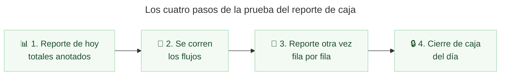

# Comprobar que el reporte de caja cuadra

> **Heredado (2026-11).** Este flujo es anterior al estándar de QA: se conserva como checklist de regresión y se
> corre tal cual. Si lo reescribes, usa [guia-produccion-etapas.md](guia-produccion-etapas.md) como molde y cámbialo en
> el [índice](README.md).

> **La caja es el dinero real del día, venga del módulo que venga.** Se mira por caja y por rango de fechas, y cada
> movimiento tiene que salir **una sola vez**.

Paso 0, siempre: [00-acceso.md](00-acceso.md). Qué flujos probar y en qué orden: [README de QA](README.md).

## 🗺️ La prueba, en cuatro pasos

## 🧭 De dónde puede venir un movimiento

Cada origen se prueba en su flujo; aquí está lo que el reporte tiene que mostrar.

| Origen | Se prueba en | Signo | Etiqueta |
|---|---|---|---|
| Venta | [inventario y facturación](e2e-happy-path-inventario-facturacion.md), pasos 3 y 4 | Entrada | Ventas |
| Rectificativa (devolución de una venta) | mismo flujo, paso 6 | Salida | Devoluciones |
| Anticipo o abono de separado, abono de cartera | [separados y cartera](e2e-cartera-separados.md), 1.1, 1.4 y 3.3 | Entrada | Recibos |
| Devolución al cancelar un separado | separados y cartera, 2.3 | Salida | Devoluciones |
| Compra pagada de contado | [compras y cuentas por pagar](e2e-compras-cuentas-por-pagar.md), 2.1 | Salida | Compras de contado |
| Abono a proveedor | compras, 3.1 | Salida | Pago a proveedores |
| Reverso de un abono a proveedor | compras, 3.3 | Entrada | Pago a proveedores |
| Devolución de compra | compras, 4.3 | Entrada, en la **caja elegida al devolver** | Devoluciones de compra |
| Reembolso del proveedor | compras, 4.4 | Entrada | Reembolsos de proveedores |
| Cruce de saldo a favor | compras, 4.6 | **No aparece**: no mueve dinero | — |

## 📏 Cuatro reglas que se comprueban

1. **La caja es la del día en que se mueve el dinero**, no la del documento. Una devolución de una compra de hace un
   mes entra hoy, en la caja elegida hoy.
2. **De una compra, sólo lo pagado de contado** mueve caja; lo que estaba a crédito reduce la deuda o deja saldo a favor.
3. **Un medio distinto del efectivo** (transferencia, tarjeta, bono) también es movimiento de caja: cambia lo que el
   cajero entrega físicamente (el comprobante en vez del efectivo), no si aparece.
4. **Cada movimiento sale una sola vez:** una compra mixta no duplica su parte de contado ni su parte a crédito.

## ✅ El paso a paso

1. **Antes.** Genera el reporte de la Caja A para hoy y anota los totales (si ya había movimientos previos).
2. **Ejecuta.** Corre los bloques de la tabla de arriba, anotando el monto de cada operación.
3. **Compara.** Genera el reporte otra vez y revisa fila por fila contra lo anotado. Tiene que cuadrar:
   - cada operación con su etiqueta y su signo, y el total por medio de pago igual a la suma de las operaciones;
   - **sin** el cruce de saldo a favor ni la parte a crédito de una compra mixta;
   - un rango de fechas sin movimientos muestra *“No hay información para el reporte con los filtros elegidos”*.
4. **Cierra.** Haz el cierre de la Caja A. Tiene que incluir todos los movimientos del día, cuadrar los totales por
   medio de pago y generar el comprobante sin error.

## ⚠️ Si algo no cuadra

| Síntoma | Causa probable | Qué hacer |
|---|---|---|
| Una operación de hoy no aparece | se está mirando otra caja o un rango que no incluye hoy | elige la caja con la que se cobró y el rango de hoy |
| Aparece la parte a crédito de una compra mixta | el movimiento se está leyendo por documento y no por dinero | reportarlo: sólo lo pagado mueve caja |
| Un cruce de saldo a favor aparece como movimiento | se está contando un pago que no existió | reportarlo: el cruce no mueve caja |

**Última revisión:** 2026-11-19.
