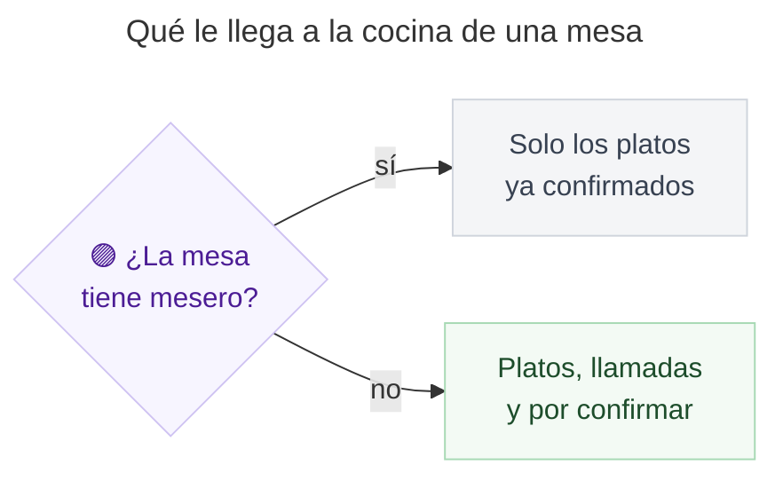
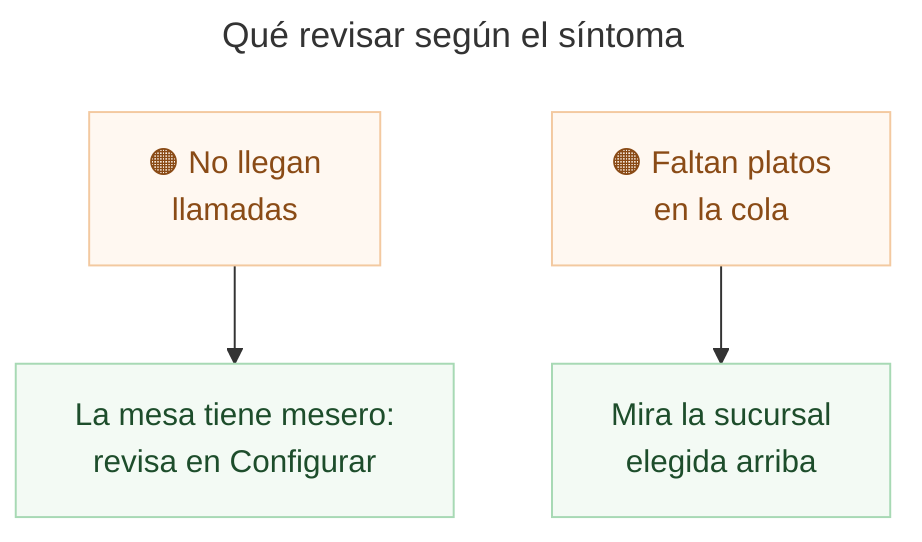

# Probar lo que hace la cocina

> **Prepara, avisa y responde lo que nadie más atiende.** Pantalla **Cocina**, con permiso `KITCHEN` y **sin** permiso
> de mesas. Las direcciones, en [00-acceso.md](00-acceso.md). Antes: lo que deja listo [el dueño](e2e-restaurante-dueno.md).

## 🧰 Antes de empezar

| Necesitas | Para qué escena |
|---|---|
| Mesa A con mesero y mesa B sin mesero | K-05 a K-10 |
| Un teléfono (o ventana privada) con el enlace de cada una | K-05 a K-10 |
| Dos sucursales con una mesa del mismo nombre | K-11 |

## 🔥 La cola

| # | Haz | Debe pasar | ✔ |
|---|---|---|---|
| K-01 | Un mesero envía una ronda | Aparece una tarjeta **por pedido**, con sonido, en máximo 5 segundos | ☐ |
| K-02 | **Empezar** y luego **Listo** en cada plato | La tarjeta pasa a *Listos para servir* | ☐ |
| K-03 | Pliega una tarjeta y espera la siguiente lectura | Sigue plegada, con el resumen de platos | ☐ |
| K-04 | Corta la red un momento | *Sin conexión*; se conserva lo último y se recupera solo | ☐ |

## 🔔 Mesas sin mesero

| # | Haz | Debe pasar | ✔ |
|---|---|---|---|
| K-05 | Llama al mesero desde **B** | *Mesa B llama* en Cocina y en Mesas | ☐ |
| K-06 | Llama desde **A** | **No** aparece ni suena en Cocina | ☐ |
| K-07 | **Atendido** en la llamada de B | Se quita de Cocina y de Mesas | ☐ |
| K-08 | El comensal pide desde B y la cocina **Confirma** | Entra a la cola y la mesa queda **sin mesero** | ☐ |
| K-09 | Vuelve a llamar desde B | Sigue llegando a Cocina | ☐ |
| K-10 | El comensal pide desde A | **No** aparece en Cocina; sí en Mesas | ☐ |

## 🏬 Sucursales y agotados

| # | Haz | Debe pasar | ✔ |
|---|---|---|---|
| K-11 | Elige **Todas las sucursales** | Cada tarjeta y llamada dice su sucursal | ☐ |
| K-12 | Cambia a una sola | La cola se vuelve a leer sin sonar como pedido nuevo | ☐ |
| K-13 | **Marcar agotado** un plato, con hora y motivo | En la carta del mesero, el aviso cabe en la tarjeta en un renglón; en la de la mesa sale agotado y no se puede pedir | ☐ |
| K-14 | **Disponible ya** | Se vuelve a pedir | ☐ |

## 🩺 Si algo falla

El agotado en el catálogo público, con prueba automática, en
[aprobación y plato agotado](e2e-restaurante-aprobacion-y-agotado.md). Las escenas de esta página son manuales.

**Dueño del documento:** equipo de restaurante. **Última revisión:** 2026-11-25.
