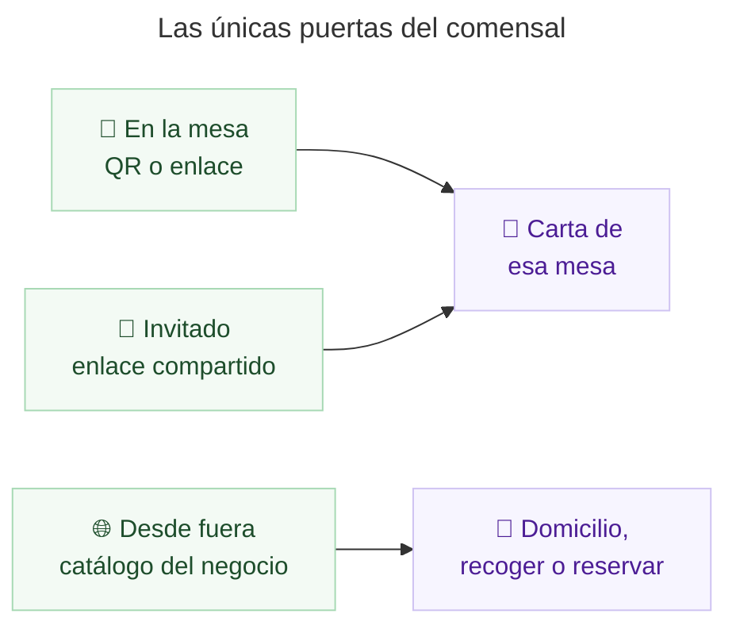
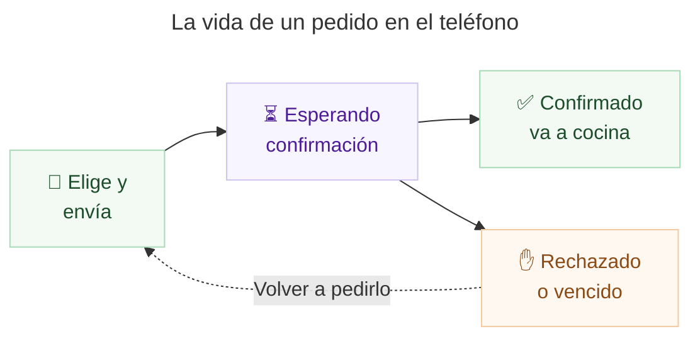
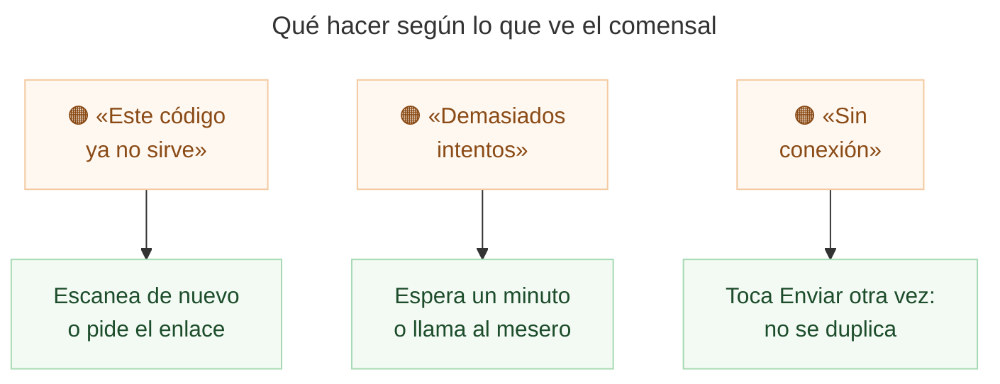

# Probar lo que hace el comensal

> **Sin cuenta ni contraseña.** En la mesa entra con el QR o el enlace; desde su casa, con el catálogo. Se prueba en un
> teléfono. Antes: [el dueño](e2e-restaurante-dueno.md) enciende *Pedir desde la mesa* y entrega el QR.

## 🚪 Entrar

| # | Haz | Debe pasar | ✔ |
|---|---|---|---|
| C-01 | Escanea el QR de una mesa libre | Nombre de la mesa, negocio, sucursal y carta | ☐ |
| C-02 | Busca en el catálogo cómo pedir «desde el restaurante» | **No existe** esa opción ni una lista de mesas | ☐ |
| C-03 | Cambia o inventa letras al final del enlace | «Este código ya no sirve» | ☐ |

## 🍽️ Pedir en la mesa

| # | Haz | Debe pasar | ✔ |
|---|---|---|---|
| C-04 | **Agregar** dos platos, una nota, tu nombre y **Enviar pedido** | *Enviado. Esperando que lo confirmen* | ☐ |
| C-05 | Envía sin escribir tu nombre | El botón no deja enviar | ☐ |
| C-06 | Con uno en espera, arma otro | *Espera a que confirmen tu pedido anterior* | ☐ |
| C-07 | El local confirma | *Confirmado*, con el estado de cada plato | ☐ |
| C-08 | El local rechaza | Se lee el motivo y aparece **Volver a pedirlo** | ☐ |
| C-09 | Nadie responde en 10 minutos | *Nadie alcanzó a confirmarlo* | ☐ |
| C-10 | Mira un plato agotado | Dice **Agotado** y no se puede agregar | ☐ |

## 🔔 Llamar al mesero

| # | Haz | Debe pasar | ✔ |
|---|---|---|---|
| C-11 | **Llamar al mesero** sin haber pedido | *Ya avisamos al mesero*; no se puede repetir | ☐ |
| C-12 | El local marca *Atendido* | *Ya te atendieron*; a los 2 minutos se puede llamar otra vez | ☐ |

## 👥 Compartir la mesa

| # | Haz | Debe pasar | ✔ |
|---|---|---|---|
| C-13 | Antes de tener un pedido confirmado | **No** aparece *Compartir la mesa* | ☐ |
| C-14 | Con uno confirmado, **Compartir la mesa → Enviar enlace** | Se comparte un enlace distinto al de la mesa | ☐ |
| C-15 | Ábrelo en otro teléfono y pide | Dice quién compartió; no puede llamar ni volver a compartir | ☐ |
| C-16 | Mira el teléfono de quien compartió | Ve ese pedido con *Pidió …, con tu enlace* | ☐ |
| C-17 | Se cobra la mesa y se reabre el enlace compartido | «Este código ya no sirve» (también a las 3 horas) | ☐ |

## 🚧 Cuando la mesa no recibe pedidos

La carta se ve igual; solo cambia el aviso.

| # | Situación | Aviso que debe salir | ✔ |
|---|---|---|---|
| C-18 | La mesa ya pidió la cuenta | *Esta mesa ya pidió la cuenta* | ☐ |
| C-19 | Está en la franja de una reserva | *Esta mesa está reservada* | ☐ |
| C-20 | El local la silenció | *No puede pedir desde el teléfono en este momento* | ☐ |
| C-21 | El local apagó *Pedir desde la mesa* | *Aquí no se está pidiendo desde el teléfono* | ☐ |

## 🛵 Desde fuera del local

| # | Haz | Debe pasar | ✔ |
|---|---|---|---|
| C-22 | Pide a domicilio desde el catálogo | Queda esperando aprobación y entrega el enlace de seguimiento | ☐ |
| C-23 | Envía un cuarto pedido con **el mismo teléfono** y tres en espera | Lo rechaza y pide esperar respuesta | ☐ |
| C-24 | Rechazan tres y envías otro | Lo acepta: los rechazados no cuentan | ☐ |
| C-25 | Reserva mesa desde el catálogo | Aparece en *Mesas → Reservas* de su sucursal | ☐ |
| C-26 | Con dos sucursales, mira un servicio con sucursal en el catálogo | La tarjeta dice dónde se atiende | ☐ |

## 🩺 Si algo falla

El carrito y la aprobación del pedido del catálogo, en
[aprobación y plato agotado](e2e-restaurante-aprobacion-y-agotado.md). Las escenas de esta página son manuales.

**Dueño del documento:** equipo de restaurante. **Última revisión:** 2026-11-25.
