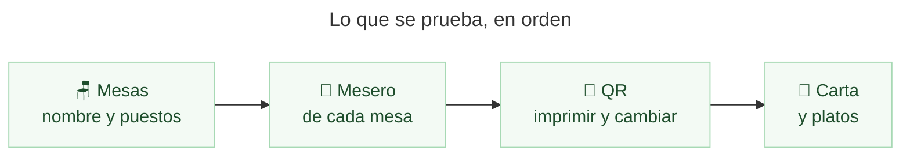
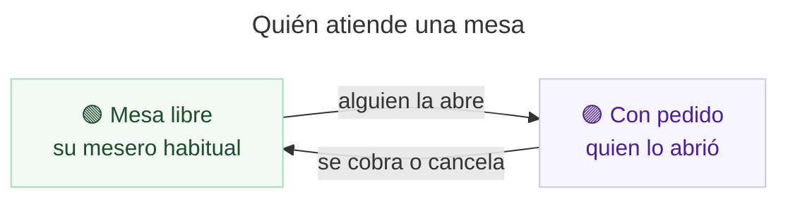
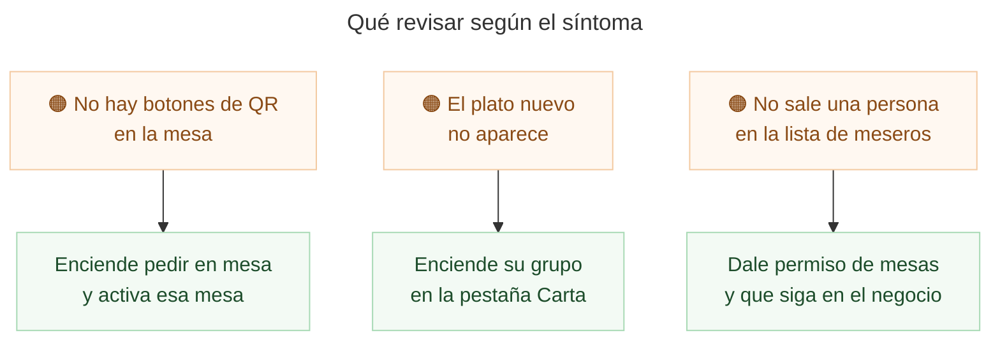

# Probar lo que hace el dueño del restaurante

> **Deja el local listo para vender.** Mesas, meseros, QR y carta, en **Configurar**. Entra con permiso de
> configuración (`TABLE_ADMIN`); las direcciones, en [00-acceso.md](00-acceso.md).
>
> Se prueba **antes** que [mesero](e2e-restaurante-mesero.md), [cocina](e2e-restaurante-cocina.md) y
> [comensal](e2e-restaurante-comensal.md): ellos usan lo que aquí queda creado.

## 🧰 Antes de empezar

| Necesitas | Para qué escena |
|---|---|
| Dos sucursales | D-12 a D-14 |
| Dos usuarios que atiendan mesas (`TABLE_SERVICE`) | D-04 a D-06 |
| Un grupo de productos con platos y precio | D-10 a D-13 |

## 🪑 Mesas · pestaña «Mesas y QR»

| # | Haz | Debe pasar | ✔ |
|---|---|---|---|
| D-01 | **Nueva mesa** con nombre, número y puestos | Aparece en la lista como *Activa* | ☐ |
| D-02 | Crea otra con el **mismo nombre** en la misma sucursal | La rechaza y dice por qué | ☐ |
| D-03 | Apaga *Activa* en una mesa | Queda *Inactiva* aquí y **desaparece de Mesas**; no se borra | ☐ |

## 👤 Mesero de cada mesa

| # | Haz | Debe pasar | ✔ |
|---|---|---|---|
| D-04 | En **Mesero** de la mesa A escribe dos letras y elige | Ofrece solo quienes coinciden; aviso con mesa y nombre; al recargar se conserva | ☐ |
| D-05 | **Limpiar** el mesero de la mesa B | Aviso «quedó sin mesero» | ☐ |
| D-06 | Retira del negocio al mesero de A | A dice *Ya no atiende mesas* y cuenta como sin mesero | ☐ |
| D-15 | Crea o invita en **Usuarios** a alguien con permiso de mesas y marca **Dar de alta como empleado** | Aparece en el buscador de **Mesero**, con el horario de la empresa | ☐ |
| D-17 | Lo mismo **sin marcar** la casilla | No queda como empleado y no aparece en el buscador | ☐ |
| D-16 | Marca **inactivo** a ese empleado | Ya no se ofrece; su mesa dice *Ya no atiende mesas* | ☐ |

## 🔳 QR de las mesas

| # | Haz | Debe pasar | ✔ |
|---|---|---|---|
| D-07 | Enciende **Pedir desde la mesa** | Cada mesa activa muestra *Imprimir QR*, *Copiar enlace* y *Cambiar QR* | ☐ |
| D-08 | **Imprimir QR** de una mesa, y luego *Imprimir todos* | El PDF se abre **en la misma pantalla**; cuatro tarjetas por hoja | ☐ |
| D-09 | **Cambiar QR** y confirma; abre el enlace anterior | El anterior dice «Este código ya no sirve»; el nuevo abre | ☐ |

## 📖 Carta y platos

| # | Haz | Debe pasar | ✔ |
|---|---|---|---|
| D-10 | Pestaña **Carta**: enciende un grupo en *Todas las sucursales* | Sus platos salen en Platos, en Mesas y en la página de la mesa | ☐ |
| D-11 | Pestaña **Platos**: *Nuevo plato* con foto; luego **Editar** su precio | La tarjeta muestra foto y precio nuevos, igual en todas las pantallas | ☐ |
| D-12 | En Carta, elige una sucursal y enciende otro grupo | Lo heredado sale bloqueado; el grupo nuevo vale **solo** en esa sucursal | ☐ |
| D-13 | En Platos elige **Todas las sucursales** | Salen los platos de las dos, **cada uno una vez** | ☐ |
| D-14 | En **Mi catálogo**, abre un servicio que se reserva, elige **Sucursal** y guarda | Se conserva al reabrirlo; sus reservas nuevas se sientan solo allí | ☐ |

## 🩺 Si algo falla

Escenas manuales: todavía no tienen prueba automática. Cómo reportar un fallo, en [el índice](INDEX.md).

**Dueño del documento:** equipo de restaurante. **Última revisión:** 2026-11-25.
