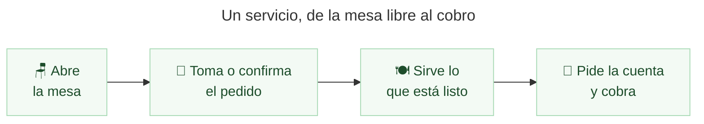
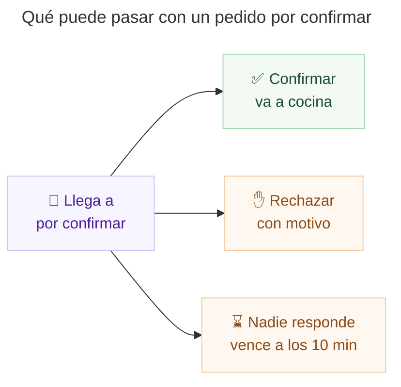
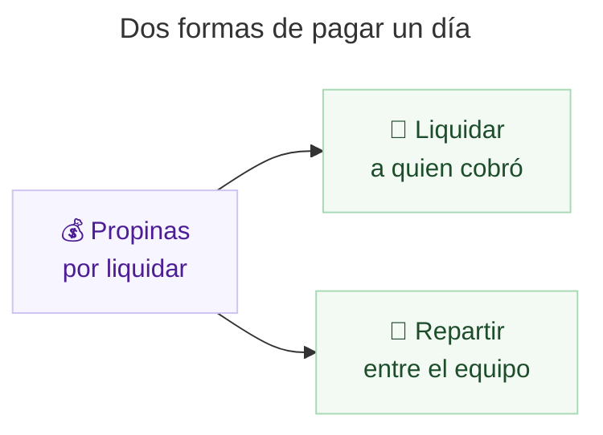
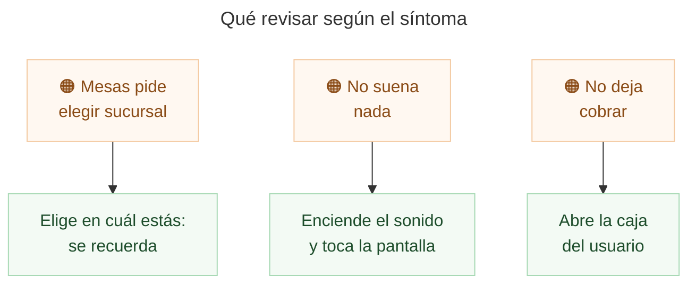

# Probar lo que hace el mesero

> **Atiende, confirma y cobra.** Pantallas **Mesas**, **Pedidos**, **Domicilios** y **Propinas**, con permiso
> `TABLE_SERVICE`. Las direcciones, en [00-acceso.md](00-acceso.md). Antes: lo que deja listo [el dueño](e2e-restaurante-dueno.md).

## 🧰 Antes de empezar

| Necesitas | Para qué escena |
|---|---|
| Dos meseros, cada uno con su sesión | M-03, M-04 |
| Mesa A con mesero y mesa B sin mesero | M-01 a M-04 |
| Un teléfono (o ventana privada) con el enlace de la mesa | M-09 a M-14 |
| Caja abierta y medio de pago | M-17, M-18 |
| Dos sucursales y una reserva | M-20 a M-23 |

## 🪑 Mesas: lo mío y el relevo

| # | Haz | Debe pasar | ✔ |
|---|---|---|---|
| M-01 | Entra a **Mesas** con el mesero de A | A resaltada como **Tu mesa**; B sin nombre | ☐ |
| M-02 | Toca una mesa libre y **Abrir mesa** (comensales opcionales) | Pasa a *Ocupada* y se abre su pedido | ☐ |
| M-03 | El **otro** mesero abre A | Para él es **Tu mesa**; el primero ve el nombre del otro | ☐ |
| M-04 | Se cobra o cancela ese pedido | A vuelve a su mesero habitual | ☐ |

| M-26 | Abre **Mi horario** | Salen los días de la empresa, para ajustarlos y guardar | ☐ |
| M-27 | Deja hoy fuera de tu horario, con tu mesa libre; llama desde ella | La mesa no es de nadie: la llamada llega también a **Cocina** | ☐ |
| M-28 | Vuelve a incluir hoy y la hora actual | La mesa vuelve a ser **Tu mesa** | ☐ |

## 📨 Tomar el pedido

| # | Haz | Debe pasar | ✔ |
|---|---|---|---|
| M-05 | Toca dos platos y pon una nota | Quedan arriba en **Ronda 1 · por enviar** y cada plato dice cuántos van; **Enviar a cocina** los manda | ☐ |
| M-06 | Envía otro plato | Es la ronda 2; no se mezcla con la primera | ☐ |
| M-07 | Cancela un plato sin servir **sin motivo** | No deja confirmar | ☐ |
| M-08 | Cocina marca un plato listo; mira **Mesas** sin tocar nada | Aviso con sonido y la mesa marcada; al marcarlo **Servido** se apaga | ☐ |

## 🔔 Lo que llega del teléfono del comensal

| # | Haz | Debe pasar | ✔ |
|---|---|---|---|
| M-09 | El comensal pide en una mesa libre | Suena; la tarjeta dice *Mesa nueva: se abre al confirmar* | ☐ |
| M-10 | Quita un plato y **Confirmar** | Se abre la mesa con tu nombre; va a cocina solo lo marcado | ☐ |
| M-11 | **Rechazar** otro pedido escribiendo el motivo | El comensal lee ese motivo | ☐ |
| M-12 | Deja uno sin responder más de 3 minutos | La tarjeta dice *Lleva rato esperando* | ☐ |
| M-13 | **Silenciar mesa** y luego **Deshacer** | La mesa deja de poder pedir 30 min; al deshacer vuelve a pedir | ☐ |
| M-14 | Llega un pedido de un enlace compartido | Dice **Invitado de** quien compartió | ☐ |
| M-15 | El comensal toca **Llamar al mesero** | *Mesa N llama* con sonido; **Atendido** la quita | ☐ |
| M-16 | En un pedido abierto, **Compartir la carta de la mesa** | El enlace abre la página de esa mesa | ☐ |

## 🧾 Cuenta y cobro

| # | Haz | Debe pasar | ✔ |
|---|---|---|---|
| M-17 | **Pedir la cuenta** con un plato sin servir | Bloqueado, y dice por qué | ☐ |
| M-18 | Sirve todo, pide la cuenta y **Cobrar** con propina | Mesa libre; la propina va aparte de la factura | ☐ |
| M-19 | Cobra con propina una mesa que **abrió la cocina** | La propina queda a tu nombre en **Propinas** | ☐ |

## 💰 Propinas, con permiso de liquidar

| # | Haz | Debe pasar | ✔ |
|---|---|---|---|
| M-29 | **Repartir entre el equipo** y quita a una persona | Todo el equipo llega marcado; se paga en partes iguales a los marcados | ☐ |
| M-30 | Vuelve a la pantalla | El reparto sale con lo de cada uno; ese día ya no ofrece liquidar ni repartir | ☐ |
| M-31 | Con dos sucursales, elige una en el diálogo | Solo toma las propinas de sus mesas; el resto sigue por liquidar | ☐ |

## 🏬 Sucursales, reservas y domicilios

| # | Haz | Debe pasar | ✔ |
|---|---|---|---|
| M-20 | En **Pedidos** elige *Todas las sucursales* | Cada tarjeta dice su sucursal; **Mesas** conserva la tuya | ☐ |
| M-21 | Elige una sola | No salen mesas ni reservas de la otra; los domicilios sí | ☐ |
| M-22 | **Reservas** en *Todas* y **Sentar** una | Ofrece solo mesas de la sucursal reservada | ☐ |
| M-23 | Abre un pedido de otra sucursal y comparte la carta | Funciona con la mesa de ese pedido | ☐ |
| M-24 | **Domicilios**: *Despachar*, *En camino*, *Entregado*; en uno para recoger, *Marcar listo* y *Retirado* | Avanza de estado; con platos aún en cocina no deja salir | ☐ |
| M-25 | Marca **No entregado** y **Reintentar** hasta agotar los intentos | Al agotarlos solo se puede cancelar | ☐ |

## 🩺 Si algo falla

El pedido del catálogo que espera aprobación se prueba en [aprobación y plato agotado](e2e-restaurante-aprobacion-y-agotado.md).
Escenas manuales: todavía no tienen prueba automática.

**Dueño del documento:** equipo de restaurante. **Última revisión:** 2026-11-25.
