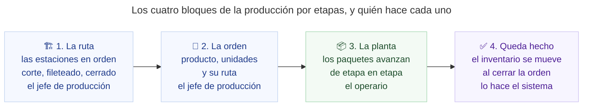
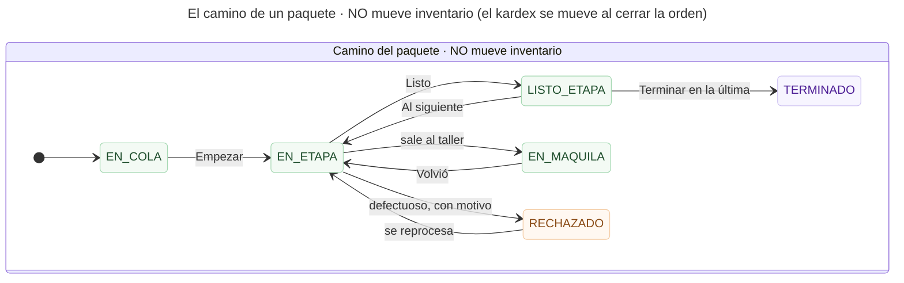

# Cómo se sigue una prenda por la planta

> **La prenda dice dónde está sin que nadie abra una orden nueva.** Una orden de producción puede llevar ruta de
> etapas; sus unidades se reparten en paquetes, y cada paquete avanza de estación en estación. En cualquier momento se
> sabe cuántas unidades hay en la cola de cada etapa, dentro de una etapa o en un taller externo, y cuántas faltan.
>
> Las direcciones y el acceso están en [00-acceso.md](00-acceso.md). Esto es la prueba de la producción por etapas; el
> restaurante y los probióticos siguen igual que antes y se prueban en [la guía del restaurante](guia-restaurante.md).

## 🗺️ La foto completa

Cuatro bloques. El primero lo define una sola vez el jefe de producción; los dos siguientes los hace el equipo cada
día; el último no lo hace nadie.



La idea en una línea: **mientras la prenda avanza, el inventario no se mueve; se mueve cuando la orden se cierra.** Lo
que la planta ve moverse son los paquetes de un lado a otro, no las existencias.

| Quién | Qué hace | Dónde |
|---|---|---|
| **Jefe de producción** | Define la ruta, abre la orden y la cierra | Backoffice (la orden) y la API (la ruta, por ahora) |
| **Operario de planta** | Mueve los paquetes de su etapa | La pantalla de la planta, en tableta o celular |
| **El sistema** | Cuenta los saldos por etapa y mueve el inventario al cerrar | Solo, sin que nadie lo digite |

El detalle de cómo se arma un producto y cuándo baja el inventario está en *interno*: `docs/RECIPES_AND_PRODUCTION.md`.

## 📋 Antes de empezar

- Una base con la **migración 293** aplicada (si falta, la pantalla dice *«the production status is not seeded»*).
- El usuario con el permiso **«Gestión de ordenes de producción»** (el mismo que abre la pantalla de la orden en el Backoffice).
- Una **ruta** con sus etapas y una **orden de producción** que la tenga.
- El **número de la orden** (el `id`, no el número de documento) para abrir la pantalla.

> [!IMPORTANT]
> Hoy **la ruta todavía no se elige desde la pantalla de la orden**: se deja puesta por la API (o por SQL) y la pantalla
> entra por dirección. Quién prepara los datos tiene el paso a paso abajo, en «Preparar los datos».

## ➡️ Los pasos

| # | Acción | Esperado |
|---|---|---|
| 1 | Abrir la orden de producción en el Backoffice y anotar su número | La orden existe con su producto y sus unidades |
| 2 | Elegir la ruta de la orden y repartir en paquetes (ver «Preparar los datos») | La respuesta dice cuántos paquetes se crearon: 500 unidades con paquetes de 50 dan **10** |
| 3 | Abrir la pantalla de la planta en `/etapas/12` (cambia 12 por el número de la orden) | Arriba, una pastilla por etapa en el orden del proceso, con las unidades que tiene |
| 4 | Mirar la primera etapa | Todo en **cola**: las 500 unidades esperan para empezar |
| 5 | Pulsar **Empezar** en el primer paquete | El paquete pasa a **EN_ETAPA**; la etapa muestra 50 dentro y 450 en la cola |
| 6 | Pulsar **Listo** | El paquete queda **LISTO_ETAPA**: terminó esta estación y espera la siguiente |
| 7 | Pulsar **Al siguiente** | El paquete desaparece de esta etapa y aparece en la segunda, **EN_ETAPA** |
| 8 | Repetir con otro paquete y mirar los saldos | Las cuentas cuadran: lo que salió de una etapa entró en la otra, y el total no cambia |
| 9 | Cerrar la orden con todos sus paquetes terminados | Bajan los insumos y entra el producto terminado, **una sola vez** |
| 10 | Mirar el kardex | Solo se movió al cerrar: el paso por las etapas no dejó rastro de inventario |

El último paquete de la última etapa cambia el botón: dice **Terminar**, y ahí el paquete queda **TERMINADO**.

## 🔀 Qué puede pasar con un paquete



Los botones de la pantalla cubren **Empezar**, **Listo**, **Al siguiente**, **Terminar** y **Volvió**. El **rechazo**
y la **salida a maquila** todavía se piden por la API: piden motivo, y un rechazo saca el paquete del trabajo en proceso
porque es una pérdida, no algo a medio hacer.

## 🚫 Lo que NO debe pasar

- El botón de una etapa mueve paquetes de **otra** etapa, o deja el paquete en dos etapas a la vez.
- Un paquete **salta** una etapa: de la primera a la tercera sin pasar por la segunda.
- El paquete cambia de etapa **sin quedar registrado** quién lo movió y cuándo.
- El kardex se mueve por avanzar de etapa; o se mueve **dos veces** al cerrar la orden.
- La orden **sin ruta** deja de comportarse como antes (probióticos y restaurante): esas órdenes no tienen etapas ni
  paquetes y se cierran de un solo golpe.
- Un rechazo pasa **sin motivo**.

## 🆘 Si algo no da lo esperado

| Síntoma | Causa probable | Salida |
|---|---|---|
| «Esta orden no tiene ruta» | La orden se creó sin ruta, o las etapas no se generaron | Asignar la ruta y volver a crear los paquetes (ver «Preparar los datos») |
| «No se pudo crear: la orden ya tiene sus etapas» | Se pulsó dos veces | Es correcto: no se duplica nada; seguir con la pantalla |
| «The production status is not seeded» | Falta la migración 293 en esa base | Aplicarla; el QA avisa, no la aplica |
| El botón no hace nada y no hay aviso | El usuario no tiene «Gestión de ordenes de producción» | Pedir el permiso al administrador |
| Un paquete no aparece en la etapa donde debería | Está en la etapa anterior esperando **Listo → Al siguiente**, o está listo y hay que moverlo | Mirar la etapa anterior |
| El botón dice **Terminar** y esperaba **Al siguiente** | Es la última etapa de la ruta | Cerrar el paquete; después cerrar la orden |
| Las unidades no cuadran entre dos etapas | Se movió un paquete y se miró antes de que la pantalla se refrescara (lee cada 5 segundos) | Esperar el refresco y volver a mirar |

## 🛠️ Preparar los datos

Para quien monta la prueba. La ruta y sus etapas no tienen pantalla todavía: se dejan con SQL en la base del negocio, y
la asignación y el reparto se piden por la API con el token del usuario.

<details>
<summary><strong>La ruta y sus etapas (SQL, una vez por tipo de prenda)</strong></summary>

```sql
-- La ruta: 50 unidades por paquete es el valor habitual en confección
INSERT INTO inventory.production_route (name, default_packet_size, active, creation_date)
VALUES ('Camisa manga larga', 50, true, now()) RETURNING id;

-- Sus etapas, en orden. Si una etapa es maquila: kind = 'EXTERNA' y supplier = el proveedor
INSERT INTO inventory.production_route_stage (route, sequence, station, standard_minutes, kind) VALUES
  (1, 1, 'Corte',    2.5, 'INTERNA'),
  (1, 2, 'Fileteado', 4.0, 'INTERNA'),
  (1, 3, 'Cerrado',  5.0, 'INTERNA');
```

</details>

<details>
<summary><strong>Asignar la ruta y repartir en paquetes (API)</strong></summary>

```bash
# 1. la orden toma la ruta (falla si ya tiene etapas: no se puede cambiar a mitad de camino)
curl -X POST "$ADA/restapi/v1/production/orders/12/route?routeId=1" -H "Authorization: Bearer $TOKEN"

# 2. se copian las etapas y se crean los paquetes: responde cuántos
curl -X POST "$ADA/restapi/v1/production/orders/12/stages" -H "Authorization: Bearer $TOKEN"

# 3. lo que la pantalla muestra, para comprobarlo sin abrirla
curl "$ADA/restapi/v1/production/orders/12/stages" -H "Authorization: Bearer $TOKEN"

# 4. rechazar un paquete o mandarlo a maquila (pide motivo)
curl -X POST "$ADA/restapi/v1/production/packets/34/move?target=RECHAZADO&reason=costura%20abierta" \
  -H "Authorization: Bearer $TOKEN"
```

</details>

## 📌 Lo que todavía no está

- **La entrada en el menú.** La pantalla se abre por dirección (`/etapas/12`) porque el módulo no la expone al menú del
  shell; el menú llega cuando se sume la exposición por federación.
- **Elegir la ruta al crear la orden**, en la pantalla del Backoffice: hoy se asigna por la API.
- **El botón de rechazo y el de salida a maquila** en la pantalla: hoy se piden por la API.

**Última revisión:** 2026-11-20.
