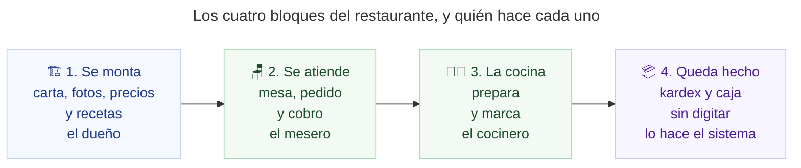
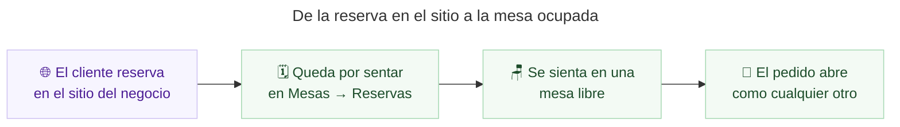
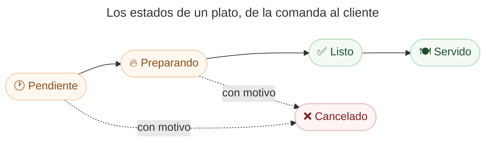
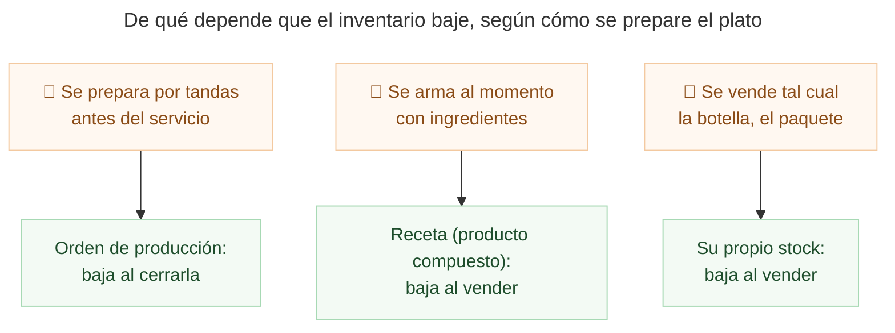

# Cómo se pone a vender el restaurante

> **Se monta, se atiende y el inventario se mueve solo.** Esta guía es el mapa completo: qué dejar listo antes de
> abrir, quién hace cada cosa durante el servicio y por qué camino el inventario se descuenta sin que nadie lo digite.
>
> Las direcciones y el acceso están en [00-acceso.md](00-acceso.md). Lo que hay que dejar montado antes de abrir, en
> [cómo dejar listo el restaurante](restaurante-configuracion.md).

## 🗺️ La foto completa

Cuatro bloques. El primero lo deja listo el dueño; los dos siguientes los hace el equipo cada día; el último no lo
hace nadie.

Ver el paso a paso: [cómo dejar listo el restaurante](restaurante-configuracion.md).

## 🏗️ Antes de abrir: lo que deja listo el dueño

Tres cosas, y sin las tres no hay servicio:

- **Qué se publica.** Los grupos de la carta se encienden por canal, por sede o por mesa; lo que no se enciende no
  aparece en el celular del mesero. Detalle: [qué se publica](restaurante-configuracion.md).
- **Fotos y precios.** Cada plato es una tarjeta con foto, precio y grupo. Sin foto se vende peor y el mesero duda.
- **Recetas.** Qué gasta cada plato. Es lo que hace que el inventario baje solo: los tres caminos están abajo, y el
  detalle en cómo se arma un plato (interno: `docs/RECIPES_AND_PRODUCTION.md`).
- Y **una caja abierta** antes del primer cobro.

## 🪑 Durante el servicio: lo que hace el mesero

- Abre la mesa **sin escribir nada**: los platos más pedidos salen primero, en tarjetas.
- Cada ronda se envía a cocina y **lleva su número**: la segunda no se mezcla con la primera.
- Dos toques por plato, con una mano y sin teclado.

## 🗓️ Las reservas que llegan del marketplace

El cliente reserva desde el sitio del negocio y la reserva **entra como un pedido**, no como una nota aparte. Hasta que
alguien la sienta, espera en **Mesas → Reservas**.

- La lista muestra **quién reservó, a qué hora y cuántos comensales**. Sin fecha se ven todas las de hoy en adelante; con
  fecha, solo ese día.
- **Sentar** pide una mesa libre y la ocupa. Desde ese momento el pedido es uno normal: se toma, va a cocina y se cobra.
- Una reserva no ocupa la mesa por sí sola: **la mesa se ocupa cuando se sienta**.

> [!IMPORTANT]
> Para que lleguen reservas tiene que estar cargado el servicio *Reserva* (un producto de tipo servicio con empleado y
> turno). Sin eso, el sitio del negocio no ofrece reservar.

## 👨‍🍳 La cocina

La cocina ve solo lo que le toca, en el orden en que llegó. El salón se entera **sin gritar**: el mesero ve el plato
pasar a *listo* en su propio celular. Cancelar pide motivo, y queda quién y por qué.

## 🧾 El cobro

| Cliente | Qué sale |
|---|---|
| No pide factura | **ticket de venta**, con los medios de pago |
| Pide factura electrónica | el cliente se crea en la mesa y sale el documento DIAN; el documento es obligatorio |

- Con un plato **sin servir**, la cuenta no se puede pedir: el botón está bloqueado y dice por qué.
- La **propina** viene sugerida por la caja, la decide el cliente, se quita con un toque y va **aparte** de la factura.
- Al cobrar, la mesa queda libre.

## 🧮 Tres caminos para que el inventario baje solo

Se elige según cómo se cocine el plato. Los tres terminan igual: nadie digita el inventario al cierre.

- **Camino 1 — por tandas.** Se cocina una vez para todo el servicio y se cierra la **orden de producción**: bajan
  los insumos y suben las porciones listas. Ejemplos: arroz con pollo, ajiaco, salsa de la casa.
- **Camino 2 — receta (producto compuesto).** El plato se arma al vender y descuenta sus ingredientes, hasta seis
  niveles (una ensalada dentro de un combinado). Ejemplos: ensalada, plato combinado.
- **Camino 3 — sin receta.** La bebida o el paquete que se vende tal cual, con su propio stock: baja una unidad.

Ver el paso a paso de los caminos 1 y 2: cómo se arma un plato y cuándo baja el inventario (interno: `docs/RECIPES_AND_PRODUCTION.md`).

Un plato con **stock propio** corta la receta ahí: si ya hay porciones hechas, se descuenta la porción, no los
ingredientes. El ejemplo completo, paso a paso, en de la receta al kardex (interno: `docs/RECIPES_AND_PRODUCTION.md`).

## 📦 Lo que queda hecho sin que nadie lo digite

| Dónde | Qué se ve |
|---|---|
| Backoffice → *Inventario → Kardex* | el plato vendido descontó lo que gasta |
| Backoffice → *Reporte de caja* | lo cobrado por cada medio de pago, y la propina aparte |
| Pulso Mobile → *Pedidos → Pagadas* | las propinas del día por mesero |

**Si el kardex no bajó:** la venta tiene que estar cerrada (no en borrador) y el plato marcado para descontar. Si
bajó el plato en vez de sus ingredientes, es porque el plato tiene existencias propias.

## 🛒 De dónde sale la materia prima

La compra se registra en el Backoffice y queda como cuenta por pagar; desde ahí el kardex tiene qué descontar.
Detalle: [compras y cuentas por pagar](e2e-compras-cuentas-por-pagar.md).

<strong>Lo que todavía no se promete</strong>

| Tema | Estado | Qué decir |
|---|---|---|
| Domicilios | no está | el módulo atiende **mesa**; el domicilio se evalúa |
| Reservas | funciona | el cliente reserva en el sitio del negocio y el pedido espera en *Mesas → Reservas*; el negocio necesita el servicio *Reserva* cargado |
| Comandas impresas | construido | sale en papel de 80 mm; requiere el agente de impresión instalado en el local |

La guía de montaje está aparte: [cómo dejar listo el restaurante](restaurante-configuracion.md).

**Última revisión:** 2026-11-19.
