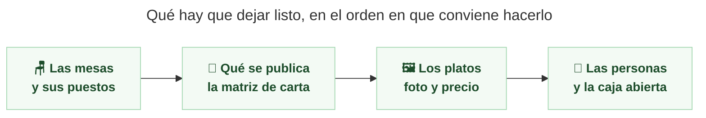

# Cómo dejar listo el restaurante

> **Cuatro cosas y ya se puede vender.** Todo se configura en **Configurar**, dentro de Pulso Mobile, y **por
> sucursal**: lo que se arma en una sucursal no aparece en otra.

Entra con un usuario que tenga el permiso de configuración (`TABLE_ADMIN`): normalmente el dueño o el administrador
del negocio. Las direcciones, en [00-acceso.md](00-acceso.md).

## El orden

## 🪑 Las mesas

- Se crean con *Nueva mesa*: **nombre y número de puestos**.
- Una mesa se **activa o desactiva; nunca se borra**. La que ya se usó conserva su historia; la desactivada
  simplemente desaparece del salón.

## 📖 Qué se publica

La **matriz de carta** decide qué ve el cliente y qué ve el mesero: un grupo de la carta se enciende **por canal, por
sede o por mesa**.

- Lo que se hereda de arriba sale **bloqueado**: se enciende donde de verdad aplica.
- Un grupo apagado no existe para el mesero: no aparece en el celular.

## 🖼️ Los platos: foto y precio

Cada plato es una **tarjeta**: nombre, grupo, precio y foto.

- La foto no es adorno: el mesero reconoce el plato y el cliente elige sin preguntar.
- Las fotos necesitan el almacenamiento de imágenes activo en el servidor; si no, la tarjeta sale sin imagen.
- El plato es un producto con carta: las otras puertas para crearlo están en [dónde se crea un producto](../PRODUCT_AND_SERVICE_ENTRY_POINTS.md).

## 👤 Las personas y la caja

| Quién | Qué puede hacer |
|---|---|
| **Mesero** | *Mesas* y *Pedidos*: abrir mesa, tomar el pedido, cobrar |
| **Cocina** | *Cocina*: empezar, terminar y cancelar platos |
| **Dueño o administrador** | *Configurar*: mesas, matriz de carta y platos |

Y **una caja abierta** antes del primer cobro: sin caja el cobro no se puede cerrar.

## 🧮 Para que el inventario baje solo

Falta una decisión de cocina, no de configuración: **cómo se prepara cada plato** y, con eso, cuándo se descuenta el
inventario. Está explicado en [cómo se arma un plato](../RECIPES_AND_PRODUCTION.md), con los tres caminos y el
ejemplo de punta a punta.

Cuando ya esté montado, el día a día es la otra guía: [cómo atender el salón](guia-restaurante.md).

**Última revisión:** 2026-11-19.
